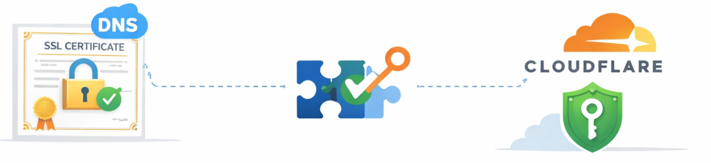

# lego-cloudflare-certgen



Issue Let's Encrypt certificates with **lego v4.34.0** and the **Cloudflare DNS-01** challenge. Each group in `domains.yaml` issues one certificate. A, AAAA and CNAME service records work with ordinary names and wildcards. The container prints an ANSI certificate summary and exits.

## Tags and platforms

| Tag | Runtime |
|---|---|
| `3.3`, `latest` | Alpine 3.24.4 |
| `lego4.34.0-3.3`, `lego4.34-3.3` | Alpine 3.24.4 |
| `alpine-3.24.4-lego4.34.0-3.3`, `alpine-3.24-lego4.34-3.3` | Alpine 3.24.4 |
| `3.2`, `lego4.34.0-3.2` | Debian Bookworm Slim |

Each tag supports `linux/amd64`, `linux/386`, `linux/arm/v7` and `linux/arm64`.

## Quick start

Create a Cloudflare API token with **Zone DNS Edit** and **Zone Read** for the required zones. Fill in `.env` after reviewing the [Let's Encrypt Terms of Service](https://letsencrypt.org/repository/).

```dotenv
EMAIL=you@example.com
CLOUDFLARE_API_TOKEN=your_cloudflare_token
ACCEPT_LEGO_TOS=true
PRODUCTION=false
```

Create `domains.yaml` with names in a zone you control.

```yaml
web:
  - example.com
  - www.example.com
  - '*.example.com'
```

```bash
chmod 600 .env
mkdir -p ssl-certs
docker run --rm -t --env-file .env \
  -v ./domains.yaml:/app/domains.yaml:ro -v ./ssl-certs:/ssl-certs \
  ljgonzalez/lego-cloudflare-certgen:3.3
```

Relative bind paths require Docker Engine 23 or later. For older versions, prefix the two host paths with `$PWD/`. The example uses staging. Add `--production` after the image name to request trusted certificates. Set `LEGO_DISABLE_CNAME_SUPPORT=false` for an explicit `_acme-challenge` CNAME delegation.

The [GitHub repository](https://github.com/ljgonzalez1/lego-cloudflare-ssl-certgen) contains the Dockerfiles, Compose setup, configuration templates and build instructions. See [issues](https://github.com/ljgonzalez1/lego-cloudflare-ssl-certgen/issues) for support and the [MIT license](https://github.com/ljgonzalez1/lego-cloudflare-ssl-certgen/blob/master/LICENSE) for the source license.
