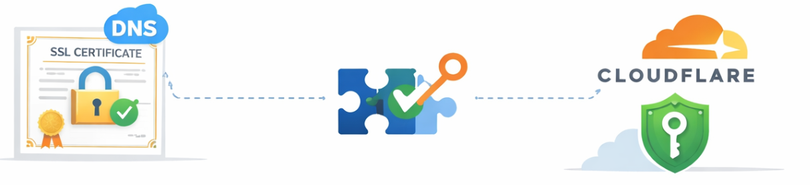

# :closed_lock_with_key: lego-cloudflare-certgen

> One-shot Docker container for automated SSL/TLS certificate generation via **Let's Encrypt** using [lego](https://github.com/go-acme/lego) v4.34.0 and **Cloudflare DNS-01 challenge**. No HTTP ports or web server required.

---



---

## :sparkles: Why use this instead of running lego directly?

Running lego directly works perfectly well. This image exists for two quality-of-life improvements:

1. **Keep your settings in `certgen.env` and your domains in YAML.** Each top-level key in `domains.yaml` represents one certificate and its output folder. Its list contains all the DNS names on that certificate.

2. **Use Docker Compose for a repeatable, secrets-safe workflow.** Docker Compose provides the Cloudflare API token as a [Docker secret](https://docs.docker.com/compose/use-secrets/). lego reads the secret file directly.

---

## :whale: Requirements

- Docker Engine and the Docker Compose plugin if using Option B
- A Cloudflare [**DNS API token**](https://developers.cloudflare.com/fundamentals/api/get-started/create-token/) with `Zone > DNS > Edit` and `Zone > Zone > Read` for the relevant zones

---

### How to build?

Both options use the same local image. If you need to build it, run this once from the repository root.

```bash
docker build -t lego-cloudflare-certgen:lego4.34.0-2.0 ./build
```

---

## :rocket: Quick start

### Option A - `docker run` (simple, token in shell environment)

```bash
# 1. Copy the environment template.
cp template.env certgen.env

# 2. Edit certgen.env. Set EMAIL and ACCEPT_LEGO_TOS=true.

# 3. Set your domains in domains.yaml and create the output directory.
mkdir -p ./ssl-certs

# 4. Export CLOUDFLARE_API_KEY with your Cloudflare DNS API token, then run.
docker run --rm \
  --env-file ./certgen.env \
  --env CLOUDFLARE_API_KEY \
  --volume "$(pwd)/domains.yaml:/app/domains.yaml:ro" \
  --volume "$(pwd)/ssl-certs:/ssl-certs" \
  --security-opt no-new-privileges:true \
  --cap-drop ALL \
  --cap-add CHOWN \
  --cap-add SETUID \
  --cap-add SETGID \
  lego-cloudflare-certgen:lego4.34.0-2.0
```

> :warning: **`--rm` is important.** Docker can show container environment variables in `docker inspect`. `--rm` removes the container when it exits.

---

### Option B - Docker Compose (recommended; token passed as secret)

```bash
# 1. Export CLOUDFLARE_API_TOKEN, then create .env for the Compose secret.
#    If .env already exists, edit the token entry in place and unset the shell variable.
(
  umask 077
  set -C
  printf 'CLOUDFLARE_API_TOKEN=%s\n' "${CLOUDFLARE_API_TOKEN:?Export your Cloudflare token first}" > .env
) && unset CLOUDFLARE_API_TOKEN
chmod 600 .env

# 2. Copy and edit the container settings. Set EMAIL and ACCEPT_LEGO_TOS=true.
cp template.env certgen.env

# 3. Set your domains in domains.yaml and create the output directory.
mkdir -p ./ssl-certs

# 4. Issue certificates (staging by default). Compose removes the container on exit.
docker compose run --rm certgen

# 5. After use, remove the token entry from .env. If .env only held the token:
# rm .env
```

Compose loads `.env` from the project directory and makes the token available to lego as a secret file. Use `certgen.env` for container settings.

To validate the example YAML and preview a single group without issuing a certificate:

```bash
CLOUDFLARE_API_TOKEN= DOMAINS_FILE=./template.domains.yaml docker compose run --rm certgen --list
CLOUDFLARE_API_TOKEN= DOMAINS_FILE=./template.domains.yaml docker compose run --rm certgen --dry-run --only certificateA
```

To issue production certificates for the configured groups, use `docker compose run --rm certgen --production`.

Certificates appear in `./ssl-certs/<group>/<timestamp>/requested_<timestamp>_expires_<timestamp>/`. For example:

```text
ssl-certs/
└── certificateA/
    └── 2026-11-11_17.18.00_GMT-3/
        └── requested_2026-11-11_17.18.55_GMT-3_expires_2027-02-09_05.18.00_GMT-3/
            ├── accounts/
            │   └── acme-v02.api.letsencrypt.org/
            │       └── you@example.com/
            └── certificates/
                ├── example.com.crt
                ├── example.com.issuer.crt
                ├── example.com.json
                └── example.com.key
```

The directory timestamps use the original script’s naming convention and offsets. Read the exact expiry from the issued certificate with `openssl x509 -in example.com.crt -noout -enddate`.

---

## :gear: Configuration reference

All variables are optional unless marked **required**.

| Variable | Default | Required | Description |
|---|---|---|---|
| `TZ` | `Etc/UTC` | :x: | IANA timezone for directory names. Use `America/Santiago` to match the original script. |
| `EMAIL` | - | :heavy_check_mark: | Let's Encrypt account contact e-mail for issuance |
| `PRODUCTION` | `false` | :x: | Set `true` to issue browser-trusted certificates |
| `CLOUDFLARE_API_KEY` | - | :heavy_check_mark: | Cloudflare DNS API token for `docker run`. Compose reads `CLOUDFLARE_API_TOKEN` from the host as a secret. |
| `PROPAGATION_SECONDS` | `60` | :x: | DNS TXT propagation timeout in seconds |
| `DNS_RESOLVERS` | `1.1.1.1:53,8.8.8.8:53,1.0.0.1:53` | :x: | Comma-separated resolvers used to verify TXT record visibility |
| `ACCEPT_LEGO_TOS` | `false` | :heavy_check_mark: | Set `true` after reading the [Let's Encrypt Terms of Service](https://letsencrypt.org/repository/) |
| `UID` | `1000` | :x: | UID used to write certificates and ACME account data |
| `GID` | `1000` | :x: | GID used to write certificates and ACME account data |
| `DOMAINS_FILE` | `./domains.yaml` | :x: | Host YAML path, set in the shell or the project’s `.env` for Compose |

### Certificate groups and wildcard domains

If you need a new `domains.yaml`, copy [`template.domains.yaml`](template.domains.yaml) and replace the sample DNS names. Keep the populated file local when uploading the project to GitHub.

```yaml
certificateA:
  - example.com
  - www.example.com
  - "*.example.com"

certificateB:
  - example.net
  - "*.example.net"
```

- Quote wildcard names so YAML reads them as strings.
- Use letters, numbers, hyphens or underscores for the folder name, starting with a letter or number.
- List up to 100 distinct DNS names per certificate. A domain can appear in multiple groups.
- The first DNS name determines lego’s certificate filename.

### Command options

| Option | Description |
|---|---|
| `--list` | Validate the YAML and list the selected groups and domain counts |
| `--dry-run` | Print the selected domains, ACME endpoint and planned output paths |
| `--only FOLDER` | Select a group. Repeat to select multiple groups in YAML order. |
| `--staging` / `--production` | Override `PRODUCTION` for one invocation |
| `--config FILE` | Select a YAML file inside the container. The default mount target is `/app/domains.yaml`. |
| `--output DIRECTORY` | Select a directory inside the container. Mount it and grant write access to the configured UID/GID. The default is `/ssl-certs`. |

---

## :key: Cloudflare API token

Create a token at [dash.cloudflare.com/profile/api-tokens](https://dash.cloudflare.com/profile/api-tokens) with the following permissions:

| Resource | Permission |
|---|---|
| Zone - DNS | Edit |
| Zone - Zone | Read |

Scope the token to the zones for the groups you plan to issue.

---

## :shield: Security

The container starts with these Linux capabilities:

| Capability | Why it is needed |
|---|---|
| `CHOWN` | Entrypoint sets ownership of the mounted output directory to the target UID/GID |
| `SETUID` | `gosu` switches to the configured UID |
| `SETGID` | `gosu` switches to the configured GID |

`--cap-drop ALL` clears the default capability set before adding the three capabilities above. `no-new-privileges:true` prevents programs from gaining elevated privileges during execution. The YAML reader and lego run as the configured non-root identity.

### Docker Compose secrets vs environment variables

| Method | Token visible in `docker inspect`? | Token visible in `env` inside container? |
|---|---|---|
| `--env CLOUDFLARE_API_KEY` | :white_check_mark: Yes | :white_check_mark: Yes |
| Docker secret (`/run/secrets/`) | :x: No | :x: No |

### Recommended `.gitignore`

```gitignore
.env
certgen.env
/domains.yaml
ssl-certs/
```

---

## :file_folder: File structure

```text
.
├── assets
│   └── readme-banner.png    # Project banner
├── build
│   ├── Dockerfile           # Image definition
│   ├── entrypoint.sh        # CLI, output mount and privilege drop
│   ├── read_domains.py      # YAML validation
│   ├── run_lego.sh          # Non-root phase: invokes lego per group
│   └── validate_env.sh      # Sourced module: environment validation
├── compose.yml              # Compose workflow with Docker secrets
├── example.env              # Annotated sample configuration
├── LICENSE
├── README.md
├── template.domains.yaml    # Example groups and domains
└── template.env             # Blank configuration template
```

Local runtime files:

```text
.
├── .env                    # Compose settings and secret source
├── certgen.env             # Container settings (copy of template.env)
├── domains.yaml            # Local certificate groups and DNS names
└── ssl-certs/              # Certificates, private keys and account data
```

---

## :information_source: Notes

- **Staging by default.** `PRODUCTION=false` uses Let's Encrypt staging. Test there first. Browsers do not trust certificates from staging.
- **One certificate per group.** Each invocation processes the groups in YAML order. If a group fails, the run continues and reports a nonzero exit status after the summary. Retry individual groups with `--only`.
- **Fresh output on every issuance.** Rerunning creates a new timestamp directory per group.
- **Rate limits.** Production limits apply to both registered domains and identical sets of DNS names. See the [Let's Encrypt rate limits](https://letsencrypt.org/docs/rate-limits/).

---

## :page_facing_up: Licence

This project is a thin wrapper around [lego](https://github.com/go-acme/lego), which is licenced under the [MIT Licence](https://github.com/go-acme/lego/blob/master/LICENSE). Refer to the lego repository for its terms.
