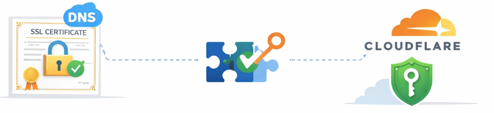
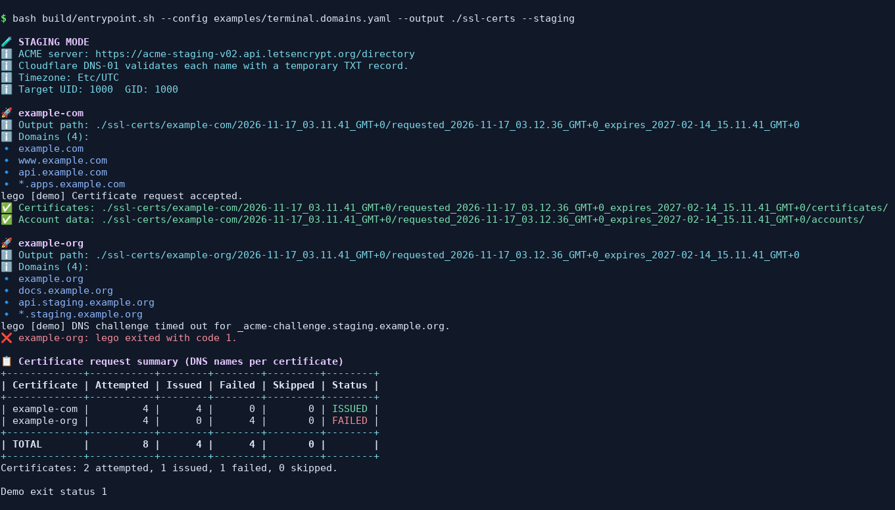
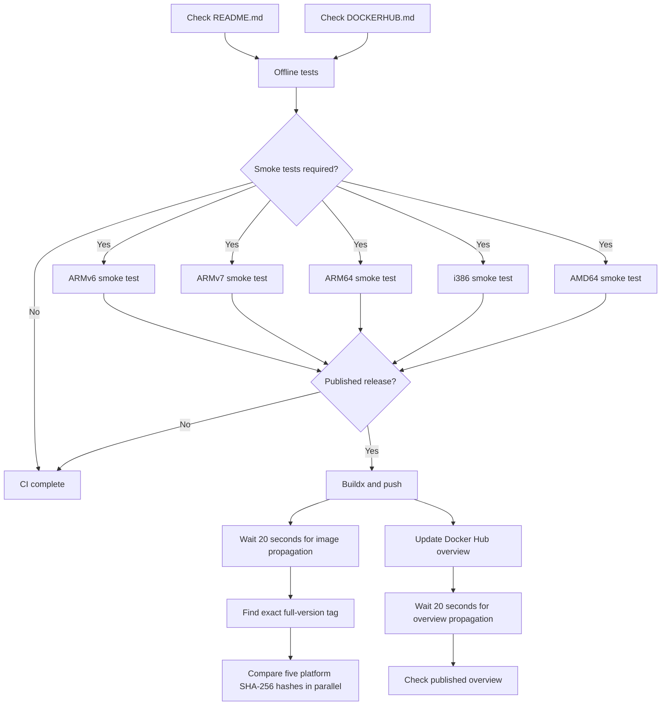

# :closed_lock_with_key: lego-cloudflare-certgen



[](https://hub.docker.com/r/ljgonzalez/lego-cloudflare-certgen)
[](https://hub.docker.com/r/ljgonzalez/lego-cloudflare-certgen/tags)
[](https://github.com/ljgonzalez1/lego-cloudflare-ssl-certgen/releases/tag/v4.4.1)
[](https://github.com/go-acme/lego/releases/tag/v4.34.0)
[](https://github.com/ljgonzalez1/lego-cloudflare-ssl-certgen/actions/workflows/tests.yml)
[](LICENSE)

> One-shot Docker container that issues **Let's Encrypt** certificates with [lego](https://github.com/go-acme/lego) **v4.34.0** and the **Cloudflare DNS-01** challenge. No open ports and no web server: list your DNS names in a YAML file, run the container, collect the certificates. The container prints a summary and exits.

---

## :bookmark_tabs: Contents

- [Features](#sparkles-features)
- [Requirements](#clipboard-requirements)
- [Cloudflare API token](#key-cloudflare-api-token)
- [Quick start](#rocket-quick-start)
- [Output layout](#open_file_folder-output-layout)
- [Configuration](#gear-configuration)
- [Issuance report](#bar_chart-issuance-report)
- [Image tags and platforms](#label-image-tags-and-platforms)
- [Build the image yourself](#hammer_and_wrench-build-the-image-yourself)
- [Tests](#test_tube-tests)
- [CI/CD pipeline](#cicd-pipeline)
- [Security and permissions](#shield-security-and-permissions)
- [Project files](#file_folder-project-files)
- [Notes](#information_source-notes)
- [Version history](#version-history)
- [License](#page_facing_up-license)

---

## :sparkles: Features

- **One certificate per group.** Each top-level key in `domains.yaml` is one certificate and one output folder. Its list holds every DNS name on that certificate.
- **Wildcards and any record type.** DNS-01 works the same for names with A, AAAA or CNAME records, for quoted wildcards such as `"*.example.com"`, and for names that have no record yet.
- **Token kept out of the environment.** Mount the Cloudflare token as a file, or let Compose pass it as a [Docker secret](https://docs.docker.com/compose/use-secrets/). lego reads that file directly.
- **Staging first.** Runs use Let's Encrypt staging unless `PRODUCTION=true` is set in `.env`.
- **Clear results.** A final table lists attempted, issued, failed and skipped names for every group, with totals.
- **Small, non-root runtime.** A `scratch` image with a minimal Alpine 3.24 filesystem. The entrypoint drops to your UID/GID before reading the YAML or calling lego.
- **Five architectures.** `linux/amd64`, `linux/386`, `linux/arm/v6`, `linux/arm/v7` and `linux/arm64`.

---

## :clipboard: Requirements

- Docker Engine. The Docker Compose plugin is optional.
- One or more zones managed by Cloudflare.
- A Cloudflare API token, created in the [next section](#key-cloudflare-api-token).
- A contact e-mail address for your Let's Encrypt account.

---

## :key: Cloudflare API token

Create a token at [dash.cloudflare.com/profile/api-tokens](https://dash.cloudflare.com/profile/api-tokens) with these permissions:

| Resource | Permission |
|---|---|
| Zone · DNS | Edit |
| Zone · Zone | Read |

Limit the token to the zones you plan to issue certificates for. lego uses it to find each zone, create a temporary `_acme-challenge` TXT record and delete it afterwards. [Cloudflare token guide](https://developers.cloudflare.com/fundamentals/api/get-started/create-token/)

---

## :rocket: Quick start

The image is published on Docker Hub as [`ljgonzalez/lego-cloudflare-certgen`](https://hub.docker.com/r/ljgonzalez/lego-cloudflare-certgen). You don't need to clone or build anything. Pin the image to **`v4.4.1`** so that every run uses the same image.

### :one: Prepare a working directory

Download the two configuration files into a new directory.

```bash
mkdir lego-certgen
cd lego-certgen
wget -O .env https://raw.githubusercontent.com/ljgonzalez1/lego-cloudflare-ssl-certgen/v4.4.1/example.env
wget -O domains.yaml https://raw.githubusercontent.com/ljgonzalez1/lego-cloudflare-ssl-certgen/v4.4.1/template.domains.yaml
chmod 600 .env
mkdir -p ssl-certs
```

### :two: Fill in `.env`

Open `.env` and set at least these values. Read the [Let's Encrypt Terms of Service](https://letsencrypt.org/repository/) before you set `ACCEPT_LEGO_TOS=true`.

```dotenv
EMAIL=you@example.com
CLOUDFLARE_API_TOKEN=your-cloudflare-token
ACCEPT_LEGO_TOS=true
PRODUCTION=false
TZ=Etc/UTC
UID=1000
GID=1000
```

Set `UID` and `GID` to the host user that should own the certificates (`id -u` and `id -g`).

All settings are listed in [Environment variables](#environment-variables).

### :three: List your names in `domains.yaml`

Replace the sample names with your own. Each top-level key becomes one certificate:

```yaml
certificateA:
  - example.com
  - www.example.com
  - "*.example.com"

certificateB:
  - example.net
  - "*.example.net"
```

See [`domains.yaml` format](#domainsyaml-format) for the rules.

### :four: Run the container

#### :whale: `docker run --rm`

Preview the configuration, then issue the certificates:

```bash
# Check the YAML and list the groups
docker run --rm -t -v ./domains.yaml:/app/domains.yaml:ro \
  ljgonzalez/lego-cloudflare-certgen:v4.4.1 --list

# Show the names, ACME server, output paths and time limits without contacting Let's Encrypt
docker run --rm -t --env-file .env -v ./domains.yaml:/app/domains.yaml:ro \
  ljgonzalez/lego-cloudflare-certgen:v4.4.1 --dry-run

# Issue staging (untrusted) certificates
docker run --rm -t --env-file .env \
  -v ./domains.yaml:/app/domains.yaml:ro \
  -v ./ssl-certs:/ssl-certs \
  ljgonzalez/lego-cloudflare-certgen:v4.4.1

```

Docker reads `PRODUCTION` from `.env` via `--env-file .env`. After staging succeeds, set `PRODUCTION=true` in that file and rerun the same command.

Add any [command option](#command-options) after the image name, for example `--only certificateA`. `-t` enables the colored output.

- **Relative bind paths** (`./domains.yaml`) need Docker Engine 23 or later. On older versions, use `"$PWD/domains.yaml:/app/domains.yaml:ro"` and `"$PWD/ssl-certs:/ssl-certs"`.
- **Keep the token out of `docker inspect`.** With `--env-file`, the token is visible to anyone who can inspect the container. To avoid that, mount it as a file instead:

  ```bash
  (umask 077; printf '%s\n' 'your-cloudflare-token' > cloudflare_api_token)

  docker run --rm -t --env-file .env -e CLOUDFLARE_API_TOKEN= \
    -v ./domains.yaml:/app/domains.yaml:ro \
    -v ./ssl-certs:/ssl-certs \
    -v ./cloudflare_api_token:/run/secrets/cloudflare_api_token:ro \
    ljgonzalez/lego-cloudflare-certgen:v4.4.1
  ```

  `-e CLOUDFLARE_API_TOKEN=` overrides any token left in `.env`, so the container reads the file. The configured `UID` must be able to read the file.
- **Restrict the container** the same way Compose does with the flags in [Runtime permissions](#runtime-permissions).

#### :octopus: Optional Docker Compose

Download the Compose file into the same directory to reuse `.env` and `domains.yaml`.

```bash
wget -O compose.yml https://raw.githubusercontent.com/ljgonzalez1/lego-cloudflare-ssl-certgen/v4.4.1/compose.yml
```

List the groups and preview the request.

```bash
docker compose run --rm certgen --list
docker compose run --rm certgen --dry-run
```

Set `PRODUCTION=false` in `.env` to start in staging. After staging succeeds, change it to `true` and run the same command.

```bash
docker compose run --rm certgen
```

Certificates are saved in `ssl-certs/`. The provided [Compose file](compose.yml) mounts the token as a secret. See the [Compose settings](#environment-variables) for custom file paths.


---

## :open_file_folder: Output layout

Each run creates a new timestamped folder per group under `./ssl-certs/<group>/`:

```text
ssl-certs/
└── certificateA/
    └── 2026-11-11_17.18.00_GMT-3/
        └── requested_2026-11-11_17.18.55_GMT-3_expires_2027-02-09_05.18.00_GMT-3/
            ├── accounts/
            │   └── acme-v02.api.letsencrypt.org/
            │       └── you@example.com/
            └── certificates/
                ├── example.com.crt
                ├── example.com.issuer.crt
                ├── example.com.json
                └── example.com.key
```

- The first name in a group sets the file names (`example.com.*` above).
- Folder names use `TZ`. Set `TZ=America/Santiago` to match the original script's names.
- The `expires_` part of the folder name is an estimate. To read the exact expiry date:

  ```bash
  openssl x509 -in example.com.crt -noout -enddate
  ```

---

## :gear: Configuration

### Environment variables

Settings are optional unless marked **required**.

| Variable | Default | Required | Description |
|---|---|---|---|
| `EMAIL` | - | :heavy_check_mark: | Contact e-mail for the Let's Encrypt account |
| `CLOUDFLARE_API_TOKEN` | - | :heavy_check_mark: | Cloudflare DNS API token. Compose turns it into a secret file. `docker run` also accepts the legacy `CLOUDFLARE_API_KEY` variable. |
| `ACCEPT_LEGO_TOS` | `false` | :heavy_check_mark: | Set `true` after reading the [Let's Encrypt Terms of Service](https://letsencrypt.org/repository/) |
| `PRODUCTION` | `false` | :x: | `true` issues browser-trusted certificates. `false` uses staging. |
| `TZ` | `Etc/UTC` | :x: | IANA timezone used in folder names and log timestamps |
| `PROPAGATION_SECONDS` | `360` | :x: | Maximum wait for TXT propagation per challenge, in seconds. It also sets the [time limit](#stopwatch-time-limit-per-certificate) of each certificate. |
| `DNS_RESOLVERS` | `1.1.1.1:53,8.8.8.8:53,1.0.0.1:53` | :x: | Comma-separated `host:port` resolvers used to check TXT visibility |
| `UID` | `1000` | :x: | Non-zero UID that owns the certificates and ACME account data |
| `GID` | `1000` | :x: | Non-zero GID that owns the certificates and ACME account data |

These variables are read by Compose on the host, not by the container:

| Variable | Default | Description |
|---|---|---|
| `DOMAINS_FILE` | `./domains.yaml` | Host YAML file mounted at `/app/domains.yaml` |
| `CERTGEN_IMAGE` | `ljgonzalez/lego-cloudflare-certgen:v4.4.1` | Image used by the Compose service |
| `CERTGEN_ENV_FILE` | `./.env` | Settings file passed to the container |

### Command options

Add these after the image name in `docker run`, or after `docker compose run --rm certgen`.

| Option | Description |
|---|---|
| `--list` | Validate the YAML and list the selected groups with their name counts |
| `--dry-run` | Print the selected names, ACME server and planned output paths. Nothing is requested. |
| `--only FOLDER` | Process only this group. Repeat it to select several groups, in YAML order. |
| `--config FILE` | Read another YAML file inside the container. Default: `/app/domains.yaml`. |
| `--output DIRECTORY` | Write to another directory inside the container. It must be mounted and writable by `UID`/`GID`. Default: `/ssl-certs`. |
| `-h`, `--help` | Show the usage text |

### `domains.yaml` format

Copy [`template.domains.yaml`](template.domains.yaml) for 20 sample names across three certificate groups.

```yaml
certificateA:
  - example.com
  - www.example.com
  - "*.example.com"

certificateB:
  - example.net
  - "*.example.net"
```

- **Quote wildcards** (`"*.example.com"`) so YAML reads them as strings.
- **Group names** become folder names. Use letters, numbers, hyphens or underscores, starting with a letter or number.
- **Up to 100 distinct names** per certificate. Issuance marks an oversized group as failed before contacting Let's Encrypt and continues with the other groups. The same name can appear in several groups.
- One group may include names from different DNS zones. The Cloudflare credentials must cover each zone used for validation. A final DNS root dot is removed before checking for duplicates and sending names to lego.
- **The first name** in a group sets lego's certificate file name.
- A wildcard covers exactly one extra label. `*.example.com` covers `www.example.com` but not `example.com` or `a.b.example.com`.

### Hostnames and DNS-01

List every name you want on the certificate, including quoted wildcards. Every name takes the same DNS-01 path, whether it has an A, AAAA or CNAME record or no record yet. lego writes a temporary `_acme-challenge` TXT record through the Cloudflare API, Let's Encrypt checks it, and lego removes it. [Let's Encrypt DNS-01](https://letsencrypt.org/docs/challenge-types/#dns-01-challenge)

An exact TXT owner takes precedence over a CNAME inherited from a wildcard service record. A deliberate CNAME at the challenge owner itself is a separate DNS-01 delegation. Older deployments that already use lego's explicit delegation mode can keep their `LEGO_DISABLE_CNAME_SUPPORT=false` override and authorize the destination zone. [Cloudflare wildcard records](https://developers.cloudflare.com/dns/manage-dns-records/reference/wildcard-dns-records/) · [lego CNAME delegation](https://go-acme.github.io/lego/references/ref-options/#lego_disable_cname_support)

---

## :bar_chart: Issuance report

When the run ends, a table shows the DNS names of each selected certificate, followed by totals.

| Column | Meaning |
|---|---|
| Attempted | Names submitted for issuance, including groups rejected by local credential or name-count checks |
| Issued | Names covered by the certificate that was issued |
| Failed | Names in a group that could not issue a certificate |
| Skipped | Names in a group blocked by setup, for example because the output directory was not writable |

Each request issues one certificate for all its names. A group counts as issued when lego exits successfully and saves both the certificate and its key. The live view keeps each completed DNS validation time. If the certificate fails, the view marks every name in that group as failed and shows how many passed DNS validation. Successful groups still count as issued. The run finishes the other groups and exits with a nonzero status if any group failed or was skipped.

### :stopwatch: Time limit per certificate

`certgen-core` gives each certificate its own time limit based on its name count and `PROPAGATION_SECONDS`:

```text
estimate = 120 s + names × (PROPAGATION_SECONDS + 60 s)
limit    = min(estimate × 1.5, 2 hours)
```

The 120 s cover the ACME account, the order, finalization and the download. The 60 s per name cover creating and deleting the TXT record and the check by Let's Encrypt. `--dry-run` shows the limit of each group.

| Names | `PROPAGATION_SECONDS=60` | `PROPAGATION_SECONDS=360` |
|---|---|---|
| 1 | 360 s | 810 s |
| 10 | 1980 s (33 min) | 6480 s (108 min) |
| 30 | 5580 s (93 min) | 7200 s (2 h) |
| 100 | 7200 s (2 h) | 7200 s (2 h) |

The supervisor recognizes definitive errors such as an ACME `rateLimited` response, a rejected Cloudflare token, missing zone access and fatal order errors. It captures the diagnostic, gives lego a moment to exit, then sends `SIGKILL` to that process group if it is still running. DNS propagation waits, ordinary retries and cleanup warnings continue within the per-certificate limit. The supervisor also stops lego if that group reaches its deadline. A forced stop can leave temporary `_acme-challenge` TXT records behind. Full output for each attempt is available in `lego.log`.

In a terminal the table is colored and adapts to the terminal width. It uses ASCII borders and keeps emojis outside the grid.

### :desktop_computer: Terminal example

This simulated staging run uses the following configuration:

```yaml
example-com:
  - example.com
  - www.example.com
  - api.example.com
  - '*.apps.example.com'

example-org:
  - example.org
  - docs.example.org
  - api.staging.example.org
  - '*.staging.example.org'
```

The first order succeeds. The second hits a TXT propagation timeout. The report shows eight names attempted, four issued and four failed.



---

## :label: Image tags and platforms

| Tag | Use it when |
|---|---|
| `v4.4.1` | You want a fixed image. **Recommended.** |
| `v4.2`, `v4` | You want future patch or minor releases of version 4 |
| `latest` | You always want the newest release |
| `alpine3.24.4-lego4.34.0-v4.4.1` | You want the base and lego versions in the tag name |

The `v4.4.1` image supports `linux/amd64`, `linux/386`, `linux/arm/v6`, `linux/arm/v7` and `linux/arm64`. Docker pulls the right variant automatically. Older releases (v1 to v3) are still available. See [all tags on Docker Hub](https://hub.docker.com/r/ljgonzalez/lego-cloudflare-certgen/tags).

---

## :hammer_and_wrench: Build the image yourself

You only need this to change the code. A normal `docker build` produces an image for your own machine's architecture.

```bash
git clone https://github.com/ljgonzalez1/lego-cloudflare-ssl-certgen.git
cd lego-cloudflare-ssl-certgen

docker build -t lego-cloudflare-certgen:local ./build
```

Check the result:

```bash
docker run --rm --entrypoint lego lego-cloudflare-certgen:local --version
docker run --rm -v ./template.domains.yaml:/app/domains.yaml:ro lego-cloudflare-certgen:local --list
```

Use your build with `docker run`, or with Compose through `CERTGEN_IMAGE`:

```bash
docker run --rm -t --env-file .env -v ./domains.yaml:/app/domains.yaml:ro \
  lego-cloudflare-certgen:local --dry-run

CERTGEN_IMAGE=lego-cloudflare-certgen:local docker compose run --rm certgen --dry-run
```

The build needs BuildKit, the default builder since Docker Engine 23. It also needs network access to Docker Hub, GitHub Releases and the Alpine package mirrors.

### :feather: What the build does

1. **Downloader stage.** Downloads the official lego `v4.34.0` archive for the target CPU and verifies its SHA-256 checksum.
2. **Builder stage.** Compiles `certgen-core` (C++17, statically linked with libyaml) and builds a minimal Alpine 3.24.4 filesystem with musl, the CA bundle, timezone data, `su-exec` and Dash as `/bin/sh`.
3. **Final stage.** Starts from `scratch` and copies in only that filesystem, the scripts, `certgen-core` and lego. BusyBox, Bash, Python, the compiler and curl stay out of the image.
4. **Self-check.** Runs lego as the non-root user, checks its version and architecture, then runs `--list`, `--dry-run` and the report against a sample file. No certificate is requested.

Show the image size in MiB:

```sh
docker image inspect --format '{{.Size}}' lego-cloudflare-certgen:local |
  awk '{printf "%.1f MiB\n", $1 / 1048576}'
```

<details>
<summary><b>:gear: Advanced: multi-architecture builds with Buildx</b></summary>

<br>

Only release maintainers need this, or anyone who wants images for other CPUs. It needs Docker Buildx and, for non-native targets, QEMU emulators registered on the host.

| Target | Buildx platform | Official lego archive |
|---|---|---|
| AMD64 / x86-64 | `linux/amd64` | `lego_v4.34.0_linux_amd64.tar.gz` |
| i386 / 32-bit x86 | `linux/386` | `lego_v4.34.0_linux_386.tar.gz` |
| ARMv6 / Alpine armhf | `linux/arm/v6` | `lego_v4.34.0_linux_armv6.tar.gz` |
| ARMv7 / Debian armhf | `linux/arm/v7` | `lego_v4.34.0_linux_armv7.tar.gz` |
| ARMv8 / AArch64 | `linux/arm64` | `lego_v4.34.0_linux_arm64.tar.gz` |

The ARMv7 image uses the Alpine `armv7` userspace. Debian calls that architecture `armhf`. [Alpine image platforms](https://hub.docker.com/_/alpine) · [lego v4.34.0](https://github.com/go-acme/lego/releases/tag/v4.34.0)

**Create a builder** (once):

```bash
docker buildx create --name lego-multiarch --driver docker-container --use
docker buildx inspect lego-multiarch --bootstrap
```

Check that the `Platforms` line lists all five targets. On Linux, register any missing emulators and inspect again. [Docker multi-platform builds](https://docs.docker.com/build/building/multi-platform/)

```bash
docker run --privileged --rm tonistiigi/binfmt --install arm64,arm,386
docker buildx inspect lego-multiarch --bootstrap
```

**Build one platform and load it** into the local Engine for testing:

```bash
docker buildx build --builder lego-multiarch --platform linux/arm64 \
  --progress=plain --load -t lego-cloudflare-certgen:local-arm64 ./build
```

**Build every platform with its own local tag:**

```sh
for arch in amd64 386 arm/v6 arm/v7 arm64; do
  suffix=$(printf '%s' "$arch" | tr / -)
  docker buildx build --builder lego-multiarch --platform "linux/$arch" \
    --progress=plain --load -t "lego-cloudflare-certgen:local-$suffix" ./build || break
done
```

**Push one multi-architecture image** to a registry you control:

```bash
docker buildx build --builder lego-multiarch \
  --platform linux/amd64,linux/386,linux/arm/v6,linux/arm/v7,linux/arm64 \
  -t <registry>/<user>/lego-cloudflare-certgen:<tag> --push ./build
```

</details>

---

## :test_tube: Tests

`ci/tests/run.sh` covers YAML and CLI validation, credential handling, DNS-01 arguments, per-certificate deadlines, fatal errors, recoverable retries, missing certificate files, mixed issuance results, ANSI alignment and release checksums. Local stand-ins replace lego and curl, so the suite runs offline. GitHub Actions runs it on pushes and pull requests targeting `master` or a valid version branch, and on published releases.

On Debian or Ubuntu:

```sh
sudo apt-get install -y g++ libyaml-dev
sh ci/tests/run.sh
```

Or inside a throwaway Alpine container, without installing anything on the host:

```sh
docker run --rm -v "$PWD:/src:ro" -w /src alpine:3.24.4 \
  sh -c 'apk add --no-cache build-base yaml-dev util-linux-misc >/dev/null && sh ci/tests/run.sh'
```

The last line should show `0 failed`. Four terminal tests use the util-linux `script` command and are skipped when it is unavailable.

The scripts in `build/` must keep their executable bit in Git, because `entrypoint.sh` runs `run_lego.sh` directly. If the tests stop with `Bail out! … is not executable`, restore the bit and commit:

```sh
git update-index --chmod=+x build/*.sh ci/tests/run.sh
```

### :white_check_mark: End-to-end check in staging

Use this optional check to confirm real issuance for A, AAAA, CNAME, wildcard and planned names. Choose an active zone your token can edit and replace `example.net`. Create these DNS-only test records:

| DNS record | Type | Example value |
|---|---|---|
| `a-check.example.net` | A | `192.0.2.10` |
| `v6-check.example.net` | AAAA | `2001:db8::10` |
| `alias-check.example.net` | CNAME | `a-check.example.net` |
| `*.wild-check.example.net` | CNAME | `a-check.example.net` |

```bash
dig +short a-check.example.net A
dig +short v6-check.example.net AAAA
dig +short alias-check.example.net CNAME
dig +short probe.wild-check.example.net CNAME
```

Save this group as `dns-smoke.yaml`, so the check submits a single order:

```yaml
dns-smoke:
  - a-check.example.net
  - v6-check.example.net
  - alias-check.example.net
  - '*.wild-check.example.net'
  - planned-check.example.net
```

Set `PRODUCTION=false` in `.env` for this staging check.

```bash
docker run --rm -t --env-file .env \
  -v ./dns-smoke.yaml:/app/domains.yaml:ro \
  -v ./ssl-certs:/ssl-certs \
  ljgonzalez/lego-cloudflare-certgen:v4.4.1 --only dns-smoke

# Or with Compose
DOMAINS_FILE=./dns-smoke.yaml docker compose run --rm certgen --only dns-smoke
```

Expect `5 Attempted`, `5 Issued` and `0 Failed`. In the reported output path, replace the container prefix `/ssl-certs` with `./ssl-certs` and check the SANs:

```bash
openssl x509 -in ./ssl-certs/dns-smoke/<timestamp>/<request>/certificates/a-check.example.net.crt \
  -noout -issuer -ext subjectAltName
```

---

## CI/CD pipeline



The two document checks run in parallel, followed by offline regression. Eligible pull requests, pushes and merges to `master`, and published releases then run the five smoke jobs in parallel. A push to a version branch stops after offline regression. Publication runs only for a published release. The image propagation wait and overview update start independently after publication. Each verification follows its own 20-second wait.

Creating a version branch without incoming commits skips the checks. A first push containing commits runs them.

[CI/CD commands, release steps and credentials](ci/README.md)

---

## :shield: Security and permissions

### Runtime permissions

The entrypoint starts as root only to prepare `/ssl-certs`. It then switches to the configured `UID`/`GID`, and the YAML reader and lego run as that user. That identity must be able to read the mounted YAML and write the output.

| Capability | Why it is needed |
|---|---|
| `CHOWN` | Set ownership of the standard output directory |
| `SETUID` | Switch to the configured UID |
| `SETGID` | Switch to the configured GID |

Compose keeps only these three capabilities and adds `no-new-privileges:true`. Plain `docker run` uses Docker's [default capabilities](https://docs.docker.com/engine/containers/run/#runtime-privilege-and-linux-capabilities), which include them. To run `docker run` with the same restrictions as Compose, add:

```bash
--cap-drop ALL --cap-add CHOWN --cap-add SETUID --cap-add SETGID \
--security-opt no-new-privileges:true
```

### Secrets

- `docker run --env-file` exposes the token to anyone who can run `docker inspect`. Use the [secret-file variant](#whale-docker-run---rm) to avoid that.
- Compose always passes the token as `/run/secrets/cloudflare_api_token`, so it never appears in the container's environment.
- Keep `.env`, `certgen.env`, `cloudflare_api_token` and `ssl-certs/` out of version control. The provided `.gitignore` already excludes them, together with `/domains.yaml`.

### Alpine runtime security

The `scratch` image contains a minimal filesystem assembled from Alpine 3.24. The system OpenSSL and zlib packages from the Alpine build stages are outside the final filesystem. Alpine 3.24 stable includes the musl `regcomp()` fix from `1.2.6-r3`. Scan the final published image by digest to confirm its package revisions and current findings. [Alpine security releases](https://www.alpinelinux.org/posts/alpine-3.21.9-3.22.7-3.23.7-and-3.24.3-released/) · [Alpine musl package](https://pkgs.alpinelinux.org/package/v3.24/main/x86_64/musl)

This release stays on lego `v4.34.0` for simplicity. The plan is to move to lego `5.X.Y` after its CLI and the Cloudflare DNS-01 workflow are tested on all supported architectures. [lego releases](https://github.com/go-acme/lego/releases)

---

## :file_folder: Project files

| File | Purpose |
|---|---|
| `compose.yml` | One-shot Compose service with a Docker secret |
| `example.env` | Sample environment settings |
| `template.domains.yaml` | Sample certificate groups |
| `build/Dockerfile` | Downloader, C++ builder and minimal runtime stages |
| `build/download_lego.sh` | Downloads lego for the target platform and verifies its checksum |
| `build/entrypoint.sh` | CLI parsing, output directory and privilege drop |
| `build/validate_env.sh` | Logging and configuration validation |
| `build/run_lego.sh` | One lego request per selected certificate |
| `build/src/` | C++ YAML validator, runtime helpers, lego watchdog and ANSI report |
| `ci/` | Smoke, release and Docker Hub verification scripts |
| `ci/tests/` | Offline regression suite and Docker smoke checks |
| `.github/workflows/` | GitHub Actions workflow definitions |
| `ci/versions/versions.csv` | Source for the Docker tag tables |
| `ci/versions/tags_table.py` | Updates the tag tables in this README and `DOCKERHUB.md` |

---

## :information_source: Notes

- **Staging by default.** With `PRODUCTION=false` or unset, certificates come from Let's Encrypt staging, which browsers do not trust. Test there first.
- **One certificate per group.** Groups run in YAML order. If one fails, the rest still run and the exit status is nonzero. Retry a single group with `--only`.
- **Fresh output every time.** Each run creates a new timestamped folder per group. Nothing is overwritten.
- **Renewal.** The container issues new certificates and exits. Schedule it, for example with cron or a systemd timer, to renew before expiry.
- **Rate limits.** Production limits apply per registered domain and per identical set of names. Every run requests new certificates, so repeated production runs for the same group use up the limit of 5 per week quickly. Test with staging first. See [Let's Encrypt rate limits](https://letsencrypt.org/docs/rate-limits/).
- **Each group has its own deadline.** The [per-certificate limit](#stopwatch-time-limit-per-certificate) is at most two hours. A definitive failure ends that group's request early. For rate limits, see the ACME response for any retry time.
- **Lowercase names.** Names are passed to lego in lowercase, so the certificate files always match the names in the summary.

---

## Version history

Rolling aliases such as `latest` and `v4` appear with the release they point to. The full table lists every distinct tag generated from [`versions.csv`](ci/versions/versions.csv).

Maintainers append the upcoming release to the CSV and run `python3 ci/versions/tags_table.py` before committing the two Markdown files. [Release pipeline](ci/README.md)

CI version checks are advisory only for pushes and merges to `master`; failures produce warnings and a job summary while offline and smoke tests continue. PRs to `master` and releases retain blocking checks. Release publication exports Buildx SHA-256 hashes and verifies the five Docker Hub architecture digests in parallel after exact-tag discovery.

<!-- BEGIN DOCKER TAG TABLE -->

| tag | runtime | lego | other aliases |
|---|---|---|---|
| [`latest`](https://github.com/ljgonzalez1/lego-cloudflare-ssl-certgen/releases/tag/v4.4.1), [`v4.4.1`](https://github.com/ljgonzalez1/lego-cloudflare-ssl-certgen/releases/tag/v4.4.1) | [Alpine 3.24.4 minimal on `scratch`](https://hub.docker.com/_/alpine) | [`v4.34.0`](https://github.com/go-acme/lego/releases/tag/v4.34.0) | [`v4`](https://github.com/ljgonzalez1/lego-cloudflare-ssl-certgen/releases/tag/v4.4.1), [`v4.4`](https://github.com/ljgonzalez1/lego-cloudflare-ssl-certgen/releases/tag/v4.4.1), [`lego4.34-v4.4.1`](https://github.com/ljgonzalez1/lego-cloudflare-ssl-certgen/releases/tag/v4.4.1), [`lego4.34.0-v4.4.1`](https://github.com/ljgonzalez1/lego-cloudflare-ssl-certgen/releases/tag/v4.4.1), [`alpine3.24-lego4.34-v4.4.1`](https://github.com/ljgonzalez1/lego-cloudflare-ssl-certgen/releases/tag/v4.4.1), [`alpine3.24-lego4.34-v4.4`](https://github.com/ljgonzalez1/lego-cloudflare-ssl-certgen/releases/tag/v4.4.1), [`alpine3.24.4-lego4.34.0-v4.4.1`](https://github.com/ljgonzalez1/lego-cloudflare-ssl-certgen/releases/tag/v4.4.1) |
| [`v4.4.0`](https://github.com/ljgonzalez1/lego-cloudflare-ssl-certgen/releases/tag/v4.4.0) | [Alpine 3.24.4 minimal on `scratch`](https://hub.docker.com/_/alpine) | [`v4.34.0`](https://github.com/go-acme/lego/releases/tag/v4.34.0) | [`lego4.34-v4.4.0`](https://github.com/ljgonzalez1/lego-cloudflare-ssl-certgen/releases/tag/v4.4.0), [`lego4.34.0-v4.4.0`](https://github.com/ljgonzalez1/lego-cloudflare-ssl-certgen/releases/tag/v4.4.0), [`alpine3.24-lego4.34-v4.4.0`](https://github.com/ljgonzalez1/lego-cloudflare-ssl-certgen/releases/tag/v4.4.0), [`alpine3.24.4-lego4.34.0-v4.4.0`](https://github.com/ljgonzalez1/lego-cloudflare-ssl-certgen/releases/tag/v4.4.0) |
| [`v4.3.2`](https://github.com/ljgonzalez1/lego-cloudflare-ssl-certgen/releases/tag/v4.3.2) | [Alpine 3.24.4 minimal on `scratch`](https://hub.docker.com/_/alpine) | [`v4.34.0`](https://github.com/go-acme/lego/releases/tag/v4.34.0) | [`v4.3`](https://github.com/ljgonzalez1/lego-cloudflare-ssl-certgen/releases/tag/v4.3.2), [`lego4.34-v4.3.2`](https://github.com/ljgonzalez1/lego-cloudflare-ssl-certgen/releases/tag/v4.3.2), [`lego4.34.0-v4.3.2`](https://github.com/ljgonzalez1/lego-cloudflare-ssl-certgen/releases/tag/v4.3.2), [`alpine3.24-lego4.34-v4.3.2`](https://github.com/ljgonzalez1/lego-cloudflare-ssl-certgen/releases/tag/v4.3.2), [`alpine3.24-lego4.34-v4.3`](https://github.com/ljgonzalez1/lego-cloudflare-ssl-certgen/releases/tag/v4.3.2), [`alpine3.24.4-lego4.34.0-v4.3.2`](https://github.com/ljgonzalez1/lego-cloudflare-ssl-certgen/releases/tag/v4.3.2) |
| [`v4.3.1`](https://github.com/ljgonzalez1/lego-cloudflare-ssl-certgen/releases/tag/v4.3.1) | [Alpine 3.24.4 minimal on `scratch`](https://hub.docker.com/_/alpine) | [`v4.34.0`](https://github.com/go-acme/lego/releases/tag/v4.34.0) | [`lego4.34-v4.3.1`](https://github.com/ljgonzalez1/lego-cloudflare-ssl-certgen/releases/tag/v4.3.1), [`lego4.34.0-v4.3.1`](https://github.com/ljgonzalez1/lego-cloudflare-ssl-certgen/releases/tag/v4.3.1), [`alpine3.24-lego4.34-v4.3.1`](https://github.com/ljgonzalez1/lego-cloudflare-ssl-certgen/releases/tag/v4.3.1), [`alpine3.24.4-lego4.34.0-v4.3.1`](https://github.com/ljgonzalez1/lego-cloudflare-ssl-certgen/releases/tag/v4.3.1) |
| [`v4.3.0`](https://github.com/ljgonzalez1/lego-cloudflare-ssl-certgen/releases/tag/v4.3.0) | [Alpine 3.24.4 minimal on `scratch`](https://hub.docker.com/_/alpine) | [`v4.34.0`](https://github.com/go-acme/lego/releases/tag/v4.34.0) | [`lego4.34-v4.3.0`](https://github.com/ljgonzalez1/lego-cloudflare-ssl-certgen/releases/tag/v4.3.0), [`lego4.34.0-v4.3.0`](https://github.com/ljgonzalez1/lego-cloudflare-ssl-certgen/releases/tag/v4.3.0), [`alpine3.24-lego4.34-v4.3.0`](https://github.com/ljgonzalez1/lego-cloudflare-ssl-certgen/releases/tag/v4.3.0), [`alpine3.24.4-lego4.34.0-v4.3.0`](https://github.com/ljgonzalez1/lego-cloudflare-ssl-certgen/releases/tag/v4.3.0) |
| [`v4.2.16`](https://github.com/ljgonzalez1/lego-cloudflare-ssl-certgen/releases/tag/v4.2.16) | [Alpine 3.24.4 minimal on `scratch`](https://hub.docker.com/_/alpine) | [`v4.34.0`](https://github.com/go-acme/lego/releases/tag/v4.34.0) | [`v4.2`](https://github.com/ljgonzalez1/lego-cloudflare-ssl-certgen/releases/tag/v4.2.16), [`lego4.34-v4.2.16`](https://github.com/ljgonzalez1/lego-cloudflare-ssl-certgen/releases/tag/v4.2.16), [`lego4.34.0-v4.2.16`](https://github.com/ljgonzalez1/lego-cloudflare-ssl-certgen/releases/tag/v4.2.16), [`alpine3.24-lego4.34-v4.2.16`](https://github.com/ljgonzalez1/lego-cloudflare-ssl-certgen/releases/tag/v4.2.16), [`alpine3.24-lego4.34-v4.2`](https://github.com/ljgonzalez1/lego-cloudflare-ssl-certgen/releases/tag/v4.2.16), [`alpine3.24.4-lego4.34.0-v4.2.16`](https://github.com/ljgonzalez1/lego-cloudflare-ssl-certgen/releases/tag/v4.2.16) |
| [`v4.2.15`](https://github.com/ljgonzalez1/lego-cloudflare-ssl-certgen/releases/tag/v4.2.15) | [Alpine 3.24.4 minimal on `scratch`](https://hub.docker.com/_/alpine) | [`v4.34.0`](https://github.com/go-acme/lego/releases/tag/v4.34.0) | [`lego4.34-v4.2.15`](https://github.com/ljgonzalez1/lego-cloudflare-ssl-certgen/releases/tag/v4.2.15), [`lego4.34.0-v4.2.15`](https://github.com/ljgonzalez1/lego-cloudflare-ssl-certgen/releases/tag/v4.2.15), [`alpine3.24-lego4.34-v4.2.15`](https://github.com/ljgonzalez1/lego-cloudflare-ssl-certgen/releases/tag/v4.2.15), [`alpine3.24.4-lego4.34.0-v4.2.15`](https://github.com/ljgonzalez1/lego-cloudflare-ssl-certgen/releases/tag/v4.2.15) |
| [`v4.2.14`](https://github.com/ljgonzalez1/lego-cloudflare-ssl-certgen/releases/tag/v4.2.14) | [Alpine 3.24.4 minimal on `scratch`](https://hub.docker.com/_/alpine) | [`v4.34.0`](https://github.com/go-acme/lego/releases/tag/v4.34.0) | [`lego4.34-v4.2.14`](https://github.com/ljgonzalez1/lego-cloudflare-ssl-certgen/releases/tag/v4.2.14), [`lego4.34.0-v4.2.14`](https://github.com/ljgonzalez1/lego-cloudflare-ssl-certgen/releases/tag/v4.2.14), [`alpine3.24-lego4.34-v4.2.14`](https://github.com/ljgonzalez1/lego-cloudflare-ssl-certgen/releases/tag/v4.2.14), [`alpine3.24.4-lego4.34.0-v4.2.14`](https://github.com/ljgonzalez1/lego-cloudflare-ssl-certgen/releases/tag/v4.2.14) |
| [`v4.2.13`](https://github.com/ljgonzalez1/lego-cloudflare-ssl-certgen/releases/tag/v4.2.13) | [Alpine 3.24.4 minimal on `scratch`](https://hub.docker.com/_/alpine) | [`v4.34.0`](https://github.com/go-acme/lego/releases/tag/v4.34.0) | [`lego4.34-v4.2.13`](https://github.com/ljgonzalez1/lego-cloudflare-ssl-certgen/releases/tag/v4.2.13), [`lego4.34.0-v4.2.13`](https://github.com/ljgonzalez1/lego-cloudflare-ssl-certgen/releases/tag/v4.2.13), [`alpine3.24-lego4.34-v4.2.13`](https://github.com/ljgonzalez1/lego-cloudflare-ssl-certgen/releases/tag/v4.2.13), [`alpine3.24.4-lego4.34.0-v4.2.13`](https://github.com/ljgonzalez1/lego-cloudflare-ssl-certgen/releases/tag/v4.2.13) |
| [`v4.2.12`](https://github.com/ljgonzalez1/lego-cloudflare-ssl-certgen/releases/tag/v4.2.12) | [Alpine 3.24.4 minimal on `scratch`](https://hub.docker.com/_/alpine) | [`v4.34.0`](https://github.com/go-acme/lego/releases/tag/v4.34.0) | [`lego4.34-v4.2.12`](https://github.com/ljgonzalez1/lego-cloudflare-ssl-certgen/releases/tag/v4.2.12), [`lego4.34.0-v4.2.12`](https://github.com/ljgonzalez1/lego-cloudflare-ssl-certgen/releases/tag/v4.2.12), [`alpine3.24-lego4.34-v4.2.12`](https://github.com/ljgonzalez1/lego-cloudflare-ssl-certgen/releases/tag/v4.2.12), [`alpine3.24.4-lego4.34.0-v4.2.12`](https://github.com/ljgonzalez1/lego-cloudflare-ssl-certgen/releases/tag/v4.2.12) |
| [`v4.2.11`](https://github.com/ljgonzalez1/lego-cloudflare-ssl-certgen/releases/tag/v4.2.11) | [Alpine 3.24.4 minimal on `scratch`](https://hub.docker.com/_/alpine) | [`v4.34.0`](https://github.com/go-acme/lego/releases/tag/v4.34.0) | [`lego4.34-v4.2.11`](https://github.com/ljgonzalez1/lego-cloudflare-ssl-certgen/releases/tag/v4.2.11), [`lego4.34.0-v4.2.11`](https://github.com/ljgonzalez1/lego-cloudflare-ssl-certgen/releases/tag/v4.2.11), [`alpine3.24-lego4.34-v4.2.11`](https://github.com/ljgonzalez1/lego-cloudflare-ssl-certgen/releases/tag/v4.2.11), [`alpine3.24.4-lego4.34.0-v4.2.11`](https://github.com/ljgonzalez1/lego-cloudflare-ssl-certgen/releases/tag/v4.2.11) |
| [`v4.2.10`](https://github.com/ljgonzalez1/lego-cloudflare-ssl-certgen/releases/tag/v4.2.10) | [Alpine 3.24.4 minimal on `scratch`](https://hub.docker.com/_/alpine) | [`v4.34.0`](https://github.com/go-acme/lego/releases/tag/v4.34.0) | [`lego4.34-v4.2.10`](https://github.com/ljgonzalez1/lego-cloudflare-ssl-certgen/releases/tag/v4.2.10), [`lego4.34.0-v4.2.10`](https://github.com/ljgonzalez1/lego-cloudflare-ssl-certgen/releases/tag/v4.2.10), [`alpine3.24-lego4.34-v4.2.10`](https://github.com/ljgonzalez1/lego-cloudflare-ssl-certgen/releases/tag/v4.2.10), [`alpine3.24.4-lego4.34.0-v4.2.10`](https://github.com/ljgonzalez1/lego-cloudflare-ssl-certgen/releases/tag/v4.2.10) |
| [`v4.2.9`](https://github.com/ljgonzalez1/lego-cloudflare-ssl-certgen/releases/tag/v4.2.9) | [Alpine 3.24.4 minimal on `scratch`](https://hub.docker.com/_/alpine) | [`v4.34.0`](https://github.com/go-acme/lego/releases/tag/v4.34.0) | [`lego4.34-v4.2.9`](https://github.com/ljgonzalez1/lego-cloudflare-ssl-certgen/releases/tag/v4.2.9), [`lego4.34.0-v4.2.9`](https://github.com/ljgonzalez1/lego-cloudflare-ssl-certgen/releases/tag/v4.2.9), [`alpine3.24-lego4.34-v4.2.9`](https://github.com/ljgonzalez1/lego-cloudflare-ssl-certgen/releases/tag/v4.2.9), [`alpine3.24.4-lego4.34.0-v4.2.9`](https://github.com/ljgonzalez1/lego-cloudflare-ssl-certgen/releases/tag/v4.2.9) |
| [`v4.2.8`](https://github.com/ljgonzalez1/lego-cloudflare-ssl-certgen/releases/tag/v4.2.8) | [Alpine 3.24.4 minimal on `scratch`](https://hub.docker.com/_/alpine) | [`v4.34.0`](https://github.com/go-acme/lego/releases/tag/v4.34.0) | [`lego4.34-v4.2.8`](https://github.com/ljgonzalez1/lego-cloudflare-ssl-certgen/releases/tag/v4.2.8), [`lego4.34.0-v4.2.8`](https://github.com/ljgonzalez1/lego-cloudflare-ssl-certgen/releases/tag/v4.2.8), [`alpine3.24-lego4.34-v4.2.8`](https://github.com/ljgonzalez1/lego-cloudflare-ssl-certgen/releases/tag/v4.2.8), [`alpine3.24.4-lego4.34.0-v4.2.8`](https://github.com/ljgonzalez1/lego-cloudflare-ssl-certgen/releases/tag/v4.2.8) |
| [`v4.2.7`](https://github.com/ljgonzalez1/lego-cloudflare-ssl-certgen/releases/tag/v4.2.7) | [Alpine 3.24.4 minimal on `scratch`](https://hub.docker.com/_/alpine) | [`v4.34.0`](https://github.com/go-acme/lego/releases/tag/v4.34.0) | [`lego4.34-v4.2.7`](https://github.com/ljgonzalez1/lego-cloudflare-ssl-certgen/releases/tag/v4.2.7), [`lego4.34.0-v4.2.7`](https://github.com/ljgonzalez1/lego-cloudflare-ssl-certgen/releases/tag/v4.2.7), [`alpine3.24-lego4.34-v4.2.7`](https://github.com/ljgonzalez1/lego-cloudflare-ssl-certgen/releases/tag/v4.2.7), [`alpine3.24.4-lego4.34.0-v4.2.7`](https://github.com/ljgonzalez1/lego-cloudflare-ssl-certgen/releases/tag/v4.2.7) |
| [`v4.2.6`](https://github.com/ljgonzalez1/lego-cloudflare-ssl-certgen/releases/tag/v4.2.6) | [Alpine 3.24.4 minimal on `scratch`](https://hub.docker.com/_/alpine) | [`v4.34.0`](https://github.com/go-acme/lego/releases/tag/v4.34.0) | [`lego4.34-v4.2.6`](https://github.com/ljgonzalez1/lego-cloudflare-ssl-certgen/releases/tag/v4.2.6), [`lego4.34.0-v4.2.6`](https://github.com/ljgonzalez1/lego-cloudflare-ssl-certgen/releases/tag/v4.2.6), [`alpine3.24-lego4.34-v4.2.6`](https://github.com/ljgonzalez1/lego-cloudflare-ssl-certgen/releases/tag/v4.2.6), [`alpine3.24.4-lego4.34.0-v4.2.6`](https://github.com/ljgonzalez1/lego-cloudflare-ssl-certgen/releases/tag/v4.2.6) |
| [`v4.2.5`](https://github.com/ljgonzalez1/lego-cloudflare-ssl-certgen/releases/tag/v4.2.5) | [Alpine 3.24.4 minimal on `scratch`](https://hub.docker.com/_/alpine) | [`v4.34.0`](https://github.com/go-acme/lego/releases/tag/v4.34.0) | [`lego4.34-v4.2.5`](https://github.com/ljgonzalez1/lego-cloudflare-ssl-certgen/releases/tag/v4.2.5), [`lego4.34.0-v4.2.5`](https://github.com/ljgonzalez1/lego-cloudflare-ssl-certgen/releases/tag/v4.2.5), [`alpine3.24-lego4.34-v4.2.5`](https://github.com/ljgonzalez1/lego-cloudflare-ssl-certgen/releases/tag/v4.2.5), [`alpine3.24.4-lego4.34.0-v4.2.5`](https://github.com/ljgonzalez1/lego-cloudflare-ssl-certgen/releases/tag/v4.2.5) |
| [`v4.2.4`](https://github.com/ljgonzalez1/lego-cloudflare-ssl-certgen/releases/tag/v4.2.4) | [Alpine 3.24.4 minimal on `scratch`](https://hub.docker.com/_/alpine) | [`v4.34.0`](https://github.com/go-acme/lego/releases/tag/v4.34.0) | [`lego4.34-v4.2.4`](https://github.com/ljgonzalez1/lego-cloudflare-ssl-certgen/releases/tag/v4.2.4), [`lego4.34.0-v4.2.4`](https://github.com/ljgonzalez1/lego-cloudflare-ssl-certgen/releases/tag/v4.2.4), [`alpine3.24-lego4.34-v4.2.4`](https://github.com/ljgonzalez1/lego-cloudflare-ssl-certgen/releases/tag/v4.2.4), [`alpine3.24.4-lego4.34.0-v4.2.4`](https://github.com/ljgonzalez1/lego-cloudflare-ssl-certgen/releases/tag/v4.2.4) |
| [`v4.2.3`](https://github.com/ljgonzalez1/lego-cloudflare-ssl-certgen/releases/tag/v4.2.3) | [Alpine 3.24.4 minimal on `scratch`](https://hub.docker.com/_/alpine) | [`v4.34.0`](https://github.com/go-acme/lego/releases/tag/v4.34.0) | [`lego4.34-v4.2.3`](https://github.com/ljgonzalez1/lego-cloudflare-ssl-certgen/releases/tag/v4.2.3), [`lego4.34.0-v4.2.3`](https://github.com/ljgonzalez1/lego-cloudflare-ssl-certgen/releases/tag/v4.2.3), [`alpine3.24-lego4.34-v4.2.3`](https://github.com/ljgonzalez1/lego-cloudflare-ssl-certgen/releases/tag/v4.2.3), [`alpine3.24.4-lego4.34.0-v4.2.3`](https://github.com/ljgonzalez1/lego-cloudflare-ssl-certgen/releases/tag/v4.2.3) |
| [`v4.2.2`](https://github.com/ljgonzalez1/lego-cloudflare-ssl-certgen/releases/tag/v4.2.2) | [Alpine 3.24.4 minimal on `scratch`](https://hub.docker.com/_/alpine) | [`v4.34.0`](https://github.com/go-acme/lego/releases/tag/v4.34.0) | [`lego4.34-v4.2.2`](https://github.com/ljgonzalez1/lego-cloudflare-ssl-certgen/releases/tag/v4.2.2), [`lego4.34.0-v4.2.2`](https://github.com/ljgonzalez1/lego-cloudflare-ssl-certgen/releases/tag/v4.2.2), [`alpine3.24-lego4.34-v4.2.2`](https://github.com/ljgonzalez1/lego-cloudflare-ssl-certgen/releases/tag/v4.2.2), [`alpine3.24.4-lego4.34.0-v4.2.2`](https://github.com/ljgonzalez1/lego-cloudflare-ssl-certgen/releases/tag/v4.2.2) |
| [`v4.2.1`](https://github.com/ljgonzalez1/lego-cloudflare-ssl-certgen/releases/tag/v4.2.1) | [Alpine 3.24.4 minimal on `scratch`](https://hub.docker.com/_/alpine) | [`v4.34.0`](https://github.com/go-acme/lego/releases/tag/v4.34.0) | [`lego4.34-v4.2.1`](https://github.com/ljgonzalez1/lego-cloudflare-ssl-certgen/releases/tag/v4.2.1), [`lego4.34.0-v4.2.1`](https://github.com/ljgonzalez1/lego-cloudflare-ssl-certgen/releases/tag/v4.2.1), [`alpine3.24-lego4.34-v4.2.1`](https://github.com/ljgonzalez1/lego-cloudflare-ssl-certgen/releases/tag/v4.2.1), [`alpine3.24.4-lego4.34.0-v4.2.1`](https://github.com/ljgonzalez1/lego-cloudflare-ssl-certgen/releases/tag/v4.2.1) |
| [`v4.2.0`](https://github.com/ljgonzalez1/lego-cloudflare-ssl-certgen/releases/tag/v4.2.0) | [Alpine 3.24.4 minimal on `scratch`](https://hub.docker.com/_/alpine) | [`v4.34.0`](https://github.com/go-acme/lego/releases/tag/v4.34.0) | [`lego4.34-v4.2.0`](https://github.com/ljgonzalez1/lego-cloudflare-ssl-certgen/releases/tag/v4.2.0), [`lego4.34.0-v4.2.0`](https://github.com/ljgonzalez1/lego-cloudflare-ssl-certgen/releases/tag/v4.2.0), [`alpine3.24-lego4.34-v4.2.0`](https://github.com/ljgonzalez1/lego-cloudflare-ssl-certgen/releases/tag/v4.2.0), [`alpine3.24.4-lego4.34.0-v4.2.0`](https://github.com/ljgonzalez1/lego-cloudflare-ssl-certgen/releases/tag/v4.2.0) |
| [`v4.1.0`](https://github.com/ljgonzalez1/lego-cloudflare-ssl-certgen/releases/tag/v4.1.0) | [Alpine 3.24.4 minimal on `scratch`](https://hub.docker.com/_/alpine) | [`v4.34.0`](https://github.com/go-acme/lego/releases/tag/v4.34.0) | [`v4.1`](https://github.com/ljgonzalez1/lego-cloudflare-ssl-certgen/releases/tag/v4.1.0), [`lego4.34-v4.1.0`](https://github.com/ljgonzalez1/lego-cloudflare-ssl-certgen/releases/tag/v4.1.0), [`lego4.34.0-v4.1.0`](https://github.com/ljgonzalez1/lego-cloudflare-ssl-certgen/releases/tag/v4.1.0), [`alpine3.24-lego4.34-v4.1.0`](https://github.com/ljgonzalez1/lego-cloudflare-ssl-certgen/releases/tag/v4.1.0), [`alpine3.24-lego4.34-v4.1`](https://github.com/ljgonzalez1/lego-cloudflare-ssl-certgen/releases/tag/v4.1.0), [`alpine3.24.4-lego4.34.0-v4.1.0`](https://github.com/ljgonzalez1/lego-cloudflare-ssl-certgen/releases/tag/v4.1.0) |
| [`v4.0.1`](https://github.com/ljgonzalez1/lego-cloudflare-ssl-certgen/releases/tag/v4.0.1) | [Alpine 3.24.4 minimal on `scratch`](https://hub.docker.com/_/alpine) | [`v4.34.0`](https://github.com/go-acme/lego/releases/tag/v4.34.0) | [`v4.0`](https://github.com/ljgonzalez1/lego-cloudflare-ssl-certgen/releases/tag/v4.0.1), [`lego4.34-v4.0.1`](https://github.com/ljgonzalez1/lego-cloudflare-ssl-certgen/releases/tag/v4.0.1), [`lego4.34.0-v4.0.1`](https://github.com/ljgonzalez1/lego-cloudflare-ssl-certgen/releases/tag/v4.0.1), [`alpine3.24-lego4.34-v4.0.1`](https://github.com/ljgonzalez1/lego-cloudflare-ssl-certgen/releases/tag/v4.0.1), [`alpine3.24-lego4.34-v4.0`](https://github.com/ljgonzalez1/lego-cloudflare-ssl-certgen/releases/tag/v4.0.1), [`alpine3.24.4-lego4.34.0-v4.0.1`](https://github.com/ljgonzalez1/lego-cloudflare-ssl-certgen/releases/tag/v4.0.1) |
| [`v4.0.0`](https://github.com/ljgonzalez1/lego-cloudflare-ssl-certgen/releases/tag/v4.0.0) | [Alpine 3.24.4 minimal on `scratch`](https://hub.docker.com/_/alpine) | [`v4.34.0`](https://github.com/go-acme/lego/releases/tag/v4.34.0) | [`lego4.34-v4.0.0`](https://github.com/ljgonzalez1/lego-cloudflare-ssl-certgen/releases/tag/v4.0.0), [`lego4.34.0-v4.0.0`](https://github.com/ljgonzalez1/lego-cloudflare-ssl-certgen/releases/tag/v4.0.0), [`alpine3.24-lego4.34-v4.0.0`](https://github.com/ljgonzalez1/lego-cloudflare-ssl-certgen/releases/tag/v4.0.0), [`alpine3.24.4-lego4.34.0-v4.0.0`](https://github.com/ljgonzalez1/lego-cloudflare-ssl-certgen/releases/tag/v4.0.0) |
| [`v3.4.5`](https://github.com/ljgonzalez1/lego-cloudflare-ssl-certgen/releases/tag/v3.4.5) | [Alpine 3.24.4](https://hub.docker.com/_/alpine) | [`v4.34.0`](https://github.com/go-acme/lego/releases/tag/v4.34.0) | [`v3`](https://github.com/ljgonzalez1/lego-cloudflare-ssl-certgen/releases/tag/v3.4.5), [`v3.4`](https://github.com/ljgonzalez1/lego-cloudflare-ssl-certgen/releases/tag/v3.4.5), [`lego4.34-v3.4.5`](https://github.com/ljgonzalez1/lego-cloudflare-ssl-certgen/releases/tag/v3.4.5), [`lego4.34.0-v3.4.5`](https://github.com/ljgonzalez1/lego-cloudflare-ssl-certgen/releases/tag/v3.4.5), [`alpine3.24-lego4.34-v3.4.5`](https://github.com/ljgonzalez1/lego-cloudflare-ssl-certgen/releases/tag/v3.4.5), [`alpine3.24-lego4.34-v3.4`](https://github.com/ljgonzalez1/lego-cloudflare-ssl-certgen/releases/tag/v3.4.5), [`alpine3.24.4-lego4.34.0-v3.4.5`](https://github.com/ljgonzalez1/lego-cloudflare-ssl-certgen/releases/tag/v3.4.5) |
| [`v3.4.4`](https://github.com/ljgonzalez1/lego-cloudflare-ssl-certgen/releases/tag/v3.4.4) | [Alpine 3.24.4](https://hub.docker.com/_/alpine) | [`v4.34.0`](https://github.com/go-acme/lego/releases/tag/v4.34.0) | [`lego4.34-v3.4.4`](https://github.com/ljgonzalez1/lego-cloudflare-ssl-certgen/releases/tag/v3.4.4), [`lego4.34.0-v3.4.4`](https://github.com/ljgonzalez1/lego-cloudflare-ssl-certgen/releases/tag/v3.4.4), [`alpine3.24-lego4.34-v3.4.4`](https://github.com/ljgonzalez1/lego-cloudflare-ssl-certgen/releases/tag/v3.4.4), [`alpine3.24.4-lego4.34.0-v3.4.4`](https://github.com/ljgonzalez1/lego-cloudflare-ssl-certgen/releases/tag/v3.4.4) |
| [`v3.4.3`](https://github.com/ljgonzalez1/lego-cloudflare-ssl-certgen/releases/tag/v3.4.3) | [Alpine 3.24.4](https://hub.docker.com/_/alpine) | [`v4.34.0`](https://github.com/go-acme/lego/releases/tag/v4.34.0) | [`lego4.34-v3.4.3`](https://github.com/ljgonzalez1/lego-cloudflare-ssl-certgen/releases/tag/v3.4.3), [`lego4.34.0-v3.4.3`](https://github.com/ljgonzalez1/lego-cloudflare-ssl-certgen/releases/tag/v3.4.3), [`alpine3.24-lego4.34-v3.4.3`](https://github.com/ljgonzalez1/lego-cloudflare-ssl-certgen/releases/tag/v3.4.3), [`alpine3.24.4-lego4.34.0-v3.4.3`](https://github.com/ljgonzalez1/lego-cloudflare-ssl-certgen/releases/tag/v3.4.3) |
| [`v3.4.2`](https://github.com/ljgonzalez1/lego-cloudflare-ssl-certgen/releases/tag/v3.4.2) | [Alpine 3.24.4](https://hub.docker.com/_/alpine) | [`v4.34.0`](https://github.com/go-acme/lego/releases/tag/v4.34.0) | [`lego4.34-v3.4.2`](https://github.com/ljgonzalez1/lego-cloudflare-ssl-certgen/releases/tag/v3.4.2), [`lego4.34.0-v3.4.2`](https://github.com/ljgonzalez1/lego-cloudflare-ssl-certgen/releases/tag/v3.4.2), [`alpine3.24-lego4.34-v3.4.2`](https://github.com/ljgonzalez1/lego-cloudflare-ssl-certgen/releases/tag/v3.4.2), [`alpine3.24.4-lego4.34.0-v3.4.2`](https://github.com/ljgonzalez1/lego-cloudflare-ssl-certgen/releases/tag/v3.4.2) |
| [`v3.4.1`](https://github.com/ljgonzalez1/lego-cloudflare-ssl-certgen/releases/tag/v3.4.1) | [Alpine 3.24.4](https://hub.docker.com/_/alpine) | [`v4.34.0`](https://github.com/go-acme/lego/releases/tag/v4.34.0) | [`lego4.34-v3.4.1`](https://github.com/ljgonzalez1/lego-cloudflare-ssl-certgen/releases/tag/v3.4.1), [`lego4.34.0-v3.4.1`](https://github.com/ljgonzalez1/lego-cloudflare-ssl-certgen/releases/tag/v3.4.1), [`alpine3.24-lego4.34-v3.4.1`](https://github.com/ljgonzalez1/lego-cloudflare-ssl-certgen/releases/tag/v3.4.1), [`alpine3.24.4-lego4.34.0-v3.4.1`](https://github.com/ljgonzalez1/lego-cloudflare-ssl-certgen/releases/tag/v3.4.1) |
| [`v3.4.0`](https://github.com/ljgonzalez1/lego-cloudflare-ssl-certgen/releases/tag/v3.4.0) | [Alpine 3.24.4](https://hub.docker.com/_/alpine) | [`v4.34.0`](https://github.com/go-acme/lego/releases/tag/v4.34.0) | [`lego4.34-v3.4.0`](https://github.com/ljgonzalez1/lego-cloudflare-ssl-certgen/releases/tag/v3.4.0), [`lego4.34.0-v3.4.0`](https://github.com/ljgonzalez1/lego-cloudflare-ssl-certgen/releases/tag/v3.4.0), [`alpine3.24-lego4.34-v3.4.0`](https://github.com/ljgonzalez1/lego-cloudflare-ssl-certgen/releases/tag/v3.4.0), [`alpine3.24.4-lego4.34.0-v3.4.0`](https://github.com/ljgonzalez1/lego-cloudflare-ssl-certgen/releases/tag/v3.4.0) |
| [`v3.3.0`](https://github.com/ljgonzalez1/lego-cloudflare-ssl-certgen/releases/tag/v3.3.0) | [Alpine 3.24.4](https://hub.docker.com/_/alpine) | [`v4.34.0`](https://github.com/go-acme/lego/releases/tag/v4.34.0) | [`v3.3`](https://github.com/ljgonzalez1/lego-cloudflare-ssl-certgen/releases/tag/v3.3.0), [`lego4.34-v3.3.0`](https://github.com/ljgonzalez1/lego-cloudflare-ssl-certgen/releases/tag/v3.3.0), [`lego4.34.0-v3.3.0`](https://github.com/ljgonzalez1/lego-cloudflare-ssl-certgen/releases/tag/v3.3.0), [`alpine3.24-lego4.34-v3.3.0`](https://github.com/ljgonzalez1/lego-cloudflare-ssl-certgen/releases/tag/v3.3.0), [`alpine3.24-lego4.34-v3.3`](https://github.com/ljgonzalez1/lego-cloudflare-ssl-certgen/releases/tag/v3.3.0), [`alpine3.24.4-lego4.34.0-v3.3.0`](https://github.com/ljgonzalez1/lego-cloudflare-ssl-certgen/releases/tag/v3.3.0) |
| [`v3.2.0`](https://github.com/ljgonzalez1/lego-cloudflare-ssl-certgen/releases/tag/v3.2.0) | [Alpine 3.24.4](https://hub.docker.com/_/alpine) | [`v4.34.0`](https://github.com/go-acme/lego/releases/tag/v4.34.0) | [`v3.2`](https://github.com/ljgonzalez1/lego-cloudflare-ssl-certgen/releases/tag/v3.2.0), [`lego4.34-v3.2.0`](https://github.com/ljgonzalez1/lego-cloudflare-ssl-certgen/releases/tag/v3.2.0), [`lego4.34.0-v3.2.0`](https://github.com/ljgonzalez1/lego-cloudflare-ssl-certgen/releases/tag/v3.2.0), [`alpine3.24-lego4.34-v3.2.0`](https://github.com/ljgonzalez1/lego-cloudflare-ssl-certgen/releases/tag/v3.2.0), [`alpine3.24-lego4.34-v3.2`](https://github.com/ljgonzalez1/lego-cloudflare-ssl-certgen/releases/tag/v3.2.0), [`alpine3.24.4-lego4.34.0-v3.2.0`](https://github.com/ljgonzalez1/lego-cloudflare-ssl-certgen/releases/tag/v3.2.0) |
| [`v3.1.0`](https://github.com/ljgonzalez1/lego-cloudflare-ssl-certgen/releases/tag/v3.1.0) | [Debian 12.15 Slim](https://hub.docker.com/_/debian) | [`v4.34.0`](https://github.com/go-acme/lego/releases/tag/v4.34.0) | [`v3.1`](https://github.com/ljgonzalez1/lego-cloudflare-ssl-certgen/releases/tag/v3.1.0), [`lego4.34-v3.1.0`](https://github.com/ljgonzalez1/lego-cloudflare-ssl-certgen/releases/tag/v3.1.0), [`lego4.34.0-v3.1.0`](https://github.com/ljgonzalez1/lego-cloudflare-ssl-certgen/releases/tag/v3.1.0), [`debian-12-slim-lego4.34-v3.1.0`](https://github.com/ljgonzalez1/lego-cloudflare-ssl-certgen/releases/tag/v3.1.0), [`debian-slim-lego4.34-v3.1`](https://github.com/ljgonzalez1/lego-cloudflare-ssl-certgen/releases/tag/v3.1.0), [`debian-12.15-slim-lego4.34.0-v3.1.0`](https://github.com/ljgonzalez1/lego-cloudflare-ssl-certgen/releases/tag/v3.1.0) |
| [`v3.0.2`](https://github.com/ljgonzalez1/lego-cloudflare-ssl-certgen/releases/tag/v3.0.2) | [Debian 12.15 Slim](https://hub.docker.com/_/debian) | [`v4.34.0`](https://github.com/go-acme/lego/releases/tag/v4.34.0) | [`v3.0`](https://github.com/ljgonzalez1/lego-cloudflare-ssl-certgen/releases/tag/v3.0.2), [`lego4.34-v3.0.2`](https://github.com/ljgonzalez1/lego-cloudflare-ssl-certgen/releases/tag/v3.0.2), [`lego4.34.0-v3.0.2`](https://github.com/ljgonzalez1/lego-cloudflare-ssl-certgen/releases/tag/v3.0.2), [`debian-12-slim-lego4.34-v3.0.2`](https://github.com/ljgonzalez1/lego-cloudflare-ssl-certgen/releases/tag/v3.0.2), [`debian-slim-lego4.34-v3.0`](https://github.com/ljgonzalez1/lego-cloudflare-ssl-certgen/releases/tag/v3.0.2), [`debian-12.15-slim-lego4.34.0-v3.0.2`](https://github.com/ljgonzalez1/lego-cloudflare-ssl-certgen/releases/tag/v3.0.2) |
| [`v3.0.1`](https://github.com/ljgonzalez1/lego-cloudflare-ssl-certgen/tree/v3.0.1) | [Debian 12.15 Slim](https://hub.docker.com/_/debian) | [`v4.34.0`](https://github.com/go-acme/lego/releases/tag/v4.34.0) | [`lego4.34-v3.0.1`](https://github.com/ljgonzalez1/lego-cloudflare-ssl-certgen/tree/v3.0.1), [`lego4.34.0-v3.0.1`](https://github.com/ljgonzalez1/lego-cloudflare-ssl-certgen/tree/v3.0.1), [`debian-12-slim-lego4.34-v3.0.1`](https://github.com/ljgonzalez1/lego-cloudflare-ssl-certgen/tree/v3.0.1), [`debian-12.15-slim-lego4.34.0-v3.0.1`](https://github.com/ljgonzalez1/lego-cloudflare-ssl-certgen/tree/v3.0.1) |
| [`v3.0.0`](https://github.com/ljgonzalez1/lego-cloudflare-ssl-certgen/tree/v3) | [Debian 12.15 Slim](https://hub.docker.com/_/debian) | [`v4.34.0`](https://github.com/go-acme/lego/releases/tag/v4.34.0) | [`lego4.34-v3.0.0`](https://github.com/ljgonzalez1/lego-cloudflare-ssl-certgen/tree/v3), [`lego4.34.0-v3.0.0`](https://github.com/ljgonzalez1/lego-cloudflare-ssl-certgen/tree/v3), [`debian-12-slim-lego4.34-v3.0.0`](https://github.com/ljgonzalez1/lego-cloudflare-ssl-certgen/tree/v3), [`debian-12.15-slim-lego4.34.0-v3.0.0`](https://github.com/ljgonzalez1/lego-cloudflare-ssl-certgen/tree/v3) |
| [`v2.0.0`](https://github.com/ljgonzalez1/lego-cloudflare-ssl-certgen/tree/V2) | [Debian 13.5 Slim](https://hub.docker.com/_/debian) | [`v4.34.0`](https://github.com/go-acme/lego/releases/tag/v4.34.0) | [`v2`](https://github.com/ljgonzalez1/lego-cloudflare-ssl-certgen/tree/V2), [`v2.0`](https://github.com/ljgonzalez1/lego-cloudflare-ssl-certgen/tree/V2), [`lego4.34-v2.0.0`](https://github.com/ljgonzalez1/lego-cloudflare-ssl-certgen/tree/V2), [`lego4.34.0-v2.0.0`](https://github.com/ljgonzalez1/lego-cloudflare-ssl-certgen/tree/V2), [`debian-13-slim-lego4.34-v2.0.0`](https://github.com/ljgonzalez1/lego-cloudflare-ssl-certgen/tree/V2), [`debian-slim-lego4.34-v2.0`](https://github.com/ljgonzalez1/lego-cloudflare-ssl-certgen/tree/V2), [`debian-13.5-slim-lego4.34.0-v2.0.0`](https://github.com/ljgonzalez1/lego-cloudflare-ssl-certgen/tree/V2) |
| [`v1.0.0`](https://github.com/ljgonzalez1/lego-cloudflare-ssl-certgen/releases/tag/v1.0) | [Debian 12.13 Slim](https://hub.docker.com/_/debian) | [`v4.34.0`](https://github.com/go-acme/lego/releases/tag/v4.34.0) | [`v1`](https://github.com/ljgonzalez1/lego-cloudflare-ssl-certgen/releases/tag/v1.0), [`v1.0`](https://github.com/ljgonzalez1/lego-cloudflare-ssl-certgen/releases/tag/v1.0), [`lego4.34-v1.0.0`](https://github.com/ljgonzalez1/lego-cloudflare-ssl-certgen/releases/tag/v1.0), [`lego4.34.0-v1.0.0`](https://github.com/ljgonzalez1/lego-cloudflare-ssl-certgen/releases/tag/v1.0), [`debian-12-slim-lego4.34-v1.0.0`](https://github.com/ljgonzalez1/lego-cloudflare-ssl-certgen/releases/tag/v1.0), [`debian-slim-lego4.34-v1.0`](https://github.com/ljgonzalez1/lego-cloudflare-ssl-certgen/releases/tag/v1.0), [`debian-12.13-slim-lego4.34.0-v1.0.0`](https://github.com/ljgonzalez1/lego-cloudflare-ssl-certgen/releases/tag/v1.0) |

<!-- END DOCKER TAG TABLE -->

---

## :page_facing_up: License

This project is released under the [MIT License](LICENSE). It is a thin wrapper around [lego](https://github.com/go-acme/lego), which is also [MIT licensed](https://github.com/go-acme/lego/blob/master/LICENSE). The C++ validator uses [libyaml](build/licenses/libyaml.txt) under its MIT license.
