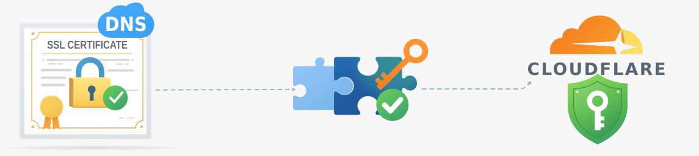

# :closed_lock_with_key: lego-cloudflare-certgen



[](https://hub.docker.com/r/ljgonzalez/lego-cloudflare-certgen)
[](https://hub.docker.com/r/ljgonzalez/lego-cloudflare-certgen/tags)
[](https://github.com/ljgonzalez1/lego-cloudflare-ssl-certgen/releases/tag/v6.0.1-beta-6)
[](https://github.com/go-acme/lego/releases/tag/v4.34.0)
[](https://github.com/ljgonzalez1/lego-cloudflare-ssl-certgen/actions/workflows/tests.yml)
[](LICENSE)

> One-shot Docker container that issues **Let's Encrypt** certificates with [lego](https://github.com/go-acme/lego) **v4.34.0** and the **Cloudflare DNS-01** challenge. No open ports and no web server: list your DNS names in a YAML file, run the container, collect the certificates. The container prints a summary and exits.

> ⚠️ **Go debug beta.** Pin `v6.0.1-beta-6` to test this migration. `latest` remains on the last stable release, `v5.2.4`. Start in staging: repeated production orders consume Let's Encrypt rate limits. [Rate limits](https://letsencrypt.org/docs/rate-limits/)

---

## :bookmark_tabs: Contents

- [Features](#sparkles-features)
- [Requirements](#clipboard-requirements)
- [Cloudflare API token](#key-cloudflare-api-token)
- [Quick start](#rocket-quick-start)
- [Output layout](#open_file_folder-output-layout)
- [Configuration](#gear-configuration)
- [Issuance report](#bar_chart-issuance-report)
- [Image tags and platforms](#label-image-tags-and-platforms)
- [Build the image yourself](#hammer_and_wrench-build-the-image-yourself)
- [Tests](#test_tube-tests)
- [CI/CD pipeline](#cicd-pipeline)
- [Security and permissions](#shield-security-and-permissions)
- [Project files](#file_folder-project-files)
- [Notes](#information_source-notes)
- [Version history](#version-history)
- [License](#page_facing_up-license)

---

## :sparkles: Features

- **One certificate per group.** Each top-level key in `domains.yaml` is one certificate and one output folder. Its list holds every DNS name on that certificate.
- **Wildcards and any record type.** DNS-01 works the same for names with A, AAAA or CNAME records, for quoted wildcards such as `"*.example.com"`, and for names that have no record yet.
- **Token kept out of the environment.** Mount the Cloudflare token as a file, or let Compose pass it as a [Docker secret](https://docs.docker.com/compose/use-secrets/). lego reads that file directly.
- **Confirm before issuing.** The menu describes staging and production and defaults to staging. Both confirmations default to No.
- **Pulse progress.** Domains being checked show a three-column Unicode pulse beside their name in the interactive pretty view. The 1.4-second animation also appears on the overall status line. Verified and failed domains stop animating; redirected and raw output do not animate.
- **Clear results.** A final table lists attempted, issued, failed and skipped names for every group, with totals.
- **Go runtime with full debug information.** The `scratch` image includes statically compiled Go programs, CA certificates and timezone data from Alpine 3.24. The entrypoint drops to your UID/GID before reading the YAML or calling lego.
- **Five architectures.** `linux/amd64`, `linux/386`, `linux/arm/v6`, `linux/arm/v7` and `linux/arm64`.

---

## :clipboard: Requirements

- Docker Engine. The Docker Compose plugin is optional.
- One or more zones managed by Cloudflare.
- A Cloudflare API token, created in the [next section](#key-cloudflare-api-token).
- A contact e-mail address for your Let's Encrypt account.

---

## :key: Cloudflare API token

Create a token at [dash.cloudflare.com/profile/api-tokens](https://dash.cloudflare.com/profile/api-tokens) with these permissions:

| Resource | Permission |
|---|---|
| Zone · DNS | Edit |
| Zone · Zone | Read |

Limit the token to the zones you plan to issue certificates for. lego uses it to find each zone, create a temporary `_acme-challenge` TXT record and delete it afterwards. [Cloudflare token guide](https://developers.cloudflare.com/fundamentals/api/get-started/create-token/)

---

## :rocket: Quick start

The image is published on Docker Hub as [`ljgonzalez/lego-cloudflare-certgen`](https://hub.docker.com/r/ljgonzalez/lego-cloudflare-certgen). You don't need to clone or build anything. Pin the image to **`v6.0.1-beta-6`** so that every run uses the same image.

### :one: Prepare a working directory

Download the two configuration files into a new directory.

```bash
mkdir lego-certgen
cd lego-certgen
wget -O .env https://raw.githubusercontent.com/ljgonzalez1/lego-cloudflare-ssl-certgen/v6.0.1-beta-6/template.env
wget -O domains.yaml https://raw.githubusercontent.com/ljgonzalez1/lego-cloudflare-ssl-certgen/v6.0.1-beta-6/template.domains.yaml
chmod 600 .env
mkdir -p ssl-certs
```

### :two: Fill in `.env`

Open `.env` and set at least these values. Read the [Let's Encrypt Terms of Service](https://letsencrypt.org/repository/) before you set `ACCEPT_LEGO_TOS=true`.

```dotenv
EMAIL=you@example.com
CLOUDFLARE_API_TOKEN=your-cloudflare-token
ACCEPT_LEGO_TOS=true
TZ=Etc/UTC
UID=1000
GID=1000
```

Set `UID` and `GID` to the host user that should own the certificates (`id -u` and `id -g`).

All settings are listed in [Environment variables](#environment-variables).

### :three: List your names in `domains.yaml`

Replace the sample names with your own. Each top-level key becomes one certificate:

```yaml
certificateA:
  - example.com
  - www.example.com
  - "*.example.com"

certificateB:
  - example.net
  - "*.example.net"
```

See [`domains.yaml` format](#domainsyaml-format) for the rules.

### :four: Run the container

#### :whale: `docker run --rm`

Preview the configuration, then issue the certificates:

```bash
# Check the YAML and list the groups
docker run --rm -t -v ./domains.yaml:/app/domains.yaml:ro \
  -v ./ssl-certs:/ssl-certs \
  ljgonzalez/lego-cloudflare-certgen:v6.0.1-beta-6 --list

# Show the names, ACME server, output paths and time limits without contacting Let's Encrypt
docker run --rm -t --env-file .env -v ./domains.yaml:/app/domains.yaml:ro \
  -v ./ssl-certs:/ssl-certs \
  ljgonzalez/lego-cloudflare-certgen:v6.0.1-beta-6 --dry-run

# Issue certificates
docker run --rm -it --env-file .env \
  -v ./domains.yaml:/app/domains.yaml:ro \
  -v ./ssl-certs:/ssl-certs \
  ljgonzalez/lego-cloudflare-certgen:v6.0.1-beta-6

```

Use `-it` to open the issuance menu. Choose **Staging** for a real request to Let's Encrypt staging, **Production** for a browser-trusted certificate, or **Cancel** to exit. Both issuance choices open an ANSI confirmation box that defaults to **No**. Use the arrows or Tab to move and Enter to select. With `TERM=dumb` or `NO_COLOR=1`, the `> selected <` markers remain visible in plain text.

Add any [command option](#command-options) after the image name, for example `--only certificateA`. `-t` enables the colored output.

- **Relative bind paths** (`./domains.yaml`) need Docker Engine 23 or later. On older versions, use `"$PWD/domains.yaml:/app/domains.yaml:ro"` and `"$PWD/ssl-certs:/ssl-certs"`.
- **Keep the token out of `docker inspect`.** With `--env-file`, the token is visible to anyone who can inspect the container. To avoid that, mount it as a file instead:

  ```bash
  (umask 077; printf '%s\n' 'your-cloudflare-token' > cloudflare_api_token)

  docker run --rm -it --env-file .env -e CLOUDFLARE_API_TOKEN= \
    -v ./domains.yaml:/app/domains.yaml:ro \
    -v ./ssl-certs:/ssl-certs \
    -v ./cloudflare_api_token:/run/secrets/cloudflare_api_token:ro \
    ljgonzalez/lego-cloudflare-certgen:v6.0.1-beta-6
  ```

  `-e CLOUDFLARE_API_TOKEN=` overrides any token left in `.env`, so the container reads the file. The configured `UID` must be able to read the file.
- **Restrict the container** the same way Compose does with the flags in [Runtime permissions](#runtime-permissions).

#### :octopus: Optional Docker Compose

Download the Compose file into the same directory to reuse `.env` and `domains.yaml`.

```bash
wget -O compose.yml https://raw.githubusercontent.com/ljgonzalez1/lego-cloudflare-ssl-certgen/v6.0.1-beta-6/compose.yml
```

List the groups and preview the request.

```bash
docker compose run --rm certgen --list
docker compose run --rm certgen --dry-run
```

Start an unattended staging run.

```bash
docker compose run --rm certgen
```

Compose runs unattended in staging. The `x-certgen-mode` value inside `compose.yml` is `"--staging"`; change it to `"--production"` only when you intend to issue live certificates without confirmation. If you add issuance arguments after the service name, retain the mode: `docker compose run --rm certgen --staging --only certificateA`.

Certificates are saved in `ssl-certs/`. The provided [Compose file](compose.yml) mounts the token as a secret. See the [Compose settings](#environment-variables) for custom file paths.


---

## :open_file_folder: Output layout

Each run creates a new timestamped folder per group under `./ssl-certs/<group>/`:

```text
ssl-certs/
└── certificateA/
    └── 2026-11-11_17.18.00_GMT-3/
        └── requested_2026-11-11_17.18.55_GMT-3_expires_2027-02-09_05.18.00_GMT-3/
            ├── accounts/
            │   └── acme-v02.api.letsencrypt.org/
            │       └── you@example.com/
            └── certificates/
                ├── example.com.crt
                ├── example.com.issuer.crt
                ├── example.com.json
                └── example.com.key
```

- The first name in a group sets the file names (`example.com.*` above).
- Folder names use `TZ`. Set `TZ=America/Santiago` to match the original script's names.
- The `expires_` part of the folder name is an estimate. To read the exact expiry date:

  ```bash
  openssl x509 -in example.com.crt -noout -enddate
  ```

---

## :gear: Configuration

### Environment variables

Settings are optional unless marked **required**.

| Variable | Default | Required | Description |
|---|---|---|---|
| `EMAIL` | - | :heavy_check_mark: | Contact e-mail for the Let's Encrypt account |
| `CLOUDFLARE_API_TOKEN` | - | :heavy_check_mark: | Cloudflare DNS API token. Compose turns it into a secret file. `docker run` also accepts the legacy `CLOUDFLARE_API_KEY` variable. |
| `ACCEPT_LEGO_TOS` | `false` | :heavy_check_mark: | Set `true` after reading the [Let's Encrypt Terms of Service](https://letsencrypt.org/repository/) |
| `TZ` | `Etc/UTC` | :x: | IANA timezone used in folder names and log timestamps |
| `PROPAGATION_SECONDS` | `360` | :x: | Maximum wait for TXT propagation per challenge, in seconds. It also sets the [time limit](#stopwatch-time-limit-per-certificate) of each certificate. |
| `DNS_RESOLVERS` | `1.1.1.1:53,8.8.8.8:53,1.0.0.1:53` | :x: | Comma-separated `host:port` resolvers used to check TXT visibility |
| `UID` | `1000` | :x: | Non-zero UID that owns the certificates and ACME account data |
| `GID` | `1000` | :x: | Non-zero GID that owns the certificates and ACME account data |
| `CERTGEN_TRACE` | `errors` | :x: | Extra console diagnostics: `errors`, `always` or `off`. Persistent logging is attempted independently. |
| `CERTGEN_LOG_DIR` | `/ssl-certs/debug` | :x: | Directory for versioned logs and failure dumps; bind `/ssl-certs` to preserve them |
| `GOGC` | `off` | :x: | Disable heap-growth-triggered garbage collection in this debug beta |
| `GOMEMLIMIT` | `256MiB` | :x: | Go's soft memory limit. It can trigger collection even with `GOGC=off`; it is not a hard container memory cap. |
| `GOTRACEBACK` | `system` | :x: | Include runtime goroutines in unrecovered Go failure traces |

These variables are read by Compose on the host, not by the container:

| Variable | Default | Description |
|---|---|---|
| `DOMAINS_FILE` | `./domains.yaml` | Host YAML file mounted at `/app/domains.yaml` |
| `CERTGEN_IMAGE` | `ljgonzalez/lego-cloudflare-certgen:v6.0.1-beta-6` | Image used by the Compose service |
| `CERTGEN_ENV_FILE` | `./.env` | Settings file passed to the container |

### Command options

Add these after the image name in `docker run`, or after `docker compose run --rm certgen`.

| Option | Description |
|---|---|
| `--list` | Validate the YAML and list the selected groups with their name counts |
| `--dry-run` | Print the selected names, ACME server and planned output paths. Nothing is requested. |
| `--test` | Check `lego --version`, validate configuration and preview staging offline. Returns nonzero if a check fails. |
| `--staging` | Request staging certificates without the menu |
| `--production` | Request production certificates without confirmation |
| `--only FOLDER` | Process only this group. Repeat it to select several groups, in YAML order. |
| `--config FILE` | Read another YAML file inside the container. Default: `/app/domains.yaml`. |
| `--output DIRECTORY` | Write to another directory inside the container. It must be mounted and writable by `UID`/`GID`. Default: `/ssl-certs`. |
| `-h`, `--help` | Show the usage text |

### Unattended issuance

Pass `--staging` for a real staging order without a terminal. CI/CD uses `--test` with networking disabled.

> ⚠️ **Use `--production` carefully.** It skips both confirmation screens and submits live orders. Repeated runs can consume Let's Encrypt's limits per registered domain or repeated set of names. Use the interactive menu when issuing manually. [Let's Encrypt rate limits](https://letsencrypt.org/docs/rate-limits/)

```bash
docker run --rm --env-file .env \
  -v "$PWD/domains.yaml:/app/domains.yaml:ro" \
  -v "$PWD/ssl-certs:/ssl-certs" \
  ljgonzalez/lego-cloudflare-certgen:v6.0.1-beta-6 --staging
```

Use one issuance flag per run. The issuance flags conflict with `--list`, `--dry-run` and `--test`.

### `domains.yaml` format

Copy [`template.domains.yaml`](template.domains.yaml) for 20 sample names across three certificate groups.

```yaml
certificateA:
  - example.com
  - www.example.com
  - "*.example.com"

certificateB:
  - example.net
  - "*.example.net"
```

- **Quote wildcards** (`"*.example.com"`) so YAML reads them as strings.
- **Group names** become folder names. Use letters, numbers, hyphens or underscores, starting with a letter or number.
- **Up to 100 distinct names** per certificate. Issuance marks an oversized group as failed before contacting Let's Encrypt and continues with the other groups. The same name can appear in several groups.
- One group may include names from different DNS zones. The Cloudflare credentials must cover each zone used for validation. A final DNS root dot is removed before checking for duplicates and sending names to lego.
- **The first name** in a group sets lego's certificate file name.
- A wildcard covers exactly one extra label. `*.example.com` covers `www.example.com` but not `example.com` or `a.b.example.com`.

### Hostnames and DNS-01

List every name you want on the certificate, including quoted wildcards. Every name takes the same DNS-01 path, whether it has an A, AAAA or CNAME record or no record yet. lego writes a temporary `_acme-challenge` TXT record through the Cloudflare API, Let's Encrypt checks it, and lego removes it. [Let's Encrypt DNS-01](https://letsencrypt.org/docs/challenge-types/#dns-01-challenge)

An exact TXT owner takes precedence over a CNAME inherited from a wildcard service record. A deliberate CNAME at the challenge owner itself is a separate DNS-01 delegation. Older deployments that already use lego's explicit delegation mode can keep their `LEGO_DISABLE_CNAME_SUPPORT=false` override and authorize the destination zone. [Cloudflare wildcard records](https://developers.cloudflare.com/dns/manage-dns-records/reference/wildcard-dns-records/) · [lego CNAME delegation](https://go-acme.github.io/lego/references/ref-options/#lego_disable_cname_support)

---

## :bar_chart: Issuance report

When the run ends, a table shows the DNS names of each selected certificate, followed by totals.

| Column | Meaning |
|---|---|
| Attempted | Names submitted for issuance, including groups rejected by local credential or name-count checks |
| Issued | Names covered by the certificate that was issued |
| Failed | Names in a group that could not issue a certificate |
| Skipped | Names in a group blocked by setup, for example because the output directory was not writable |

Each request issues one certificate for all its names. A group counts as issued when lego exits successfully and saves both the certificate and its key. The live view keeps each completed DNS validation time. If the certificate fails, the view marks every name in that group as failed and shows how many passed DNS validation. Successful groups still count as issued. The run finishes the other groups and exits with a nonzero status if any group failed or was skipped.

### :stopwatch: Time limit per certificate

`certgen` gives each certificate its own time limit based on its name count and `PROPAGATION_SECONDS`:

```text
estimate = 120 s + names × (PROPAGATION_SECONDS + 60 s)
limit    = min(estimate × 1.5, 2 hours)
```

The 120 s cover the ACME account, the order, finalization and the download. The 60 s per name cover creating and deleting the TXT record and the check by Let's Encrypt. `--dry-run` shows the limit of each group.

| Names | `PROPAGATION_SECONDS=60` | `PROPAGATION_SECONDS=360` |
|---|---|---|
| 1 | 360 s | 810 s |
| 10 | 1980 s (33 min) | 6480 s (108 min) |
| 30 | 5580 s (93 min) | 7200 s (2 h) |
| 100 | 7200 s (2 h) | 7200 s (2 h) |

The supervisor recognizes definitive errors such as an ACME `rateLimited` response, a rejected Cloudflare token, missing zone access and fatal order errors. It captures the diagnostic, gives lego a moment to exit, then sends `SIGKILL` to that process group if it is still running. DNS propagation waits, ordinary retries and cleanup warnings continue within the per-certificate limit. The supervisor also stops lego if that group reaches its deadline. A forced stop can leave temporary `_acme-challenge` TXT records behind. Full output for each attempt is available in `lego.log`.

In a terminal the table is colored and adapts to the terminal width. It uses ASCII borders and keeps emojis outside the grid.

### :desktop_computer: Terminal example

This simulated staging run uses the following configuration:

```yaml
example-com:
  - example.com
  - www.example.com
  - api.example.com
  - '*.apps.example.com'

example-org:
  - example.org
  - docs.example.org
  - api.staging.example.org
  - '*.staging.example.org'
```

The first order succeeds. The second hits a TXT propagation timeout. The report shows eight names attempted, four issued and four failed.

The independent [Go pulse package](build/spinner/README.md) preserves the supplied Unicode transitions and timing. ANSI intensity approximates brightness; terminal output cannot reproduce CSS blur or glow. Pending domains keep their normal icon. Checked rows use a check mark or failure icon. Short terminals use the compact progress line, which includes the current domain and activity as space allows.


---

## :label: Image tags and platforms

| Tag | Use it when |
|---|---|
| `v6.0.1-beta-6` | You want a fixed image. **Recommended.** |
| `v6.0-beta-3`, `v6-beta-3` | You want rolling aliases within this beta suffix |
| `v5.2`, `v5` | You want future patch or minor releases of version 5 |
| `latest` | You want the newest release outside the alpha, alfa and beta channels |
| `alpine3.24.4-lego4.34.0-v6.0.1-beta-6` | You want the base and lego versions in the tag name |

The `v6.0.1-beta-6` image supports `linux/amd64`, `linux/386`, `linux/arm/v6`, `linux/arm/v7` and `linux/arm64`. Docker pulls the right variant automatically. Older releases (v1 to v3) are still available. See [all tags on Docker Hub](https://hub.docker.com/r/ljgonzalez/lego-cloudflare-certgen/tags).

---

## :hammer_and_wrench: Build the image yourself

You only need this to change the code. A normal `docker build` produces an image for your own machine's architecture.

```bash
git clone https://github.com/ljgonzalez1/lego-cloudflare-ssl-certgen.git
cd lego-cloudflare-ssl-certgen

docker build -t lego-cloudflare-certgen:local ./build
```

Check the result:

```bash
docker run --rm --entrypoint lego lego-cloudflare-certgen:local --version
docker run --rm -v ./template.domains.yaml:/app/domains.yaml:ro lego-cloudflare-certgen:local --list
```

Use your build with `docker run`, or with Compose through `CERTGEN_IMAGE`:

```bash
docker run --rm -t --env-file .env -v ./domains.yaml:/app/domains.yaml:ro \
  lego-cloudflare-certgen:local --dry-run

CERTGEN_IMAGE=lego-cloudflare-certgen:local docker compose run --rm certgen --dry-run
```

The build needs BuildKit, the default builder since Docker Engine 23. It also needs network access to Docker Hub, GitHub Releases and the Alpine package mirrors.

### :feather: What the build does

1. **Native tools and license evidence.** Go 1.27.4 compiles the Go build helper on the builder's native CPU. The application vendors its YAML parser. A shared native stage loads the committed original notices from `build/licenses/third-party/`, or prepares them once if absent. `bash ci/update-license-bundle.sh` refreshes that text-only evidence after a dependency change.
2. **Downloader stage.** The Go helper downloads the official lego `v4.34.0` archive for the target CPU and verifies SHA-256 before extracting regular files with bounded sizes. It rejects missing, duplicated, linked or corrupt payloads.
3. **Builder stage.** Go cross-compiles a static application with optimizations and inlining disabled, additional pointer checks, full symbols and uncompressed DWARF. It checks the actual ELF and embedded build settings. Delve `v1.27.2` is considered only on AMD64, ARM64 and i386, with its dependency licenses; the execution probe decides whether it remains in the final image. Its installation downloads pinned Go modules through the Go checksum system.
4. **Final stage.** The `scratch` image carries `certgen`, lego, supported Delve binaries, source files for debugging, CA certificates and timezone data. There is no shell, Python interpreter, C++ executable or dynamic C library in the runtime.
5. **Self-check, offline audit and final assembly.** With networking disabled, the build probes actual Delve execution, checks lego and offline operation, removes unusable debugger binaries, binds the common local notice set to the actual retained payload and copies the validated filesystem into a fresh scratch image.

The debug build intentionally favors diagnostics over image size and execution speed. Neither `-s`, `-w` nor `-trimpath` is used. Sources retain their `/src` build paths.

### Debugging the Go beta

The application and build helper use these compiler settings:

```bash
cd build
CGO_ENABLED=0 go build -buildvcs=false -mod=vendor \
  -gcflags='all=-N -l -d=checkptr=2' \
  -ldflags='-compressdwarf=false' \
  -o certgen ./cmd/certgen
```

`-N` disables optimizations, `-l` disables inlining, and `checkptr=2` adds pointer checks. DWARF and symbols remain in the executable. The application and lego run without a C runtime in every published architecture.

Every public execution attempts a private log, including `--help`, `--list`, `--dry-run`, `--test`, cancellation and certificate issuance. The default directory is `/ssl-certs/debug`, so the existing `./ssl-certs:/ssl-certs` bind preserves logs after `docker run --rm`. Mount that directory for previews too. Set `CERTGEN_LOG_DIR` to another writable location when needed.

```text
ssl-certs/debug/
  v6.0.1-beta-6.2026-18-11_20.30.45.amd64.log
  dump.v6.0.1-beta-6.2026-18-11_20.30.45.amd64.log
```

The timestamp deliberately uses **year-day-month**, then `HH.MM.SS`, in `TZ` (UTC if the zone cannot be loaded). Architecture labels are `armv6`, `armv7`, `arm64`, `i386` and `amd64`. Concurrent executions reserve different filenames without overwriting an existing log. Files use mode `0600`.

The normal log records console output, full lego output, diagnostic events, a final Go goroutine snapshot on every normal completion and any Delve diagnostics. A Go supervisor stays alive outside the application. On a nonzero exit, a recovered or unrecovered panic, interruption or abrupt child termination, it writes `dump.<normal-log-name>` just before its own shutdown, using captured output and the latest available snapshots. Working applications also emit bounded Go snapshots every five seconds. These are text stack/event dumps, not binary memory cores.

Known Cloudflare credentials are redacted, including values split between output writes. The existing per-certificate `lego.log` retains its original role and permissions. `CERTGEN_TRACE=errors|always|off` controls extra console traces; it does not disable persistent logs. If the configured log directory is unavailable, the supervisor tries a private temporary directory and reports its path. Logging failures do not intentionally cancel certificate issuance.

| Platform | Delve candidate | Go logs and text dumps |
|---|---|---|
| `linux/arm/v6` | Excluded | Attempted on every run |
| `linux/arm/v7` | Excluded | Attempted on every run |
| `linux/arm64` | Included only after a real execution probe passes | Attempted on every run |
| `linux/386` | Included only after a real execution probe passes | Attempted on every run |
| `linux/amd64` | Included only after a real execution probe passes | Attempted on every run |

The image build asks Delve to execute a real Go probe and waits for an authenticated completion from that probe. `dlv version` alone is insufficient. If execution is unavailable, including unsupported ptrace under QEMU or container restrictions, the build removes Delve. The final image copies the validated filesystem into a fresh scratch stage, so removed debugger bytes are absent from all final layers. `/usr/share/certgen/debugger.json` records the decision.

At runtime the supervisor repeats the execution probe before starting the user's action under Delve. It uses private local IPC with no published network port. If Delve cannot start the target, it runs the action once with Go diagnostics. Once the action has been resumed, it is never replayed after a debugger failure; this avoids duplicate ACME orders. ARMv6 and ARMv7 always use the portable Go supervisor. Native control pipes preserve diagnostics even if local Unix sockets are forbidden.

A stopped target's Delve goroutines and stack frames are collected before continuing past an unrecovered failure. The debugger runs the target under the configured UID/GID from the start, preserving the interactive menu and avoiding an identity switch while being traced. Use the normal entry point to retain automatic logging:

```bash
docker run --rm -it --cap-add SYS_PTRACE --security-opt seccomp=unconfined \
  --env-file .env \
  -v "$PWD/domains.yaml:/app/domains.yaml:ro" \
  -v "$PWD/ssl-certs:/ssl-certs" \
  ljgonzalez/lego-cloudflare-certgen:v6.0.1-beta-6
```

Those extra permissions can allow an included Delve to run on a supported native platform; ordinary invocations still produce Go diagnostics without them. QEMU may not implement the necessary ptrace behavior. Killing the entire container/supervisor with `SIGKILL`, losing power or having no writable storage cannot guarantee a final dump; already-written log data and prior snapshots remain the available evidence.

`GOGC=off` disables collection triggered by heap growth. `GOMEMLIMIT=256MiB` remains a soft backstop that can trigger collection. Override them in `.env` when investigating memory behavior.

For a separate local race-enabled binary on supported native AMD64 or ARM64 Linux hosts, install a C compiler and use:

```bash
CGO_ENABLED=1 go build -race -buildvcs=false -mod=vendor \
  -gcflags='all=-N -l -d=checkptr=2' -ldflags='-compressdwarf=false' \
  -o certgen-race ./cmd/certgen
dlv exec ./certgen-race -- --test --config ../template.domains.yaml
```

This extra binary may require the host C runtime and is not copied into the static five-platform image. The race detector is unavailable for 32-bit ARM and i386 Linux. [Go diagnostics](https://go.dev/doc/diagnostics) · [Go GC guide](https://go.dev/doc/gc-guide) · [Race detector](https://go.dev/doc/articles/race_detector) · [Delve platform support](https://github.com/go-delve/delve/blob/master/Documentation/faq.md)

Show the image size in MiB:

```sh
docker image inspect --format '{{.Size}}' lego-cloudflare-certgen:local |
  awk '{printf "%.1f MiB\n", $1 / 1048576}'
```

<details>
<summary><b>:gear: Advanced: multi-architecture builds with Buildx</b></summary>

<br>

Only release maintainers need this, or anyone who wants images for other CPUs. It needs Docker Buildx and, for non-native targets, QEMU emulators registered on the host.

| Target | Buildx platform | Official lego archive |
|---|---|---|
| AMD64 / x86-64 | `linux/amd64` | `lego_v4.34.0_linux_amd64.tar.gz` |
| i386 / 32-bit x86 | `linux/386` | `lego_v4.34.0_linux_386.tar.gz` |
| ARMv6 / Alpine armhf | `linux/arm/v6` | `lego_v4.34.0_linux_armv6.tar.gz` |
| ARMv7 / Debian armhf | `linux/arm/v7` | `lego_v4.34.0_linux_armv7.tar.gz` |
| ARMv8 / AArch64 | `linux/arm64` | `lego_v4.34.0_linux_arm64.tar.gz` |

The ARMv7 image uses the Alpine `armv7` userspace. Debian calls that architecture `armhf`. [Alpine image platforms](https://hub.docker.com/_/alpine) · [lego v4.34.0](https://github.com/go-acme/lego/releases/tag/v4.34.0)

**Create a builder** (once):

```bash
docker buildx create --name lego-multiarch --driver docker-container --use
docker buildx inspect lego-multiarch --bootstrap
```

Check that the `Platforms` line lists all five targets. On Linux, register any missing emulators and inspect again. [Docker multi-platform builds](https://docs.docker.com/build/building/multi-platform/)

```bash
docker run --privileged --rm tonistiigi/binfmt --install arm64,arm,386
docker buildx inspect lego-multiarch --bootstrap
```

**Build one platform and load it** into the local Engine for testing:

```bash
docker buildx build --builder lego-multiarch --platform linux/arm64 \
  --progress=plain --load -t lego-cloudflare-certgen:local-arm64 ./build
```

**Build every platform with its own local tag:**

```sh
for arch in amd64 386 arm/v6 arm/v7 arm64; do
  suffix=$(printf '%s' "$arch" | tr / -)
  docker buildx build --builder lego-multiarch --platform "linux/$arch" \
    --progress=plain --load -t "lego-cloudflare-certgen:local-$suffix" ./build || break
done
```

**Push one multi-architecture image** to a registry you control:

```bash
docker buildx build --builder lego-multiarch \
  --platform linux/amd64,linux/386,linux/arm/v6,linux/arm/v7,linux/arm64 \
  -t <registry>/<user>/lego-cloudflare-certgen:<tag> --push ./build
```

</details>

---

## :test_tube: Tests

For unattended checks of the built image, run `docker run --rm --network none --env-file .env -v "$PWD/domains.yaml:/app/domains.yaml:ro" ljgonzalez/lego-cloudflare-certgen:v6.0.1-beta-6 --test`. This checks the lego binary and previews staging without opening the issuance menu. It needs no Cloudflare token. Bind `/ssl-certs` if you want its debug log to persist.

`ci/tests/run.sh` covers YAML and CLI validation, credential handling, DNS-01 arguments, per-certificate deadlines, fatal errors, recoverable retries, missing certificate files, mixed issuance results and ANSI alignment. Local stand-ins replace lego, so the suite runs offline. GitHub Actions runs it on pushes and pull requests targeting `master` or a valid version branch, and on published releases.

Install Go 1.27.4, Python 3, and util-linux (`script`). Then run from the repository root:

```sh
cd build
go vet -buildvcs=false -mod=vendor ./...
go test -buildvcs=false -mod=vendor -gcflags='all=-N -l -d=checkptr=2' -ldflags='-compressdwarf=false' ./...
cd ..
python3 -B ci/test_go_binary.py
sh ci/tests/run.sh
```

`ci/test_go_binary.py` builds and launches the real Go executable. It verifies offline testing, interactive guards, both unattended ACME modes with a compiled Go fixture, hidden/visible traces, failed inputs, and real debug ELF files for all five targets. Go unit tests exercise archive checksums and malformed archives through a local HTTPS server, credentials and input limits, concurrent output reservations, fatal-error detection, cancellation and per-certificate timeouts. No test in this offline stage requests a certificate.

For the extra race detector on a supported native AMD64 or ARM64 Linux machine, install a C compiler and run:

```sh
cd build
CGO_ENABLED=1 go test -race -buildvcs=false -mod=vendor \
  -gcflags='all=-N -l -d=checkptr=2' -ldflags='-compressdwarf=false' ./...
```

The race detector is an extra native test, not a requirement of the five static runtime images: it does not support Go's 32-bit ARM or i386 Linux targets. The regression suite also tests the Go menu in a pseudo-terminal with Python 3. The last line should show `0 failed`. Four terminal tests use `script` and are skipped when it is unavailable.

Static analysis now runs first in three parallel jobs: Go formatting/vet for
all five targets, ShellCheck for CI shell scripts, and Ruff for Python. Two
independent offline jobs follow: the CA/runtime regressions, and Go unit,
coverage, race, fuzz and compiled-binary checks. Every smoke test requires both
jobs. See the [CI test commands](ci/README.md#static-analysis-and-offline-checks).

The [validation report](ci/validation-6.0.1-beta-6.md) records the executed local checks and the image-specific checks that require Docker and QEMU in GitHub Actions. Beta 6 ships the [prepared third-party notice bundle](build/licenses/third-party/README.md) and keeps complete build tracing.

### :white_check_mark: End-to-end check in staging

Use this optional check to confirm real issuance for A, AAAA, CNAME, wildcard and planned names. Choose an active zone your token can edit and replace `example.net`. Create these DNS-only test records:

| DNS record | Type | Example value |
|---|---|---|
| `a-check.example.net` | A | `192.0.2.10` |
| `v6-check.example.net` | AAAA | `2001:db8::10` |
| `alias-check.example.net` | CNAME | `a-check.example.net` |
| `*.wild-check.example.net` | CNAME | `a-check.example.net` |

```bash
dig +short a-check.example.net A
dig +short v6-check.example.net AAAA
dig +short alias-check.example.net CNAME
dig +short probe.wild-check.example.net CNAME
```

Save this group as `dns-smoke.yaml`, so the check submits a single order:

```yaml
dns-smoke:
  - a-check.example.net
  - v6-check.example.net
  - alias-check.example.net
  - '*.wild-check.example.net'
  - planned-check.example.net
```

Select **Staging**, then **Yes**, for this live staging check.

```bash
docker run --rm -it --env-file .env \
  -v ./dns-smoke.yaml:/app/domains.yaml:ro \
  -v ./ssl-certs:/ssl-certs \
  ljgonzalez/lego-cloudflare-certgen:v6.0.1-beta-6 --only dns-smoke

# Or with Compose
DOMAINS_FILE=./dns-smoke.yaml docker compose run --rm certgen --staging --only dns-smoke
```

Expect `5 Attempted`, `5 Issued` and `0 Failed`. In the reported output path, replace the container prefix `/ssl-certs` with `./ssl-certs` and check the SANs:

```bash
openssl x509 -in ./ssl-certs/dns-smoke/<timestamp>/<request>/certificates/a-check.example.net.crt \
  -noout -issuer -ext subjectAltName
```

---

## CI/CD pipeline

The [event policy](docs/ci-policy.md) implements the five event diagrams. Static analysis runs first for every used language. It blocks PRs to master and is advisory for version-branch activity, master pushes, releases and prereleases. Version branches then run the offline suites. Master activity and releases also validate both Markdown version tables and run the five parallel image smoke tests. Only release/prerelease events can publish, after all mandatory functional checks pass.

Publication preserves the Buildx index digest and each architecture digest. Separate propagation waits precede tag/hash and Docker Hub description checks. Failed or cancelled functional checks cannot publish. The local badge workflow is introduced in beta-6 and inherited by subsequent snapshots.

---

## :shield: Security and permissions

### Runtime permissions

The entrypoint starts as root only to prepare `/ssl-certs`. It then switches to the configured `UID`/`GID`, and the YAML reader and lego run as that user. That identity must be able to read the mounted YAML and write the output.

| Capability | Why it is needed |
|---|---|
| `CHOWN` | Set ownership of the standard output directory |
| `SETUID` | Switch to the configured UID |
| `SETGID` | Switch to the configured GID |

Compose keeps only these three capabilities and adds `no-new-privileges:true`. Plain `docker run` uses Docker's [default capabilities](https://docs.docker.com/engine/containers/run/#runtime-privilege-and-linux-capabilities), which include them. To run `docker run` with the same restrictions as Compose, add:

```bash
--cap-drop ALL --cap-add CHOWN --cap-add SETUID --cap-add SETGID \
--security-opt no-new-privileges:true
```

### Secrets

- `docker run --env-file` exposes the token to anyone who can run `docker inspect`. Use the [secret-file variant](#whale-docker-run---rm) to avoid that.
- Compose always passes the token as `/run/secrets/cloudflare_api_token`, so it never appears in the container's environment.
- Keep `.env`, `certgen.env`, `cloudflare_api_token` and `ssl-certs/` out of version control. The provided `.gitignore` already excludes them, together with `/domains.yaml`.

### Alpine runtime security

The `scratch` runtime contains static Go binaries, CA certificates and timezone data. It carries no musl, system OpenSSL, zlib or Alpine package manager. Scan the final published image by digest, including its embedded Go modules and optional debugger dependencies; scanning only the build-stage distribution does not describe this runtime.

This release stays on lego `v4.34.0` for simplicity. The plan is to move to lego `5.X.Y` after its CLI and the Cloudflare DNS-01 workflow are tested on all supported architectures. [lego releases](https://github.com/go-acme/lego/releases)

---

## :file_folder: Project files

| File | Purpose |
|---|---|
| `compose.yml` | One-shot Compose service with a Docker secret |
| `template.env` | Sample environment settings |
| `template.domains.yaml` | Sample certificate groups |
| `build/Dockerfile` | Native Go tools, verified downloader, cross-compiler and scratch runtime stages |
| `build/cmd/certgen/` | Go application entry point and panic diagnostics |
| `build/cmd/certgen-build/` | Go downloader, compiler, runtime assembly and debug checks |
| `build/internal/certgen/` | Environment validation, menu, YAML parser, lego supervision, ANSI output and unit tests |
| `build/internal/debugrun/` | Go supervisor, execution probes, Delve API driver, terminal relay, logs and dumps |
| `build/internal/imagebuild/` | Verified downloads, extraction, cross-compilation, runtime data and Delve installation |
| `build/spinner/` | Independent pulse animation package, elapsed-time easing, ANSI rendering and tests |
| `build/vendor/` | Offline YAML dependency sources and licenses |
| `ci/` | Smoke, release and Docker Hub verification scripts |
| `ci/tests/` | Offline regression suite and Docker smoke checks |
| `ci/test_go_binary.py` | Tests of actual Go binaries and debug ELF files for all five architectures |
| `.github/workflows/` | GitHub Actions workflow definitions |
| `ci/versions/versions.csv` | Source for the Docker tag tables |
| `ci/versions/tags_table.py` | Updates the tag tables in this README and `DOCKERHUB.md` |

---

## :information_source: Notes

- **Staging first.** The menu defaults to staging. Staging issues certificates that browsers do not trust.
- **One certificate per group.** Groups run in YAML order. If one fails, the rest still run and the exit status is nonzero. Retry a single group with `--only`.
- **Fresh output every time.** Each run creates a new timestamped folder per group. Nothing is overwritten.
- **Renewal.** The container issues new certificates and exits. Run it again before expiry. The menu confirms manual requests. Scheduled issuance can use an [explicit mode](#unattended-issuance).
- **Rate limits.** Production limits apply per registered domain and per identical set of names. Every run requests new certificates, so repeated production runs for the same group use up the limit of 5 per week quickly. Test with staging first. See [Let's Encrypt rate limits](https://letsencrypt.org/docs/rate-limits/).
- **Cancelling issuance.** Ctrl+C or a stop signal ends the current request and skips the remaining groups. lego has up to two seconds to stop before its process group is force-stopped.
- **Each group has its own deadline.** The [per-certificate limit](#stopwatch-time-limit-per-certificate) is at most two hours. A definitive failure ends that group's request early. For rate limits, see the ACME response for any retry time.
- **Lowercase names.** Names are passed to lego in lowercase, so the certificate files always match the names in the summary.

---

## Version history

Alpha, alfa and beta releases keep their suffix on every Docker tag. `latest` stays on the last eligible release. The full table lists every distinct tag generated from [`versions.csv`](ci/versions/versions.csv).

Maintainers append the upcoming release to the CSV and run `python3 ci/versions/tags_table.py` before committing the two Markdown files. [Release pipeline](ci/README.md)

<!-- BEGIN DOCKER TAG TABLE -->

| tag | runtime | lego | other aliases |
|---|---|---|---|
| [`v6.0.1-beta-6`](https://github.com/ljgonzalez1/lego-cloudflare-ssl-certgen/releases/tag/v6.0.1-beta-6) | [Alpine 3.24.4 minimal on `scratch`](https://hub.docker.com/_/alpine) | [`v4.34.0`](https://github.com/go-acme/lego/releases/tag/v4.34.0) | [`v6-beta-6`](https://github.com/ljgonzalez1/lego-cloudflare-ssl-certgen/releases/tag/v6.0.1-beta-6), [`v6.0-beta-6`](https://github.com/ljgonzalez1/lego-cloudflare-ssl-certgen/releases/tag/v6.0.1-beta-6), [`lego4.34-v6.0.1-beta-6`](https://github.com/ljgonzalez1/lego-cloudflare-ssl-certgen/releases/tag/v6.0.1-beta-6), [`lego4.34.0-v6.0.1-beta-6`](https://github.com/ljgonzalez1/lego-cloudflare-ssl-certgen/releases/tag/v6.0.1-beta-6), [`alpine3.24-lego4.34-v6.0.1-beta-6`](https://github.com/ljgonzalez1/lego-cloudflare-ssl-certgen/releases/tag/v6.0.1-beta-6), [`alpine3.24-lego4.34-v6.0-beta-6`](https://github.com/ljgonzalez1/lego-cloudflare-ssl-certgen/releases/tag/v6.0.1-beta-6), [`alpine3.24.4-lego4.34.0-v6.0.1-beta-6`](https://github.com/ljgonzalez1/lego-cloudflare-ssl-certgen/releases/tag/v6.0.1-beta-6) |
| [`v6.0.1-beta-5`](https://github.com/ljgonzalez1/lego-cloudflare-ssl-certgen/releases/tag/v6.0.1-beta-5) | [Alpine 3.24.4 minimal on `scratch`](https://hub.docker.com/_/alpine) | [`v4.34.0`](https://github.com/go-acme/lego/releases/tag/v4.34.0) | [`v6-beta-5`](https://github.com/ljgonzalez1/lego-cloudflare-ssl-certgen/releases/tag/v6.0.1-beta-5), [`v6.0-beta-5`](https://github.com/ljgonzalez1/lego-cloudflare-ssl-certgen/releases/tag/v6.0.1-beta-5), [`lego4.34-v6.0.1-beta-5`](https://github.com/ljgonzalez1/lego-cloudflare-ssl-certgen/releases/tag/v6.0.1-beta-5), [`lego4.34.0-v6.0.1-beta-5`](https://github.com/ljgonzalez1/lego-cloudflare-ssl-certgen/releases/tag/v6.0.1-beta-5), [`alpine3.24-lego4.34-v6.0.1-beta-5`](https://github.com/ljgonzalez1/lego-cloudflare-ssl-certgen/releases/tag/v6.0.1-beta-5), [`alpine3.24-lego4.34-v6.0-beta-5`](https://github.com/ljgonzalez1/lego-cloudflare-ssl-certgen/releases/tag/v6.0.1-beta-5), [`alpine3.24.4-lego4.34.0-v6.0.1-beta-5`](https://github.com/ljgonzalez1/lego-cloudflare-ssl-certgen/releases/tag/v6.0.1-beta-5) |
| `v6.0.1-beta-4` | - | - | Branch only; not published on Docker Hub |
| `v6.0.1-beta-3` | - | - | Branch only; not published on Docker Hub |
| `v6.0.1-beta-2` | - | - | Branch only; not published on Docker Hub |
| `v6.0.1-beta-1` | - | - | Branch only; not published on Docker Hub |
| `v6.0.0-alpha-2` | - | - | Branch only; not published on Docker Hub |
| [`v6.0.0-alpha-1`](https://github.com/ljgonzalez1/lego-cloudflare-ssl-certgen/releases/tag/v6.0.0-alpha-1) | [Alpine 3.24.4 minimal on `scratch`](https://hub.docker.com/_/alpine) | [`v4.34.0`](https://github.com/go-acme/lego/releases/tag/v4.34.0) | [`v6-alpha-1`](https://github.com/ljgonzalez1/lego-cloudflare-ssl-certgen/releases/tag/v6.0.0-alpha-1), [`v6.0-alpha-1`](https://github.com/ljgonzalez1/lego-cloudflare-ssl-certgen/releases/tag/v6.0.0-alpha-1), [`lego4.34-v6.0.0-alpha-1`](https://github.com/ljgonzalez1/lego-cloudflare-ssl-certgen/releases/tag/v6.0.0-alpha-1), [`lego4.34.0-v6.0.0-alpha-1`](https://github.com/ljgonzalez1/lego-cloudflare-ssl-certgen/releases/tag/v6.0.0-alpha-1), [`alpine3.24-lego4.34-v6.0.0-alpha-1`](https://github.com/ljgonzalez1/lego-cloudflare-ssl-certgen/releases/tag/v6.0.0-alpha-1), [`alpine3.24-lego4.34-v6.0-alpha-1`](https://github.com/ljgonzalez1/lego-cloudflare-ssl-certgen/releases/tag/v6.0.0-alpha-1), [`alpine3.24.4-lego4.34.0-v6.0.0-alpha-1`](https://github.com/ljgonzalez1/lego-cloudflare-ssl-certgen/releases/tag/v6.0.0-alpha-1) |
| [`latest`](https://github.com/ljgonzalez1/lego-cloudflare-ssl-certgen/releases/tag/v5.2.4), [`v5.2.4`](https://github.com/ljgonzalez1/lego-cloudflare-ssl-certgen/releases/tag/v5.2.4) | [Alpine 3.24.4 minimal on `scratch`](https://hub.docker.com/_/alpine) | [`v4.34.0`](https://github.com/go-acme/lego/releases/tag/v4.34.0) | [`v5`](https://github.com/ljgonzalez1/lego-cloudflare-ssl-certgen/releases/tag/v5.2.4), [`v5.2`](https://github.com/ljgonzalez1/lego-cloudflare-ssl-certgen/releases/tag/v5.2.4), [`lego4.34-v5.2.4`](https://github.com/ljgonzalez1/lego-cloudflare-ssl-certgen/releases/tag/v5.2.4), [`lego4.34.0-v5.2.4`](https://github.com/ljgonzalez1/lego-cloudflare-ssl-certgen/releases/tag/v5.2.4), [`alpine3.24-lego4.34-v5.2.4`](https://github.com/ljgonzalez1/lego-cloudflare-ssl-certgen/releases/tag/v5.2.4), [`alpine3.24-lego4.34-v5.2`](https://github.com/ljgonzalez1/lego-cloudflare-ssl-certgen/releases/tag/v5.2.4), [`alpine3.24.4-lego4.34.0-v5.2.4`](https://github.com/ljgonzalez1/lego-cloudflare-ssl-certgen/releases/tag/v5.2.4) |
| [`v5.2.3`](https://github.com/ljgonzalez1/lego-cloudflare-ssl-certgen/releases/tag/v5.2.3) | [Alpine 3.24.4 minimal on `scratch`](https://hub.docker.com/_/alpine) | [`v4.34.0`](https://github.com/go-acme/lego/releases/tag/v4.34.0) | [`lego4.34-v5.2.3`](https://github.com/ljgonzalez1/lego-cloudflare-ssl-certgen/releases/tag/v5.2.3), [`lego4.34.0-v5.2.3`](https://github.com/ljgonzalez1/lego-cloudflare-ssl-certgen/releases/tag/v5.2.3), [`alpine3.24-lego4.34-v5.2.3`](https://github.com/ljgonzalez1/lego-cloudflare-ssl-certgen/releases/tag/v5.2.3), [`alpine3.24.4-lego4.34.0-v5.2.3`](https://github.com/ljgonzalez1/lego-cloudflare-ssl-certgen/releases/tag/v5.2.3) |
| [`v5.2.2`](https://github.com/ljgonzalez1/lego-cloudflare-ssl-certgen/releases/tag/v5.2.2) | [Alpine 3.24.4 minimal on `scratch`](https://hub.docker.com/_/alpine) | [`v4.34.0`](https://github.com/go-acme/lego/releases/tag/v4.34.0) | [`lego4.34-v5.2.2`](https://github.com/ljgonzalez1/lego-cloudflare-ssl-certgen/releases/tag/v5.2.2), [`lego4.34.0-v5.2.2`](https://github.com/ljgonzalez1/lego-cloudflare-ssl-certgen/releases/tag/v5.2.2), [`alpine3.24-lego4.34-v5.2.2`](https://github.com/ljgonzalez1/lego-cloudflare-ssl-certgen/releases/tag/v5.2.2), [`alpine3.24.4-lego4.34.0-v5.2.2`](https://github.com/ljgonzalez1/lego-cloudflare-ssl-certgen/releases/tag/v5.2.2) |
| [`v5.2.1`](https://github.com/ljgonzalez1/lego-cloudflare-ssl-certgen/releases/tag/v5.2.1) | [Alpine 3.24.4 minimal on `scratch`](https://hub.docker.com/_/alpine) | [`v4.34.0`](https://github.com/go-acme/lego/releases/tag/v4.34.0) | [`lego4.34-v5.2.1`](https://github.com/ljgonzalez1/lego-cloudflare-ssl-certgen/releases/tag/v5.2.1), [`lego4.34.0-v5.2.1`](https://github.com/ljgonzalez1/lego-cloudflare-ssl-certgen/releases/tag/v5.2.1), [`alpine3.24-lego4.34-v5.2.1`](https://github.com/ljgonzalez1/lego-cloudflare-ssl-certgen/releases/tag/v5.2.1), [`alpine3.24.4-lego4.34.0-v5.2.1`](https://github.com/ljgonzalez1/lego-cloudflare-ssl-certgen/releases/tag/v5.2.1) |
| [`v5.2.0`](https://github.com/ljgonzalez1/lego-cloudflare-ssl-certgen/releases/tag/v5.2.0) | [Alpine 3.24.4 minimal on `scratch`](https://hub.docker.com/_/alpine) | [`v4.34.0`](https://github.com/go-acme/lego/releases/tag/v4.34.0) | [`lego4.34-v5.2.0`](https://github.com/ljgonzalez1/lego-cloudflare-ssl-certgen/releases/tag/v5.2.0), [`lego4.34.0-v5.2.0`](https://github.com/ljgonzalez1/lego-cloudflare-ssl-certgen/releases/tag/v5.2.0), [`alpine3.24-lego4.34-v5.2.0`](https://github.com/ljgonzalez1/lego-cloudflare-ssl-certgen/releases/tag/v5.2.0), [`alpine3.24.4-lego4.34.0-v5.2.0`](https://github.com/ljgonzalez1/lego-cloudflare-ssl-certgen/releases/tag/v5.2.0) |
| [`v5.1.4`](https://github.com/ljgonzalez1/lego-cloudflare-ssl-certgen/releases/tag/v5.1.4) | [Alpine 3.24.4 minimal on `scratch`](https://hub.docker.com/_/alpine) | [`v4.34.0`](https://github.com/go-acme/lego/releases/tag/v4.34.0) | [`v5.1`](https://github.com/ljgonzalez1/lego-cloudflare-ssl-certgen/releases/tag/v5.1.4), [`lego4.34-v5.1.4`](https://github.com/ljgonzalez1/lego-cloudflare-ssl-certgen/releases/tag/v5.1.4), [`lego4.34.0-v5.1.4`](https://github.com/ljgonzalez1/lego-cloudflare-ssl-certgen/releases/tag/v5.1.4), [`alpine3.24-lego4.34-v5.1.4`](https://github.com/ljgonzalez1/lego-cloudflare-ssl-certgen/releases/tag/v5.1.4), [`alpine3.24-lego4.34-v5.1`](https://github.com/ljgonzalez1/lego-cloudflare-ssl-certgen/releases/tag/v5.1.4), [`alpine3.24.4-lego4.34.0-v5.1.4`](https://github.com/ljgonzalez1/lego-cloudflare-ssl-certgen/releases/tag/v5.1.4) |
| [`v5.1.3`](https://github.com/ljgonzalez1/lego-cloudflare-ssl-certgen/releases/tag/v5.1.3) | [Alpine 3.24.4 minimal on `scratch`](https://hub.docker.com/_/alpine) | [`v4.34.0`](https://github.com/go-acme/lego/releases/tag/v4.34.0) | [`lego4.34-v5.1.3`](https://github.com/ljgonzalez1/lego-cloudflare-ssl-certgen/releases/tag/v5.1.3), [`lego4.34.0-v5.1.3`](https://github.com/ljgonzalez1/lego-cloudflare-ssl-certgen/releases/tag/v5.1.3), [`alpine3.24-lego4.34-v5.1.3`](https://github.com/ljgonzalez1/lego-cloudflare-ssl-certgen/releases/tag/v5.1.3), [`alpine3.24.4-lego4.34.0-v5.1.3`](https://github.com/ljgonzalez1/lego-cloudflare-ssl-certgen/releases/tag/v5.1.3) |
| [`v5.1.2`](https://github.com/ljgonzalez1/lego-cloudflare-ssl-certgen/releases/tag/v5.1.2) | [Alpine 3.24.4 minimal on `scratch`](https://hub.docker.com/_/alpine) | [`v4.34.0`](https://github.com/go-acme/lego/releases/tag/v4.34.0) | [`lego4.34-v5.1.2`](https://github.com/ljgonzalez1/lego-cloudflare-ssl-certgen/releases/tag/v5.1.2), [`lego4.34.0-v5.1.2`](https://github.com/ljgonzalez1/lego-cloudflare-ssl-certgen/releases/tag/v5.1.2), [`alpine3.24-lego4.34-v5.1.2`](https://github.com/ljgonzalez1/lego-cloudflare-ssl-certgen/releases/tag/v5.1.2), [`alpine3.24.4-lego4.34.0-v5.1.2`](https://github.com/ljgonzalez1/lego-cloudflare-ssl-certgen/releases/tag/v5.1.2) |
| [`v5.1.1`](https://github.com/ljgonzalez1/lego-cloudflare-ssl-certgen/releases/tag/v5.1.1) | [Alpine 3.24.4 minimal on `scratch`](https://hub.docker.com/_/alpine) | [`v4.34.0`](https://github.com/go-acme/lego/releases/tag/v4.34.0) | [`lego4.34-v5.1.1`](https://github.com/ljgonzalez1/lego-cloudflare-ssl-certgen/releases/tag/v5.1.1), [`lego4.34.0-v5.1.1`](https://github.com/ljgonzalez1/lego-cloudflare-ssl-certgen/releases/tag/v5.1.1), [`alpine3.24-lego4.34-v5.1.1`](https://github.com/ljgonzalez1/lego-cloudflare-ssl-certgen/releases/tag/v5.1.1), [`alpine3.24.4-lego4.34.0-v5.1.1`](https://github.com/ljgonzalez1/lego-cloudflare-ssl-certgen/releases/tag/v5.1.1) |
| [`v5.1.0`](https://github.com/ljgonzalez1/lego-cloudflare-ssl-certgen/releases/tag/v5.1.0) | [Alpine 3.24.4 minimal on `scratch`](https://hub.docker.com/_/alpine) | [`v4.34.0`](https://github.com/go-acme/lego/releases/tag/v4.34.0) | [`lego4.34-v5.1.0`](https://github.com/ljgonzalez1/lego-cloudflare-ssl-certgen/releases/tag/v5.1.0), [`lego4.34.0-v5.1.0`](https://github.com/ljgonzalez1/lego-cloudflare-ssl-certgen/releases/tag/v5.1.0), [`alpine3.24-lego4.34-v5.1.0`](https://github.com/ljgonzalez1/lego-cloudflare-ssl-certgen/releases/tag/v5.1.0), [`alpine3.24.4-lego4.34.0-v5.1.0`](https://github.com/ljgonzalez1/lego-cloudflare-ssl-certgen/releases/tag/v5.1.0) |
| [`v5.0.1`](https://github.com/ljgonzalez1/lego-cloudflare-ssl-certgen/releases/tag/v5.0.1) | [Alpine 3.24.4 minimal on `scratch`](https://hub.docker.com/_/alpine) | [`v4.34.0`](https://github.com/go-acme/lego/releases/tag/v4.34.0) | [`v5.0`](https://github.com/ljgonzalez1/lego-cloudflare-ssl-certgen/releases/tag/v5.0.1), [`lego4.34-v5.0.1`](https://github.com/ljgonzalez1/lego-cloudflare-ssl-certgen/releases/tag/v5.0.1), [`lego4.34.0-v5.0.1`](https://github.com/ljgonzalez1/lego-cloudflare-ssl-certgen/releases/tag/v5.0.1), [`alpine3.24-lego4.34-v5.0.1`](https://github.com/ljgonzalez1/lego-cloudflare-ssl-certgen/releases/tag/v5.0.1), [`alpine3.24-lego4.34-v5.0`](https://github.com/ljgonzalez1/lego-cloudflare-ssl-certgen/releases/tag/v5.0.1), [`alpine3.24.4-lego4.34.0-v5.0.1`](https://github.com/ljgonzalez1/lego-cloudflare-ssl-certgen/releases/tag/v5.0.1) |
| [`v5.0.0`](https://github.com/ljgonzalez1/lego-cloudflare-ssl-certgen/releases/tag/v5.0.0) | [Alpine 3.24.4 minimal on `scratch`](https://hub.docker.com/_/alpine) | [`v4.34.0`](https://github.com/go-acme/lego/releases/tag/v4.34.0) | [`lego4.34-v5.0.0`](https://github.com/ljgonzalez1/lego-cloudflare-ssl-certgen/releases/tag/v5.0.0), [`lego4.34.0-v5.0.0`](https://github.com/ljgonzalez1/lego-cloudflare-ssl-certgen/releases/tag/v5.0.0), [`alpine3.24-lego4.34-v5.0.0`](https://github.com/ljgonzalez1/lego-cloudflare-ssl-certgen/releases/tag/v5.0.0), [`alpine3.24.4-lego4.34.0-v5.0.0`](https://github.com/ljgonzalez1/lego-cloudflare-ssl-certgen/releases/tag/v5.0.0) |
| [`v4.4.2`](https://github.com/ljgonzalez1/lego-cloudflare-ssl-certgen/releases/tag/v4.4.2) | [Alpine 3.24.4 minimal on `scratch`](https://hub.docker.com/_/alpine) | [`v4.34.0`](https://github.com/go-acme/lego/releases/tag/v4.34.0) | [`v4`](https://github.com/ljgonzalez1/lego-cloudflare-ssl-certgen/releases/tag/v4.4.2), [`v4.4`](https://github.com/ljgonzalez1/lego-cloudflare-ssl-certgen/releases/tag/v4.4.2), [`lego4.34-v4.4.2`](https://github.com/ljgonzalez1/lego-cloudflare-ssl-certgen/releases/tag/v4.4.2), [`lego4.34.0-v4.4.2`](https://github.com/ljgonzalez1/lego-cloudflare-ssl-certgen/releases/tag/v4.4.2), [`alpine3.24-lego4.34-v4.4.2`](https://github.com/ljgonzalez1/lego-cloudflare-ssl-certgen/releases/tag/v4.4.2), [`alpine3.24-lego4.34-v4.4`](https://github.com/ljgonzalez1/lego-cloudflare-ssl-certgen/releases/tag/v4.4.2), [`alpine3.24.4-lego4.34.0-v4.4.2`](https://github.com/ljgonzalez1/lego-cloudflare-ssl-certgen/releases/tag/v4.4.2) |
| [`v4.4.1`](https://github.com/ljgonzalez1/lego-cloudflare-ssl-certgen/releases/tag/v4.4.1) | [Alpine 3.24.4 minimal on `scratch`](https://hub.docker.com/_/alpine) | [`v4.34.0`](https://github.com/go-acme/lego/releases/tag/v4.34.0) | [`lego4.34-v4.4.1`](https://github.com/ljgonzalez1/lego-cloudflare-ssl-certgen/releases/tag/v4.4.1), [`lego4.34.0-v4.4.1`](https://github.com/ljgonzalez1/lego-cloudflare-ssl-certgen/releases/tag/v4.4.1), [`alpine3.24-lego4.34-v4.4.1`](https://github.com/ljgonzalez1/lego-cloudflare-ssl-certgen/releases/tag/v4.4.1), [`alpine3.24.4-lego4.34.0-v4.4.1`](https://github.com/ljgonzalez1/lego-cloudflare-ssl-certgen/releases/tag/v4.4.1) |
| [`v4.4.0`](https://github.com/ljgonzalez1/lego-cloudflare-ssl-certgen/releases/tag/v4.4.0) | [Alpine 3.24.4 minimal on `scratch`](https://hub.docker.com/_/alpine) | [`v4.34.0`](https://github.com/go-acme/lego/releases/tag/v4.34.0) | [`lego4.34-v4.4.0`](https://github.com/ljgonzalez1/lego-cloudflare-ssl-certgen/releases/tag/v4.4.0), [`lego4.34.0-v4.4.0`](https://github.com/ljgonzalez1/lego-cloudflare-ssl-certgen/releases/tag/v4.4.0), [`alpine3.24-lego4.34-v4.4.0`](https://github.com/ljgonzalez1/lego-cloudflare-ssl-certgen/releases/tag/v4.4.0), [`alpine3.24.4-lego4.34.0-v4.4.0`](https://github.com/ljgonzalez1/lego-cloudflare-ssl-certgen/releases/tag/v4.4.0) |
| [`v4.3.2`](https://github.com/ljgonzalez1/lego-cloudflare-ssl-certgen/releases/tag/v4.3.2) | [Alpine 3.24.4 minimal on `scratch`](https://hub.docker.com/_/alpine) | [`v4.34.0`](https://github.com/go-acme/lego/releases/tag/v4.34.0) | [`v4.3`](https://github.com/ljgonzalez1/lego-cloudflare-ssl-certgen/releases/tag/v4.3.2), [`lego4.34-v4.3.2`](https://github.com/ljgonzalez1/lego-cloudflare-ssl-certgen/releases/tag/v4.3.2), [`lego4.34.0-v4.3.2`](https://github.com/ljgonzalez1/lego-cloudflare-ssl-certgen/releases/tag/v4.3.2), [`alpine3.24-lego4.34-v4.3.2`](https://github.com/ljgonzalez1/lego-cloudflare-ssl-certgen/releases/tag/v4.3.2), [`alpine3.24-lego4.34-v4.3`](https://github.com/ljgonzalez1/lego-cloudflare-ssl-certgen/releases/tag/v4.3.2), [`alpine3.24.4-lego4.34.0-v4.3.2`](https://github.com/ljgonzalez1/lego-cloudflare-ssl-certgen/releases/tag/v4.3.2) |
| [`v4.3.1`](https://github.com/ljgonzalez1/lego-cloudflare-ssl-certgen/releases/tag/v4.3.1) | [Alpine 3.24.4 minimal on `scratch`](https://hub.docker.com/_/alpine) | [`v4.34.0`](https://github.com/go-acme/lego/releases/tag/v4.34.0) | [`lego4.34-v4.3.1`](https://github.com/ljgonzalez1/lego-cloudflare-ssl-certgen/releases/tag/v4.3.1), [`lego4.34.0-v4.3.1`](https://github.com/ljgonzalez1/lego-cloudflare-ssl-certgen/releases/tag/v4.3.1), [`alpine3.24-lego4.34-v4.3.1`](https://github.com/ljgonzalez1/lego-cloudflare-ssl-certgen/releases/tag/v4.3.1), [`alpine3.24.4-lego4.34.0-v4.3.1`](https://github.com/ljgonzalez1/lego-cloudflare-ssl-certgen/releases/tag/v4.3.1) |
| [`v4.3.0`](https://github.com/ljgonzalez1/lego-cloudflare-ssl-certgen/releases/tag/v4.3.0) | [Alpine 3.24.4 minimal on `scratch`](https://hub.docker.com/_/alpine) | [`v4.34.0`](https://github.com/go-acme/lego/releases/tag/v4.34.0) | [`lego4.34-v4.3.0`](https://github.com/ljgonzalez1/lego-cloudflare-ssl-certgen/releases/tag/v4.3.0), [`lego4.34.0-v4.3.0`](https://github.com/ljgonzalez1/lego-cloudflare-ssl-certgen/releases/tag/v4.3.0), [`alpine3.24-lego4.34-v4.3.0`](https://github.com/ljgonzalez1/lego-cloudflare-ssl-certgen/releases/tag/v4.3.0), [`alpine3.24.4-lego4.34.0-v4.3.0`](https://github.com/ljgonzalez1/lego-cloudflare-ssl-certgen/releases/tag/v4.3.0) |
| [`v4.2.16`](https://github.com/ljgonzalez1/lego-cloudflare-ssl-certgen/releases/tag/v4.2.16) | [Alpine 3.24.4 minimal on `scratch`](https://hub.docker.com/_/alpine) | [`v4.34.0`](https://github.com/go-acme/lego/releases/tag/v4.34.0) | [`v4.2`](https://github.com/ljgonzalez1/lego-cloudflare-ssl-certgen/releases/tag/v4.2.16), [`lego4.34-v4.2.16`](https://github.com/ljgonzalez1/lego-cloudflare-ssl-certgen/releases/tag/v4.2.16), [`lego4.34.0-v4.2.16`](https://github.com/ljgonzalez1/lego-cloudflare-ssl-certgen/releases/tag/v4.2.16), [`alpine3.24-lego4.34-v4.2.16`](https://github.com/ljgonzalez1/lego-cloudflare-ssl-certgen/releases/tag/v4.2.16), [`alpine3.24-lego4.34-v4.2`](https://github.com/ljgonzalez1/lego-cloudflare-ssl-certgen/releases/tag/v4.2.16), [`alpine3.24.4-lego4.34.0-v4.2.16`](https://github.com/ljgonzalez1/lego-cloudflare-ssl-certgen/releases/tag/v4.2.16) |
| [`v4.2.15`](https://github.com/ljgonzalez1/lego-cloudflare-ssl-certgen/releases/tag/v4.2.15) | [Alpine 3.24.4 minimal on `scratch`](https://hub.docker.com/_/alpine) | [`v4.34.0`](https://github.com/go-acme/lego/releases/tag/v4.34.0) | [`lego4.34-v4.2.15`](https://github.com/ljgonzalez1/lego-cloudflare-ssl-certgen/releases/tag/v4.2.15), [`lego4.34.0-v4.2.15`](https://github.com/ljgonzalez1/lego-cloudflare-ssl-certgen/releases/tag/v4.2.15), [`alpine3.24-lego4.34-v4.2.15`](https://github.com/ljgonzalez1/lego-cloudflare-ssl-certgen/releases/tag/v4.2.15), [`alpine3.24.4-lego4.34.0-v4.2.15`](https://github.com/ljgonzalez1/lego-cloudflare-ssl-certgen/releases/tag/v4.2.15) |
| [`v4.2.14`](https://github.com/ljgonzalez1/lego-cloudflare-ssl-certgen/releases/tag/v4.2.14) | [Alpine 3.24.4 minimal on `scratch`](https://hub.docker.com/_/alpine) | [`v4.34.0`](https://github.com/go-acme/lego/releases/tag/v4.34.0) | [`lego4.34-v4.2.14`](https://github.com/ljgonzalez1/lego-cloudflare-ssl-certgen/releases/tag/v4.2.14), [`lego4.34.0-v4.2.14`](https://github.com/ljgonzalez1/lego-cloudflare-ssl-certgen/releases/tag/v4.2.14), [`alpine3.24-lego4.34-v4.2.14`](https://github.com/ljgonzalez1/lego-cloudflare-ssl-certgen/releases/tag/v4.2.14), [`alpine3.24.4-lego4.34.0-v4.2.14`](https://github.com/ljgonzalez1/lego-cloudflare-ssl-certgen/releases/tag/v4.2.14) |
| [`v4.2.13`](https://github.com/ljgonzalez1/lego-cloudflare-ssl-certgen/releases/tag/v4.2.13) | [Alpine 3.24.4 minimal on `scratch`](https://hub.docker.com/_/alpine) | [`v4.34.0`](https://github.com/go-acme/lego/releases/tag/v4.34.0) | [`lego4.34-v4.2.13`](https://github.com/ljgonzalez1/lego-cloudflare-ssl-certgen/releases/tag/v4.2.13), [`lego4.34.0-v4.2.13`](https://github.com/ljgonzalez1/lego-cloudflare-ssl-certgen/releases/tag/v4.2.13), [`alpine3.24-lego4.34-v4.2.13`](https://github.com/ljgonzalez1/lego-cloudflare-ssl-certgen/releases/tag/v4.2.13), [`alpine3.24.4-lego4.34.0-v4.2.13`](https://github.com/ljgonzalez1/lego-cloudflare-ssl-certgen/releases/tag/v4.2.13) |
| [`v4.2.12`](https://github.com/ljgonzalez1/lego-cloudflare-ssl-certgen/releases/tag/v4.2.12) | [Alpine 3.24.4 minimal on `scratch`](https://hub.docker.com/_/alpine) | [`v4.34.0`](https://github.com/go-acme/lego/releases/tag/v4.34.0) | [`lego4.34-v4.2.12`](https://github.com/ljgonzalez1/lego-cloudflare-ssl-certgen/releases/tag/v4.2.12), [`lego4.34.0-v4.2.12`](https://github.com/ljgonzalez1/lego-cloudflare-ssl-certgen/releases/tag/v4.2.12), [`alpine3.24-lego4.34-v4.2.12`](https://github.com/ljgonzalez1/lego-cloudflare-ssl-certgen/releases/tag/v4.2.12), [`alpine3.24.4-lego4.34.0-v4.2.12`](https://github.com/ljgonzalez1/lego-cloudflare-ssl-certgen/releases/tag/v4.2.12) |
| [`v4.2.11`](https://github.com/ljgonzalez1/lego-cloudflare-ssl-certgen/releases/tag/v4.2.11) | [Alpine 3.24.4 minimal on `scratch`](https://hub.docker.com/_/alpine) | [`v4.34.0`](https://github.com/go-acme/lego/releases/tag/v4.34.0) | [`lego4.34-v4.2.11`](https://github.com/ljgonzalez1/lego-cloudflare-ssl-certgen/releases/tag/v4.2.11), [`lego4.34.0-v4.2.11`](https://github.com/ljgonzalez1/lego-cloudflare-ssl-certgen/releases/tag/v4.2.11), [`alpine3.24-lego4.34-v4.2.11`](https://github.com/ljgonzalez1/lego-cloudflare-ssl-certgen/releases/tag/v4.2.11), [`alpine3.24.4-lego4.34.0-v4.2.11`](https://github.com/ljgonzalez1/lego-cloudflare-ssl-certgen/releases/tag/v4.2.11) |
| [`v4.2.10`](https://github.com/ljgonzalez1/lego-cloudflare-ssl-certgen/releases/tag/v4.2.10) | [Alpine 3.24.4 minimal on `scratch`](https://hub.docker.com/_/alpine) | [`v4.34.0`](https://github.com/go-acme/lego/releases/tag/v4.34.0) | [`lego4.34-v4.2.10`](https://github.com/ljgonzalez1/lego-cloudflare-ssl-certgen/releases/tag/v4.2.10), [`lego4.34.0-v4.2.10`](https://github.com/ljgonzalez1/lego-cloudflare-ssl-certgen/releases/tag/v4.2.10), [`alpine3.24-lego4.34-v4.2.10`](https://github.com/ljgonzalez1/lego-cloudflare-ssl-certgen/releases/tag/v4.2.10), [`alpine3.24.4-lego4.34.0-v4.2.10`](https://github.com/ljgonzalez1/lego-cloudflare-ssl-certgen/releases/tag/v4.2.10) |
| [`v4.2.9`](https://github.com/ljgonzalez1/lego-cloudflare-ssl-certgen/releases/tag/v4.2.9) | [Alpine 3.24.4 minimal on `scratch`](https://hub.docker.com/_/alpine) | [`v4.34.0`](https://github.com/go-acme/lego/releases/tag/v4.34.0) | [`lego4.34-v4.2.9`](https://github.com/ljgonzalez1/lego-cloudflare-ssl-certgen/releases/tag/v4.2.9), [`lego4.34.0-v4.2.9`](https://github.com/ljgonzalez1/lego-cloudflare-ssl-certgen/releases/tag/v4.2.9), [`alpine3.24-lego4.34-v4.2.9`](https://github.com/ljgonzalez1/lego-cloudflare-ssl-certgen/releases/tag/v4.2.9), [`alpine3.24.4-lego4.34.0-v4.2.9`](https://github.com/ljgonzalez1/lego-cloudflare-ssl-certgen/releases/tag/v4.2.9) |
| [`v4.2.8`](https://github.com/ljgonzalez1/lego-cloudflare-ssl-certgen/releases/tag/v4.2.8) | [Alpine 3.24.4 minimal on `scratch`](https://hub.docker.com/_/alpine) | [`v4.34.0`](https://github.com/go-acme/lego/releases/tag/v4.34.0) | [`lego4.34-v4.2.8`](https://github.com/ljgonzalez1/lego-cloudflare-ssl-certgen/releases/tag/v4.2.8), [`lego4.34.0-v4.2.8`](https://github.com/ljgonzalez1/lego-cloudflare-ssl-certgen/releases/tag/v4.2.8), [`alpine3.24-lego4.34-v4.2.8`](https://github.com/ljgonzalez1/lego-cloudflare-ssl-certgen/releases/tag/v4.2.8), [`alpine3.24.4-lego4.34.0-v4.2.8`](https://github.com/ljgonzalez1/lego-cloudflare-ssl-certgen/releases/tag/v4.2.8) |
| [`v4.2.7`](https://github.com/ljgonzalez1/lego-cloudflare-ssl-certgen/releases/tag/v4.2.7) | [Alpine 3.24.4 minimal on `scratch`](https://hub.docker.com/_/alpine) | [`v4.34.0`](https://github.com/go-acme/lego/releases/tag/v4.34.0) | [`lego4.34-v4.2.7`](https://github.com/ljgonzalez1/lego-cloudflare-ssl-certgen/releases/tag/v4.2.7), [`lego4.34.0-v4.2.7`](https://github.com/ljgonzalez1/lego-cloudflare-ssl-certgen/releases/tag/v4.2.7), [`alpine3.24-lego4.34-v4.2.7`](https://github.com/ljgonzalez1/lego-cloudflare-ssl-certgen/releases/tag/v4.2.7), [`alpine3.24.4-lego4.34.0-v4.2.7`](https://github.com/ljgonzalez1/lego-cloudflare-ssl-certgen/releases/tag/v4.2.7) |
| [`v4.2.6`](https://github.com/ljgonzalez1/lego-cloudflare-ssl-certgen/releases/tag/v4.2.6) | [Alpine 3.24.4 minimal on `scratch`](https://hub.docker.com/_/alpine) | [`v4.34.0`](https://github.com/go-acme/lego/releases/tag/v4.34.0) | [`lego4.34-v4.2.6`](https://github.com/ljgonzalez1/lego-cloudflare-ssl-certgen/releases/tag/v4.2.6), [`lego4.34.0-v4.2.6`](https://github.com/ljgonzalez1/lego-cloudflare-ssl-certgen/releases/tag/v4.2.6), [`alpine3.24-lego4.34-v4.2.6`](https://github.com/ljgonzalez1/lego-cloudflare-ssl-certgen/releases/tag/v4.2.6), [`alpine3.24.4-lego4.34.0-v4.2.6`](https://github.com/ljgonzalez1/lego-cloudflare-ssl-certgen/releases/tag/v4.2.6) |
| [`v4.2.5`](https://github.com/ljgonzalez1/lego-cloudflare-ssl-certgen/releases/tag/v4.2.5) | [Alpine 3.24.4 minimal on `scratch`](https://hub.docker.com/_/alpine) | [`v4.34.0`](https://github.com/go-acme/lego/releases/tag/v4.34.0) | [`lego4.34-v4.2.5`](https://github.com/ljgonzalez1/lego-cloudflare-ssl-certgen/releases/tag/v4.2.5), [`lego4.34.0-v4.2.5`](https://github.com/ljgonzalez1/lego-cloudflare-ssl-certgen/releases/tag/v4.2.5), [`alpine3.24-lego4.34-v4.2.5`](https://github.com/ljgonzalez1/lego-cloudflare-ssl-certgen/releases/tag/v4.2.5), [`alpine3.24.4-lego4.34.0-v4.2.5`](https://github.com/ljgonzalez1/lego-cloudflare-ssl-certgen/releases/tag/v4.2.5) |
| [`v4.2.4`](https://github.com/ljgonzalez1/lego-cloudflare-ssl-certgen/releases/tag/v4.2.4) | [Alpine 3.24.4 minimal on `scratch`](https://hub.docker.com/_/alpine) | [`v4.34.0`](https://github.com/go-acme/lego/releases/tag/v4.34.0) | [`lego4.34-v4.2.4`](https://github.com/ljgonzalez1/lego-cloudflare-ssl-certgen/releases/tag/v4.2.4), [`lego4.34.0-v4.2.4`](https://github.com/ljgonzalez1/lego-cloudflare-ssl-certgen/releases/tag/v4.2.4), [`alpine3.24-lego4.34-v4.2.4`](https://github.com/ljgonzalez1/lego-cloudflare-ssl-certgen/releases/tag/v4.2.4), [`alpine3.24.4-lego4.34.0-v4.2.4`](https://github.com/ljgonzalez1/lego-cloudflare-ssl-certgen/releases/tag/v4.2.4) |
| [`v4.2.3`](https://github.com/ljgonzalez1/lego-cloudflare-ssl-certgen/releases/tag/v4.2.3) | [Alpine 3.24.4 minimal on `scratch`](https://hub.docker.com/_/alpine) | [`v4.34.0`](https://github.com/go-acme/lego/releases/tag/v4.34.0) | [`lego4.34-v4.2.3`](https://github.com/ljgonzalez1/lego-cloudflare-ssl-certgen/releases/tag/v4.2.3), [`lego4.34.0-v4.2.3`](https://github.com/ljgonzalez1/lego-cloudflare-ssl-certgen/releases/tag/v4.2.3), [`alpine3.24-lego4.34-v4.2.3`](https://github.com/ljgonzalez1/lego-cloudflare-ssl-certgen/releases/tag/v4.2.3), [`alpine3.24.4-lego4.34.0-v4.2.3`](https://github.com/ljgonzalez1/lego-cloudflare-ssl-certgen/releases/tag/v4.2.3) |
| [`v4.2.2`](https://github.com/ljgonzalez1/lego-cloudflare-ssl-certgen/releases/tag/v4.2.2) | [Alpine 3.24.4 minimal on `scratch`](https://hub.docker.com/_/alpine) | [`v4.34.0`](https://github.com/go-acme/lego/releases/tag/v4.34.0) | [`lego4.34-v4.2.2`](https://github.com/ljgonzalez1/lego-cloudflare-ssl-certgen/releases/tag/v4.2.2), [`lego4.34.0-v4.2.2`](https://github.com/ljgonzalez1/lego-cloudflare-ssl-certgen/releases/tag/v4.2.2), [`alpine3.24-lego4.34-v4.2.2`](https://github.com/ljgonzalez1/lego-cloudflare-ssl-certgen/releases/tag/v4.2.2), [`alpine3.24.4-lego4.34.0-v4.2.2`](https://github.com/ljgonzalez1/lego-cloudflare-ssl-certgen/releases/tag/v4.2.2) |
| [`v4.2.1`](https://github.com/ljgonzalez1/lego-cloudflare-ssl-certgen/releases/tag/v4.2.1) | [Alpine 3.24.4 minimal on `scratch`](https://hub.docker.com/_/alpine) | [`v4.34.0`](https://github.com/go-acme/lego/releases/tag/v4.34.0) | [`lego4.34-v4.2.1`](https://github.com/ljgonzalez1/lego-cloudflare-ssl-certgen/releases/tag/v4.2.1), [`lego4.34.0-v4.2.1`](https://github.com/ljgonzalez1/lego-cloudflare-ssl-certgen/releases/tag/v4.2.1), [`alpine3.24-lego4.34-v4.2.1`](https://github.com/ljgonzalez1/lego-cloudflare-ssl-certgen/releases/tag/v4.2.1), [`alpine3.24.4-lego4.34.0-v4.2.1`](https://github.com/ljgonzalez1/lego-cloudflare-ssl-certgen/releases/tag/v4.2.1) |
| [`v4.2.0`](https://github.com/ljgonzalez1/lego-cloudflare-ssl-certgen/releases/tag/v4.2.0) | [Alpine 3.24.4 minimal on `scratch`](https://hub.docker.com/_/alpine) | [`v4.34.0`](https://github.com/go-acme/lego/releases/tag/v4.34.0) | [`lego4.34-v4.2.0`](https://github.com/ljgonzalez1/lego-cloudflare-ssl-certgen/releases/tag/v4.2.0), [`lego4.34.0-v4.2.0`](https://github.com/ljgonzalez1/lego-cloudflare-ssl-certgen/releases/tag/v4.2.0), [`alpine3.24-lego4.34-v4.2.0`](https://github.com/ljgonzalez1/lego-cloudflare-ssl-certgen/releases/tag/v4.2.0), [`alpine3.24.4-lego4.34.0-v4.2.0`](https://github.com/ljgonzalez1/lego-cloudflare-ssl-certgen/releases/tag/v4.2.0) |
| [`v4.1.0`](https://github.com/ljgonzalez1/lego-cloudflare-ssl-certgen/releases/tag/v4.1.0) | [Alpine 3.24.4 minimal on `scratch`](https://hub.docker.com/_/alpine) | [`v4.34.0`](https://github.com/go-acme/lego/releases/tag/v4.34.0) | [`v4.1`](https://github.com/ljgonzalez1/lego-cloudflare-ssl-certgen/releases/tag/v4.1.0), [`lego4.34-v4.1.0`](https://github.com/ljgonzalez1/lego-cloudflare-ssl-certgen/releases/tag/v4.1.0), [`lego4.34.0-v4.1.0`](https://github.com/ljgonzalez1/lego-cloudflare-ssl-certgen/releases/tag/v4.1.0), [`alpine3.24-lego4.34-v4.1.0`](https://github.com/ljgonzalez1/lego-cloudflare-ssl-certgen/releases/tag/v4.1.0), [`alpine3.24-lego4.34-v4.1`](https://github.com/ljgonzalez1/lego-cloudflare-ssl-certgen/releases/tag/v4.1.0), [`alpine3.24.4-lego4.34.0-v4.1.0`](https://github.com/ljgonzalez1/lego-cloudflare-ssl-certgen/releases/tag/v4.1.0) |
| [`v4.0.1`](https://github.com/ljgonzalez1/lego-cloudflare-ssl-certgen/releases/tag/v4.0.1) | [Alpine 3.24.4 minimal on `scratch`](https://hub.docker.com/_/alpine) | [`v4.34.0`](https://github.com/go-acme/lego/releases/tag/v4.34.0) | [`v4.0`](https://github.com/ljgonzalez1/lego-cloudflare-ssl-certgen/releases/tag/v4.0.1), [`lego4.34-v4.0.1`](https://github.com/ljgonzalez1/lego-cloudflare-ssl-certgen/releases/tag/v4.0.1), [`lego4.34.0-v4.0.1`](https://github.com/ljgonzalez1/lego-cloudflare-ssl-certgen/releases/tag/v4.0.1), [`alpine3.24-lego4.34-v4.0.1`](https://github.com/ljgonzalez1/lego-cloudflare-ssl-certgen/releases/tag/v4.0.1), [`alpine3.24-lego4.34-v4.0`](https://github.com/ljgonzalez1/lego-cloudflare-ssl-certgen/releases/tag/v4.0.1), [`alpine3.24.4-lego4.34.0-v4.0.1`](https://github.com/ljgonzalez1/lego-cloudflare-ssl-certgen/releases/tag/v4.0.1) |
| [`v4.0.0`](https://github.com/ljgonzalez1/lego-cloudflare-ssl-certgen/releases/tag/v4.0.0) | [Alpine 3.24.4 minimal on `scratch`](https://hub.docker.com/_/alpine) | [`v4.34.0`](https://github.com/go-acme/lego/releases/tag/v4.34.0) | [`lego4.34-v4.0.0`](https://github.com/ljgonzalez1/lego-cloudflare-ssl-certgen/releases/tag/v4.0.0), [`lego4.34.0-v4.0.0`](https://github.com/ljgonzalez1/lego-cloudflare-ssl-certgen/releases/tag/v4.0.0), [`alpine3.24-lego4.34-v4.0.0`](https://github.com/ljgonzalez1/lego-cloudflare-ssl-certgen/releases/tag/v4.0.0), [`alpine3.24.4-lego4.34.0-v4.0.0`](https://github.com/ljgonzalez1/lego-cloudflare-ssl-certgen/releases/tag/v4.0.0) |
| [`v3.4.5`](https://github.com/ljgonzalez1/lego-cloudflare-ssl-certgen/releases/tag/v3.4.5) | [Alpine 3.24.4](https://hub.docker.com/_/alpine) | [`v4.34.0`](https://github.com/go-acme/lego/releases/tag/v4.34.0) | [`v3`](https://github.com/ljgonzalez1/lego-cloudflare-ssl-certgen/releases/tag/v3.4.5), [`v3.4`](https://github.com/ljgonzalez1/lego-cloudflare-ssl-certgen/releases/tag/v3.4.5), [`lego4.34-v3.4.5`](https://github.com/ljgonzalez1/lego-cloudflare-ssl-certgen/releases/tag/v3.4.5), [`lego4.34.0-v3.4.5`](https://github.com/ljgonzalez1/lego-cloudflare-ssl-certgen/releases/tag/v3.4.5), [`alpine3.24-lego4.34-v3.4.5`](https://github.com/ljgonzalez1/lego-cloudflare-ssl-certgen/releases/tag/v3.4.5), [`alpine3.24-lego4.34-v3.4`](https://github.com/ljgonzalez1/lego-cloudflare-ssl-certgen/releases/tag/v3.4.5), [`alpine3.24.4-lego4.34.0-v3.4.5`](https://github.com/ljgonzalez1/lego-cloudflare-ssl-certgen/releases/tag/v3.4.5) |
| [`v3.4.4`](https://github.com/ljgonzalez1/lego-cloudflare-ssl-certgen/releases/tag/v3.4.4) | [Alpine 3.24.4](https://hub.docker.com/_/alpine) | [`v4.34.0`](https://github.com/go-acme/lego/releases/tag/v4.34.0) | [`lego4.34-v3.4.4`](https://github.com/ljgonzalez1/lego-cloudflare-ssl-certgen/releases/tag/v3.4.4), [`lego4.34.0-v3.4.4`](https://github.com/ljgonzalez1/lego-cloudflare-ssl-certgen/releases/tag/v3.4.4), [`alpine3.24-lego4.34-v3.4.4`](https://github.com/ljgonzalez1/lego-cloudflare-ssl-certgen/releases/tag/v3.4.4), [`alpine3.24.4-lego4.34.0-v3.4.4`](https://github.com/ljgonzalez1/lego-cloudflare-ssl-certgen/releases/tag/v3.4.4) |
| [`v3.4.3`](https://github.com/ljgonzalez1/lego-cloudflare-ssl-certgen/releases/tag/v3.4.3) | [Alpine 3.24.4](https://hub.docker.com/_/alpine) | [`v4.34.0`](https://github.com/go-acme/lego/releases/tag/v4.34.0) | [`lego4.34-v3.4.3`](https://github.com/ljgonzalez1/lego-cloudflare-ssl-certgen/releases/tag/v3.4.3), [`lego4.34.0-v3.4.3`](https://github.com/ljgonzalez1/lego-cloudflare-ssl-certgen/releases/tag/v3.4.3), [`alpine3.24-lego4.34-v3.4.3`](https://github.com/ljgonzalez1/lego-cloudflare-ssl-certgen/releases/tag/v3.4.3), [`alpine3.24.4-lego4.34.0-v3.4.3`](https://github.com/ljgonzalez1/lego-cloudflare-ssl-certgen/releases/tag/v3.4.3) |
| [`v3.4.2`](https://github.com/ljgonzalez1/lego-cloudflare-ssl-certgen/releases/tag/v3.4.2) | [Alpine 3.24.4](https://hub.docker.com/_/alpine) | [`v4.34.0`](https://github.com/go-acme/lego/releases/tag/v4.34.0) | [`lego4.34-v3.4.2`](https://github.com/ljgonzalez1/lego-cloudflare-ssl-certgen/releases/tag/v3.4.2), [`lego4.34.0-v3.4.2`](https://github.com/ljgonzalez1/lego-cloudflare-ssl-certgen/releases/tag/v3.4.2), [`alpine3.24-lego4.34-v3.4.2`](https://github.com/ljgonzalez1/lego-cloudflare-ssl-certgen/releases/tag/v3.4.2), [`alpine3.24.4-lego4.34.0-v3.4.2`](https://github.com/ljgonzalez1/lego-cloudflare-ssl-certgen/releases/tag/v3.4.2) |
| [`v3.4.1`](https://github.com/ljgonzalez1/lego-cloudflare-ssl-certgen/releases/tag/v3.4.1) | [Alpine 3.24.4](https://hub.docker.com/_/alpine) | [`v4.34.0`](https://github.com/go-acme/lego/releases/tag/v4.34.0) | [`lego4.34-v3.4.1`](https://github.com/ljgonzalez1/lego-cloudflare-ssl-certgen/releases/tag/v3.4.1), [`lego4.34.0-v3.4.1`](https://github.com/ljgonzalez1/lego-cloudflare-ssl-certgen/releases/tag/v3.4.1), [`alpine3.24-lego4.34-v3.4.1`](https://github.com/ljgonzalez1/lego-cloudflare-ssl-certgen/releases/tag/v3.4.1), [`alpine3.24.4-lego4.34.0-v3.4.1`](https://github.com/ljgonzalez1/lego-cloudflare-ssl-certgen/releases/tag/v3.4.1) |
| [`v3.4.0`](https://github.com/ljgonzalez1/lego-cloudflare-ssl-certgen/releases/tag/v3.4.0) | [Alpine 3.24.4](https://hub.docker.com/_/alpine) | [`v4.34.0`](https://github.com/go-acme/lego/releases/tag/v4.34.0) | [`lego4.34-v3.4.0`](https://github.com/ljgonzalez1/lego-cloudflare-ssl-certgen/releases/tag/v3.4.0), [`lego4.34.0-v3.4.0`](https://github.com/ljgonzalez1/lego-cloudflare-ssl-certgen/releases/tag/v3.4.0), [`alpine3.24-lego4.34-v3.4.0`](https://github.com/ljgonzalez1/lego-cloudflare-ssl-certgen/releases/tag/v3.4.0), [`alpine3.24.4-lego4.34.0-v3.4.0`](https://github.com/ljgonzalez1/lego-cloudflare-ssl-certgen/releases/tag/v3.4.0) |
| [`v3.3.0`](https://github.com/ljgonzalez1/lego-cloudflare-ssl-certgen/releases/tag/v3.3.0) | [Alpine 3.24.4](https://hub.docker.com/_/alpine) | [`v4.34.0`](https://github.com/go-acme/lego/releases/tag/v4.34.0) | [`v3.3`](https://github.com/ljgonzalez1/lego-cloudflare-ssl-certgen/releases/tag/v3.3.0), [`lego4.34-v3.3.0`](https://github.com/ljgonzalez1/lego-cloudflare-ssl-certgen/releases/tag/v3.3.0), [`lego4.34.0-v3.3.0`](https://github.com/ljgonzalez1/lego-cloudflare-ssl-certgen/releases/tag/v3.3.0), [`alpine3.24-lego4.34-v3.3.0`](https://github.com/ljgonzalez1/lego-cloudflare-ssl-certgen/releases/tag/v3.3.0), [`alpine3.24-lego4.34-v3.3`](https://github.com/ljgonzalez1/lego-cloudflare-ssl-certgen/releases/tag/v3.3.0), [`alpine3.24.4-lego4.34.0-v3.3.0`](https://github.com/ljgonzalez1/lego-cloudflare-ssl-certgen/releases/tag/v3.3.0) |
| [`v3.2.0`](https://github.com/ljgonzalez1/lego-cloudflare-ssl-certgen/releases/tag/v3.2.0) | [Alpine 3.24.4](https://hub.docker.com/_/alpine) | [`v4.34.0`](https://github.com/go-acme/lego/releases/tag/v4.34.0) | [`v3.2`](https://github.com/ljgonzalez1/lego-cloudflare-ssl-certgen/releases/tag/v3.2.0), [`lego4.34-v3.2.0`](https://github.com/ljgonzalez1/lego-cloudflare-ssl-certgen/releases/tag/v3.2.0), [`lego4.34.0-v3.2.0`](https://github.com/ljgonzalez1/lego-cloudflare-ssl-certgen/releases/tag/v3.2.0), [`alpine3.24-lego4.34-v3.2.0`](https://github.com/ljgonzalez1/lego-cloudflare-ssl-certgen/releases/tag/v3.2.0), [`alpine3.24-lego4.34-v3.2`](https://github.com/ljgonzalez1/lego-cloudflare-ssl-certgen/releases/tag/v3.2.0), [`alpine3.24.4-lego4.34.0-v3.2.0`](https://github.com/ljgonzalez1/lego-cloudflare-ssl-certgen/releases/tag/v3.2.0) |
| [`v3.1.0`](https://github.com/ljgonzalez1/lego-cloudflare-ssl-certgen/releases/tag/v3.1.0) | [Debian 12.15 Slim](https://hub.docker.com/_/debian) | [`v4.34.0`](https://github.com/go-acme/lego/releases/tag/v4.34.0) | [`v3.1`](https://github.com/ljgonzalez1/lego-cloudflare-ssl-certgen/releases/tag/v3.1.0), [`lego4.34-v3.1.0`](https://github.com/ljgonzalez1/lego-cloudflare-ssl-certgen/releases/tag/v3.1.0), [`lego4.34.0-v3.1.0`](https://github.com/ljgonzalez1/lego-cloudflare-ssl-certgen/releases/tag/v3.1.0), [`debian-12-slim-lego4.34-v3.1.0`](https://github.com/ljgonzalez1/lego-cloudflare-ssl-certgen/releases/tag/v3.1.0), [`debian-slim-lego4.34-v3.1`](https://github.com/ljgonzalez1/lego-cloudflare-ssl-certgen/releases/tag/v3.1.0), [`debian-12.15-slim-lego4.34.0-v3.1.0`](https://github.com/ljgonzalez1/lego-cloudflare-ssl-certgen/releases/tag/v3.1.0) |
| [`v3.0.2`](https://github.com/ljgonzalez1/lego-cloudflare-ssl-certgen/releases/tag/v3.0.2) | [Debian 12.15 Slim](https://hub.docker.com/_/debian) | [`v4.34.0`](https://github.com/go-acme/lego/releases/tag/v4.34.0) | [`v3.0`](https://github.com/ljgonzalez1/lego-cloudflare-ssl-certgen/releases/tag/v3.0.2), [`lego4.34-v3.0.2`](https://github.com/ljgonzalez1/lego-cloudflare-ssl-certgen/releases/tag/v3.0.2), [`lego4.34.0-v3.0.2`](https://github.com/ljgonzalez1/lego-cloudflare-ssl-certgen/releases/tag/v3.0.2), [`debian-12-slim-lego4.34-v3.0.2`](https://github.com/ljgonzalez1/lego-cloudflare-ssl-certgen/releases/tag/v3.0.2), [`debian-slim-lego4.34-v3.0`](https://github.com/ljgonzalez1/lego-cloudflare-ssl-certgen/releases/tag/v3.0.2), [`debian-12.15-slim-lego4.34.0-v3.0.2`](https://github.com/ljgonzalez1/lego-cloudflare-ssl-certgen/releases/tag/v3.0.2) |
| [`v3.0.1`](https://github.com/ljgonzalez1/lego-cloudflare-ssl-certgen/tree/v3.0.1) | [Debian 12.15 Slim](https://hub.docker.com/_/debian) | [`v4.34.0`](https://github.com/go-acme/lego/releases/tag/v4.34.0) | [`lego4.34-v3.0.1`](https://github.com/ljgonzalez1/lego-cloudflare-ssl-certgen/tree/v3.0.1), [`lego4.34.0-v3.0.1`](https://github.com/ljgonzalez1/lego-cloudflare-ssl-certgen/tree/v3.0.1), [`debian-12-slim-lego4.34-v3.0.1`](https://github.com/ljgonzalez1/lego-cloudflare-ssl-certgen/tree/v3.0.1), [`debian-12.15-slim-lego4.34.0-v3.0.1`](https://github.com/ljgonzalez1/lego-cloudflare-ssl-certgen/tree/v3.0.1) |
| [`v3.0.0`](https://github.com/ljgonzalez1/lego-cloudflare-ssl-certgen/tree/v3) | [Debian 12.15 Slim](https://hub.docker.com/_/debian) | [`v4.34.0`](https://github.com/go-acme/lego/releases/tag/v4.34.0) | [`lego4.34-v3.0.0`](https://github.com/ljgonzalez1/lego-cloudflare-ssl-certgen/tree/v3), [`lego4.34.0-v3.0.0`](https://github.com/ljgonzalez1/lego-cloudflare-ssl-certgen/tree/v3), [`debian-12-slim-lego4.34-v3.0.0`](https://github.com/ljgonzalez1/lego-cloudflare-ssl-certgen/tree/v3), [`debian-12.15-slim-lego4.34.0-v3.0.0`](https://github.com/ljgonzalez1/lego-cloudflare-ssl-certgen/tree/v3) |
| [`v2.0.0`](https://github.com/ljgonzalez1/lego-cloudflare-ssl-certgen/tree/V2) | [Debian 13.5 Slim](https://hub.docker.com/_/debian) | [`v4.34.0`](https://github.com/go-acme/lego/releases/tag/v4.34.0) | [`v2`](https://github.com/ljgonzalez1/lego-cloudflare-ssl-certgen/tree/V2), [`v2.0`](https://github.com/ljgonzalez1/lego-cloudflare-ssl-certgen/tree/V2), [`lego4.34-v2.0.0`](https://github.com/ljgonzalez1/lego-cloudflare-ssl-certgen/tree/V2), [`lego4.34.0-v2.0.0`](https://github.com/ljgonzalez1/lego-cloudflare-ssl-certgen/tree/V2), [`debian-13-slim-lego4.34-v2.0.0`](https://github.com/ljgonzalez1/lego-cloudflare-ssl-certgen/tree/V2), [`debian-slim-lego4.34-v2.0`](https://github.com/ljgonzalez1/lego-cloudflare-ssl-certgen/tree/V2), [`debian-13.5-slim-lego4.34.0-v2.0.0`](https://github.com/ljgonzalez1/lego-cloudflare-ssl-certgen/tree/V2) |
| [`v1.0.0`](https://github.com/ljgonzalez1/lego-cloudflare-ssl-certgen/releases/tag/v1.0) | [Debian 12.13 Slim](https://hub.docker.com/_/debian) | [`v4.34.0`](https://github.com/go-acme/lego/releases/tag/v4.34.0) | [`v1`](https://github.com/ljgonzalez1/lego-cloudflare-ssl-certgen/releases/tag/v1.0), [`v1.0`](https://github.com/ljgonzalez1/lego-cloudflare-ssl-certgen/releases/tag/v1.0), [`lego4.34-v1.0.0`](https://github.com/ljgonzalez1/lego-cloudflare-ssl-certgen/releases/tag/v1.0), [`lego4.34.0-v1.0.0`](https://github.com/ljgonzalez1/lego-cloudflare-ssl-certgen/releases/tag/v1.0), [`debian-12-slim-lego4.34-v1.0.0`](https://github.com/ljgonzalez1/lego-cloudflare-ssl-certgen/releases/tag/v1.0), [`debian-slim-lego4.34-v1.0`](https://github.com/ljgonzalez1/lego-cloudflare-ssl-certgen/releases/tag/v1.0), [`debian-12.13-slim-lego4.34.0-v1.0.0`](https://github.com/ljgonzalez1/lego-cloudflare-ssl-certgen/releases/tag/v1.0) |

<!-- END DOCKER TAG TABLE -->

---

## :page_facing_up: License

The original project code is [MIT licensed](LICENSE). Third-party programs, modules, CA/timezone data and fonts retain their own terms. Exact image notices are collected under `/usr/share/licenses/` and checked against the retained payload. See [LICENSES.md](LICENSES.md) for MIT publication scope, original attributions, source availability and unresolved artwork/trademark grants.

## Static analysis policy

Go formatting/vet (five architectures), recursive Bash/POSIX-shell syntax and ShellCheck, Python compile/Ruff, and configuration-format contracts run on every eligible CI event. The format checker covers Dockerfile instructions/JSON/stages/COPY sources, YAML and workflow dependencies/steps/embedded shell, strict JSON, native jq compilation, TOML, CSV, environment templates, Markdown targets, SVG XML and PNG checksums. Vendored third-party code is excluded from first-party lint and remains covered by notice integrity checks. New unknown formats fail discovery until a validator is registered.

Only release events, including published prereleases, make the four static jobs advisory. Their logs, warnings and step summaries remain visible. Explicit dependency guards allow functional suites to run after a failed static job on release, while document validation, cancellation, functional/image tests and registry verifications remain blocking. Pushes and PRs retain blocking static analysis. The format contracts do not replace a real Docker build, a complete external schema validator or runtime smoke tests.

The current workflow routing and advisory/static gates are documented in [CI event policy](docs/ci-policy.md).

Run every language-specific analyzer with `python3 -B ci/analyze.py LANGUAGE`; the supported language list is printed by `--help`. All analyzers run in GitHub Actions before Markdown version checks.
