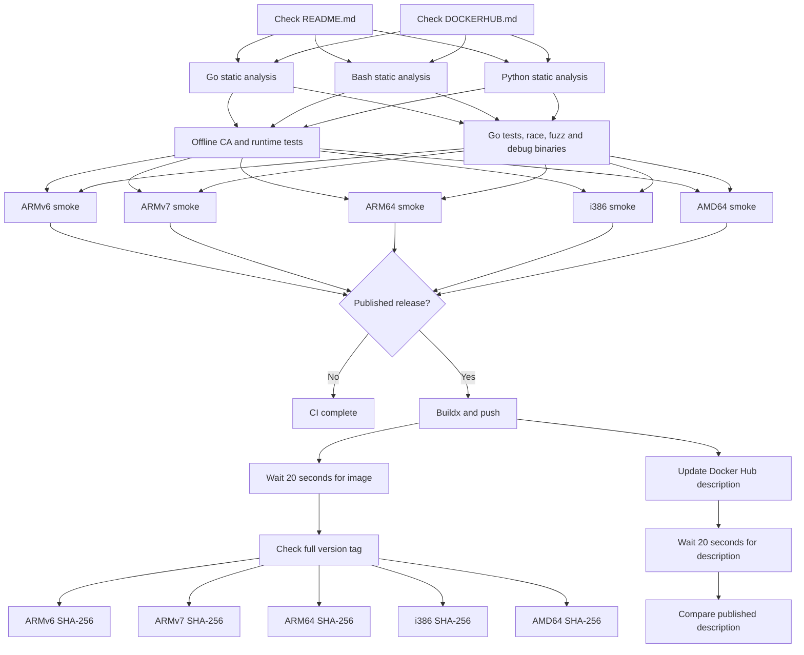

# Release pipeline

GitHub Actions runs the release tests and uses `ci/publish-image.sh` to publish five platforms and eight or nine tags to Docker Hub.

[CI/CD diagram](../README.md#cicd-pipeline)

## What runs

For a pull request, the relevant branch is its target. Merging updates the destination branch and runs the push checks there.

| Event | Document checks | Static analysis | Both offline suites | Five parallel smokes | Publish and verify Docker Hub |
|---|---|---|---|---|---|
| Create a version branch without new commits | — | — | — | — | — |
| PR or push to an unrelated branch | — | — | — | — | — |
| PR targeting a valid version branch | Required | Required | Required | Required | — |
| Push or merge to a valid version branch | Required | Required | Required | — | — |
| PR targeting `master` | Required | Required | Required | Required | — |
| Push or merge to `master` | Advisory, with warnings | Required | Required | Required | — |
| Publish a GitHub Release | Required | Required | Required | Required | After every required check passes |

The two document jobs run in parallel. They are advisory only on a push to
`master`, including a merge commit delivered by that event. A document mismatch
then produces a warning and a step summary while subsequent tests continue.
Pull requests and releases keep both document checks blocking. A checkout or
runner failure still blocks downstream jobs on every event.

The Go, Bash and Python analysis jobs start together after the document gate.
Both offline suites require all three analyses. The CA/runtime regressions and
the Go-specific suite then run independently in parallel. These issuance tests
use a local lego stand-in and do not contact an ACME server or consume quotas.

All five smoke jobs require **both** offline suites. They run for qualifying
pull requests, pushes/merges to `master`, and published releases. ARM64 and
AMD64 use native GitHub runners; ARMv6, ARMv7 and i386 use QEMU and a dedicated
Buildx builder. The smoke containers have networking disabled. Creating a
version branch without commits still skips the entire test graph.



Version branches allow an optional `v` or `V` followed by two to four dot-separated numeric components. They can end in `build`, `audit`, `review`, `beta`, `alpha`, or `alfa`, preceded by a dot or hyphen. An optional dot or hyphen followed by one to five dot-separated numbers can follow that suffix. Version prefixes also work with subpaths such as `v6.0.1-beta-4/docs/tags`. For a PR into `master`, the source branch supplies the version hint. For a version branch, the first two or three components must agree with `APP_VERSION` in `ci/versions/versions.txt`.

The publishing workflow subscribes to GitHub's `release.published` activity, including prereleases. The Git release tag selects the source commit. `ci/versions/versions.txt` from that commit supplies the version numbers used in Docker Hub. The Git release tag must match the full `APP_VERSION`, including any suffix, with an optional `v` or `V`. The final CSV row must agree with that full version, Alpine and lego versions. Prefix spelling comes from the CSV. Releases with an `alpha`, `alfa` or `beta` suffix publish eight tags, all suffixed. The last eligible release owns `latest` in Docker Hub and in both tables. The short table keeps that row visible even after seven newer prereleases.

## Update the Markdown tables

1. Update `ci/versions/versions.txt` for the upcoming image and append its row to `ci/versions/versions.csv`. Keep the upcoming release as the final CSV row. For this beta, set `APP_VERSION=6.0.1-beta-4`, use `v6.0.1-beta-4` as the Git release tag, and record `v6.0.1` with App Suffix `beta-3` in the CSV. The CSV also accepts the complete `v6.0.1-beta-4` in App Version with an empty App Suffix. `latest` stays on stable `v5.2.4`.
2. From the repository root, regenerate the short table in `DOCKERHUB.md` and the full history in `README.md`.

   ```bash
   python3 ci/versions/tags_table.py
   ```

3. Commit the version files and both Markdown files before you open the PR or publish the release. The document jobs verify that the final CSV row matches the image tags from `ci/versions/versions.txt` and that each committed table matches the CSV. Release publication starts after both documents, all three static analyses, both offline suites, and all five smoke tests pass.

## Set up Docker Hub access

1. Sign in to [Docker Home](https://app.docker.com/) with a Docker ID that can push to and edit `ljgonzalez/lego-cloudflare-certgen`. Verify the account email if Docker requires it for personal access tokens.
2. Open your avatar menu, choose **Account settings → Personal access tokens → Generate new token**, and name the token `certgen-images`. Set an expiry and choose **Repo Read & Write**. Generate and copy the token.
3. Make a second token named `certgen-overview` and choose **Repo Read, Write, Delete**, the scope required by the overview updater. Copy this value separately.
4. Review the repository's tag immutability settings. The pipeline updates the release's minor and major aliases and updates `latest` for eligible releases. Any shared aliases covered by immutability rules will cause publication to fail.

[Docker PAT setup](https://docs.docker.com/security/access-tokens/personal-access-tokens/) · [Repository access scopes](https://docs.docker.com/security/access-tokens/reference/) · [Overview updater](https://github.com/peter-evans/dockerhub-description#action-inputs)

## Publish with GitHub Actions

1. In your GitHub repository go to **Settings → Secrets and variables → Actions → Secrets → New repository secret**. Add these values separately.

   | Secret | Value |
   |---|---|
   | `DOCKERHUB_USERNAME` | Your Docker ID, normally `ljgonzalez` |
   | `DOCKERHUB_PUSH_TOKEN` | The `certgen-images` PAT |
   | `DOCKERHUB_DESCRIPTION_TOKEN` | The `certgen-overview` PAT |

2. Update the version files and generate both Markdown tables. Edit any other Docker Hub overview text in `DOCKERHUB.md`. The file must be at or below 25,000 bytes.
3. Check the Docker tags locally from the repository root.

   ```bash
   bash ci/publish-image.sh --print-tags
   ```

4. In GitHub open **Releases → Draft a new release**. Select a tag that points to the prepared commit or create `v6.0.1-beta-4` with `master` as its target. If the tag already exists, its commit supplies the workflows, source, versions, and Markdown.
5. Select **Publish release**, then open the release run under **Actions → CI/CD**. After both document jobs, the three analyses, both offline suites and five smoke jobs pass, the publisher prepares the final builder.
6. The publisher builds one immutable multi-platform index and exports its SHA-256 plus one SHA-256 for each runnable platform. Attestations are excluded. It then attaches every configured alias to that same index, with `latest` last only for eligible stable releases. GitHub job outputs contain hashes only; exporting a repository name containing a masked username can cause GitHub to suppress an output.
7. After all aliases are published, two independent paths start. One updates the overview. The other runs a separate, passing **20-second wait job**, discovers an exact full-version tag from the final CSV row through Docker's JSON APIs, then runs **five parallel hash comparison jobs**. Each compares its platform's digest with the corresponding Buildx digest; a returned index digest must also agree. Rolling aliases such as `latest` cannot satisfy this version lookup.
8. After the overview update, another independent, passing **20-second wait job** precedes comparison with the committed `DOCKERHUB.md`. Only CRLF and final whitespace are normalized. Each API verification makes up to five attempts without an embedded sleep; a mismatch, invalid JSON or persistent HTTP failure fails that job. Tag/hash failures do not prevent the description branch from completing, and description failures do not prevent hash checks.

All builds for an event use the source commit from that event. Where tag names are derived from ci/versions/versions.txt, the file from the release commit is used even if `master` has advanced. Creating a Git tag alone leaves publishing idle. If automation publishes the GitHub Release, use a GitHub App installation token or PAT to create the release so the event can start this workflow.

[Repository secrets](https://docs.github.com/en/actions/how-tos/write-workflows/choose-what-workflows-do/use-secrets) · [GitHub release event](https://docs.github.com/en/actions/reference/workflows-and-actions/events-that-trigger-workflows#release)

## Version branch creation

The workflow has no `create` subscription. A push that only creates a version reference, with `created: true` and an empty `commits` array, skips both document jobs and every dependent test. An initial push carrying commits still runs the version checks and offline suite. Later pushes and merges to an existing version branch run the same checks. Pull requests and releases keep their existing behavior. GitHub may show an entirely skipped workflow run for a creation-only push.

## Static analysis and offline checks

The three analysis jobs are independent and blocking:

| Language | Checks |
|---|---|
| Go | `gofmt` on first-party sources and `go vet` for ARMv6, ARMv7, ARM64, i386 and AMD64 |
| Bash/POSIX sh | Shell syntax and ShellCheck, including sourced release configuration |
| Python | In-memory syntax compilation and pinned Ruff checks for syntax errors, undefined names and unused variables/imports |

The Go suite runs shuffled unit tests with coverage, the native AMD64 race
detector, strict pointer checks, and three independent 15-second fuzz campaigns
for CLI arguments, YAML and lego logs. Fuzz workers are capped at two. All Go
checks use vendored modules. Debug binaries retain `-N -l -d=checkptr=2` and
uncompressed DWARF. The five final images remain CGO-free; the race detector is
used only for native CI tests.

`ci/test_go_binary.py` compiles and runs the application, checks logs and crash
dumps, tests concurrent supervised processes and version linking, and builds
all five ELF targets. It checks their architecture, debug information and
absence of a dynamic interpreter. Foreign executables are not run by that
host-only suite; the later Docker smoke jobs execute each target image.

The CA/runtime branch runs the issuance, menu/PTY, timeout, signal and failure
regressions in `ci/tests/run.sh`, the mocked Docker Hub API cases, Buildx hash
metadata tests, prerelease tag policy, and event/dependency graph checks.
The graph regressions exercise failing static analyses and either offline
branch, document warnings on master pushes, strict PR/release gates, all five
smokes, and the independent post-publication paths.

To run the same checks locally, install Go 1.27.4, GCC, Python 3.10+ with
PyYAML, jq and ShellCheck. Install the Python linter separately:

```bash
python3 -m pip install -r ci/requirements-lint.txt
bash ci/analyze-go.sh
bash ci/analyze-bash.sh
python3 -B ci/analyze-python.py
sh ci/tests/run.sh
bash ci/test-dockerhub.sh
python3 -B ci/test_publish.py
python3 -B ci/test_workflows.py
python3 -B ci/versions/test_tags.py
python3 -B ci/test_go_binary.py
```

The workflow contains the exact unit, race and fuzz commands. The
[v6.0.1-beta-4 validation report](validation-6.0.1-beta-1.md) distinguishes local
execution from Docker/QEMU and live publishing checks that require GitHub.

License evidence checks: `python3 -B ci/check_licenses.py` checks source notice copies and asset/font metadata. Every image build collects actual binary/module notices in a native builder stage, verifies them with networking disabled, and ships only the resulting evidence. `bash ci/check-image-licenses.sh IMAGE PLATFORM` independently verifies a Docker export of the final image on all five smoke-test targets. Missing source evidence fails the build; it is never replaced with the project's MIT license.

The five architecture smoke jobs also profile the actual final image offline with real lego --version. ci/profile-image.sh reports uncompressed image layer bytes, elapsed time and Linux wait4 maximum task RSS including waited-for children; this is not simultaneous cgroup peak or live-issuance RAM. QEMU measurements may include emulator overhead. The temporary measurement binary is mounted and never shipped in scratch.
