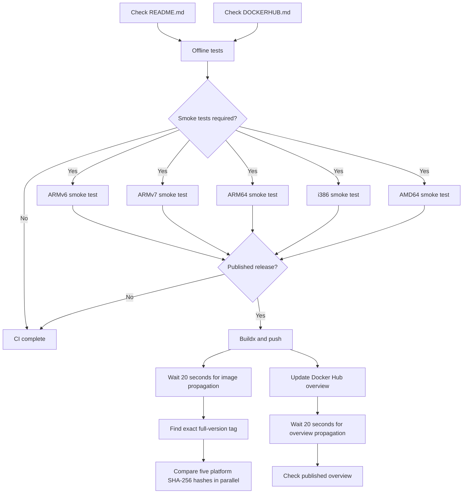

# Release pipeline

GitHub Actions runs the release tests and uses `ci/publish-image.sh` to publish five platforms and nine tags to Docker Hub.

[CI/CD diagram](../README.md#cicd-pipeline)

## What runs

For a pull request, the relevant branch is its target. Merging updates the destination branch and runs the push checks there.

| Event | README and Docker Hub table checks | Offline regression | Docker smoke tests | Push image | Sync Docker Hub overview |
|---|---|---|---|---|---|
| Create a version branch without new commits | — | — | — | — | — |
| PR or push to any other branch | — | — | — | — | — |
| PR targeting a valid version branch | Yes | Yes | Five in parallel | — | — |
| Push or merge to a valid version branch | Yes | Yes | — | — | — |
| PR, push or merge to `master` | Yes | Yes | Five in parallel | — | — |
| Publish a GitHub Release | Yes | Yes | Five in parallel | After all checks pass | After the image and all aliases are published |

The two document checks run in parallel. Only pushes to `master`, including merges, treat their version failures as advisory: warnings and job summaries identify the failed file, and offline and smoke tests continue. Pull requests (including PRs to `master`), releases and other version branches retain blocking checks. Checkout failures and later test failures remain blocking. On qualifying pull requests, pushes to `master`, and releases, ARMv6, ARMv7, ARM64, i386 and AMD64 smoke tests then run in parallel. A merge to `master` runs through the push event. GitHub Actions runs ARM64 and AMD64 natively. The other platforms use QEMU and a dedicated Buildx builder. The smoke containers run with no network and use the locally built images.



Version branches allow an optional `v` or `V` followed by two to four dot-separated numeric components. They can end in `build`, `audit`, `review`, `beta`, `alpha`, or `alfa`, preceded by a dot or hyphen. An optional dot or hyphen followed by one to five dot-separated numbers can follow that suffix. Version prefixes also work with subpaths such as `v4.4.1/docs/tags`. For a PR into `master`, the source branch supplies the version hint. For a version branch or numeric release tag, the first two or three components must agree with `APP_VERSION` in `ci/versions/versions.txt`.

The publishing workflow subscribes to GitHub's `release.published` activity, including prereleases. The Git release tag selects the source commit. `ci/versions/versions.txt` from that commit supplies the version numbers used in Docker Hub. A published prerelease follows the same sequence and updates `latest`.

## Update the Markdown tables

1. Update `ci/versions/versions.txt` for the upcoming image and append its row to `ci/versions/versions.csv`. Keep the upcoming release as the final CSV row.
2. From the repository root, regenerate the short table in `DOCKERHUB.md` and the full history in `README.md`.

   ```bash
   python3 ci/versions/tags_table.py
   ```

3. Commit the version files and both Markdown files before you open the PR or publish the release. The document jobs verify that the final CSV row matches the image tags from `ci/versions/versions.txt` and that each committed table matches the CSV. Release publication starts after both documents, offline regression, and all five smoke tests pass.

## Set up Docker Hub access

1. Sign in to [Docker Home](https://app.docker.com/) with a Docker ID that can push to and edit `ljgonzalez/lego-cloudflare-certgen`. Verify the account email if Docker requires it for personal access tokens.
2. Open your avatar menu, choose **Account settings → Personal access tokens → Generate new token**, and name the token `certgen-images`. Set an expiry and choose **Repo Read & Write**. Generate and copy the token.
3. Make a second token named `certgen-overview` and choose **Repo Read, Write, Delete**, the scope required by the overview updater. Copy this value separately.
4. Review the repository's tag immutability settings. The pipeline updates shared aliases including `v4.3`, `v4`, and `latest`. Any shared aliases covered by immutability rules will cause publication to fail.

[Docker PAT setup](https://docs.docker.com/security/access-tokens/personal-access-tokens/) · [Repository access scopes](https://docs.docker.com/security/access-tokens/reference/) · [Overview updater](https://github.com/peter-evans/dockerhub-description#action-inputs)

## Publish with GitHub Actions

1. In your GitHub repository go to **Settings → Secrets and variables → Actions → Secrets → New repository secret**. Add these values separately.

   | Secret | Value |
   |---|---|
   | `DOCKERHUB_USERNAME` | Your Docker ID, normally `ljgonzalez` |
   | `DOCKERHUB_PUSH_TOKEN` | The `certgen-images` PAT |
   | `DOCKERHUB_DESCRIPTION_TOKEN` | The `certgen-overview` PAT |

2. Update the version files and generate both Markdown tables. Edit any other Docker Hub overview text in `DOCKERHUB.md`. The file must be at or below 25,000 bytes.
3. Check the Docker tags locally from the repository root.

   ```bash
   bash ci/publish-image.sh --print-tags
   ```

4. In GitHub open **Releases → Draft a new release**. Select a tag that points to the prepared commit or create `v4.4.1` with `master` as its target. If the tag already exists, its commit supplies the workflows, source, versions, and Markdown.
5. Select **Publish release**, then open the release run under **Actions → CI/CD**. After the document, offline, and five smoke jobs pass, the publisher prepares the final builder.
6. The publisher runs Buildx with `--metadata-file build-metadata.json` in its temporary build directory. It reads `containerimage.digest`, fetches that immutable index by `repository@sha256:...`, verifies its bytes against the metadata digest, and extracts exactly one manifest digest for each of the five platforms. The image config digest is not used. It assigns every alias to the same index, publishing `latest` last. After all writes succeed, it exports `digest`, `digest_armv6`, `digest_armv7`, `digest_arm64`, `digest_i386` and `digest_amd64` through `$GITHUB_OUTPUT` and the publisher job's outputs.
7. Two independent paths now start. The overview path immediately updates Docker Hub, waits 20 seconds if the update succeeds, and compares the returned Markdown with `DOCKERHUB.md`. It tolerates CRLF and trailing whitespace at the end. A content mismatch prints a unified diff with `-` lines from the committed file and `+` lines from Docker Hub.
8. The image path waits 20 seconds, then queries the Docker Hub tag API for an exact full version with no prefix, `v`, or `V`, preserving the optional suffix. It also accepts the four fully versioned OS/lego aliases generated from the final CSV row. Rolling aliases such as `latest`, `v4` and `v4.2` cannot satisfy this check. The detected tag is exported separately, without a repository name.
9. Once a tag is found, five matrix jobs run in parallel with `fail-fast: false`. Each reads that tag from Docker Hub and compares its own `images[].digest` against its publisher output, selecting Linux plus the exact architecture and ARM variant. Missing or duplicate entries fail. ARM64 accepts an omitted variant or `v8`; i386 uses Docker's `386` architecture. Logs show the full expected and received hashes. If Hub includes an index digest, it must also match `digest`.

Each API verification makes up to five attempts and fails on different or invalid data. Retries have no embedded delay; the two propagation waits remain separate workflow jobs. A failure in either post-publication path does not block execution of the other path.

All builds for an event use the source commit from that event. Where tag names are derived from ci/versions/versions.txt, the file from the release commit is used even if `master` has advanced. Creating a Git tag alone leaves publishing idle. If automation publishes the GitHub Release, use a GitHub App installation token or PAT to create the release so the event can start this workflow.

[Repository secrets](https://docs.github.com/en/actions/how-tos/write-workflows/choose-what-workflows-do/use-secrets) · [GitHub release event](https://docs.github.com/en/actions/reference/workflows-and-actions/events-that-trigger-workflows#release)

## Version branch creation

The workflow has no `create` subscription. A push that only creates a version reference, with `created: true` and an empty `commits` array, skips both document jobs and every dependent test. An initial push carrying commits still runs the version checks and offline suite. Later pushes and merges to an existing version branch run the same checks. Pull requests and releases keep their existing behavior. GitHub may show an entirely skipped workflow run for a creation-only push.

## CI verification inherited from v4.2.16

The repository name is derived locally in downstream jobs. It is not exported as a job output: `DOCKERHUB_USERNAME` is a GitHub secret and a full image name containing that value can be suppressed by the runner. This avoids a successful push followed by an empty `IMAGE` input. Only hashes and the detected tag cross job boundaries. `ci/read-publish-result.sh` validates the entire result before emitting any outputs, including the full application identity and all five platform hashes.

`ci/versions/release_config.py` reads the final CSV release through the same parser as the Markdown generator. It checks the numeric application, Alpine and lego versions against `ci/versions/versions.txt`, preserves the CSV's application prefix and optional suffix, and supplies the same nine tags to the publisher and table checks. `APP_VERSION` in `versions.txt` may be numeric or include the exact full application suffix. A numeric value uses the suffix from the CSV; build labels include that effective suffix. Publishing scripts and smoke scripts require Python 3.10+ on the host, in addition to their existing Docker dependencies.

The offline job exercises HTTP failures, HTML, malformed/empty responses, tag variants, platform selection and Markdown diffs with deterministic fixtures in `ci/test_dockerhub.py`. `ci/test_publish.py` verifies Buildx metadata, immutable index bytes, output validation, prefix/suffix handling and a simulated publish including all aliases. `ci/test_workflows.py` checks event routing and both independent post-publication paths. Run locally with Python, PyYAML and jq:

```bash
bash ci/test-dockerhub.sh
python3 -B ci/test_publish.py
python3 -B ci/test_workflows.py
```

The standalone `image IMAGE:TAG DIGEST` checker is retained for registry-level diagnostics; the release workflow uses the separate `tag` and `platform` commands.
