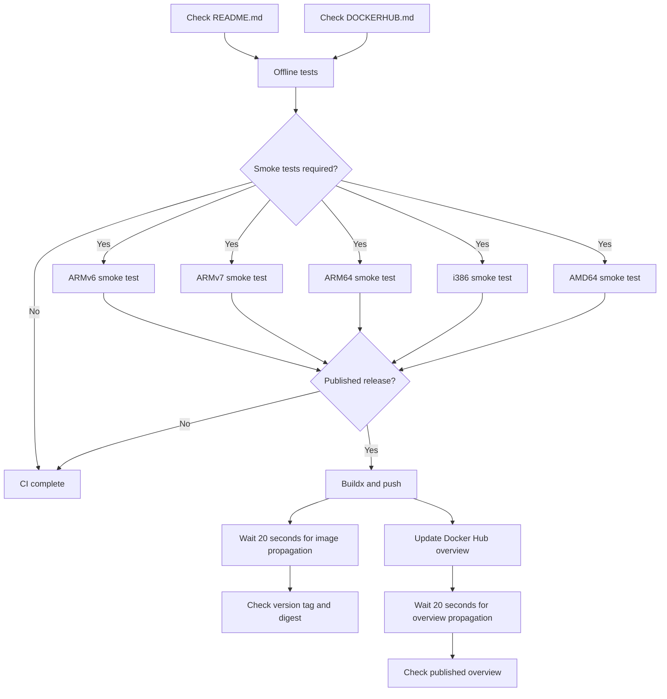

# Release pipeline

The [CI/CD workflow](../.github/workflows/tests.yml) validates branch changes and publishes releases. It uses `ci/publish-image.sh` to publish five platforms and nine tags to Docker Hub.

When applying the v4.2.13 hotfix over v4.2.9, remove `.github/workflows/release.yml`. The release trigger now lives in `tests.yml`.

## What runs

For a pull request, the relevant branch is its target. Merging updates the destination branch and runs the push checks there.

| Event | README and Docker Hub table checks | Offline regression | Docker smoke tests | Push image | Sync Docker Hub overview |
|---|---|---|---|---|---|
| PR or push to any other branch | — | — | — | — | — |
| PR targeting a valid version branch | Yes | Yes | Five in parallel | — | — |
| Push or merge to a valid version branch | Yes | Yes | — | — | — |
| PR, push or merge to `master` | Yes | Yes | Five in parallel | — | — |
| Publish a GitHub Release | Yes | Yes | Five in parallel | After all checks pass | After the image and all aliases are published |

The two document checks run in parallel. Offline regression starts when both pass. On qualifying pull requests, pushes to `master`, and releases, ARMv6, ARMv7, ARM64, i386 and AMD64 smoke tests then run in parallel. A merge to `master` runs through the push event. GitHub Actions runs ARM64 and AMD64 natively. The other platforms use QEMU and a dedicated Buildx builder. The smoke containers run with no network and use the locally built images.



Version branches allow an optional `v` or `V` followed by two to four dot-separated numeric components. They can end in `build`, `audit`, `review`, `beta`, `alpha`, or `alfa`, preceded by a dot or hyphen. An optional dot or hyphen followed by one to five dot-separated numbers can follow that suffix. Version prefixes also work with subpaths such as `v4.2.13/docs/tags`. For a PR into `master`, the source branch supplies the version hint. For a version branch or numeric release tag, the first two or three components must agree with `APP_VERSION` in `versions/versions.txt`.

The publishing workflow subscribes to GitHub's `release.published` activity, including prereleases. The Git release tag selects the source commit. `versions/versions.txt` from that commit supplies the version numbers used in Docker Hub. A published prerelease follows the same sequence and updates `latest`.

## Update the Markdown tables

1. Update `versions/versions.txt` for the upcoming image and append its row to `versions/versions.csv`. Keep the upcoming release as the final CSV row.
2. From the repository root, regenerate the short table in `DOCKERHUB.md` and the full history in `README.md`.

   ```bash
   python3 versions/tags_table.py
   ```

3. Commit the version files and both Markdown files before you open the PR or publish the release. The document jobs verify that the final CSV row matches the image tags from `versions/versions.txt` and that each committed table matches the CSV. Release publication starts after both documents, offline regression, and all five smoke tests pass.

## Set up Docker Hub access

1. Sign in to [Docker Home](https://app.docker.com/) with a Docker ID that can push to and edit `ljgonzalez/lego-cloudflare-certgen`. Verify the account email if Docker requires it for personal access tokens.
2. Open your avatar menu, choose **Account settings → Personal access tokens → Generate new token**, and name the token `certgen-images`. Set an expiry and choose **Repo Read & Write**. Generate and copy the token.
3. Make a second token named `certgen-overview` and choose **Repo Read, Write, Delete**, the scope required by the overview updater. Copy this value separately.
4. Review the repository's tag immutability settings. The pipeline updates shared aliases including `v4.2`, `v4`, and `latest`. Any shared aliases covered by immutability rules will cause publication to fail.

[Docker PAT setup](https://docs.docker.com/security/access-tokens/personal-access-tokens/) · [Repository access scopes](https://docs.docker.com/security/access-tokens/reference/) · [Overview updater](https://github.com/peter-evans/dockerhub-description#action-inputs)

## Publish with GitHub Actions

1. In your GitHub repository go to **Settings → Secrets and variables → Actions → Secrets → New repository secret**. Add these values separately.

   | Secret | Value |
   |---|---|
   | `DOCKERHUB_USERNAME` | Your Docker ID, normally `ljgonzalez` |
   | `DOCKERHUB_PUSH_TOKEN` | The `certgen-images` PAT |
   | `DOCKERHUB_DESCRIPTION_TOKEN` | The `certgen-overview` PAT |

2. Update the version files and generate both Markdown tables. Edit any other Docker Hub overview text in `DOCKERHUB.md`. The file must be at or below 25,000 bytes.
3. Check the Docker tags locally from the repository root.

   ```bash
   bash ci/publish-image.sh --print-tags
   ```

4. In GitHub open **Releases → Draft a new release**. Select a tag that points to the prepared commit or create `v4.2.13` with `master` as its target. If the tag already exists, its commit supplies the workflows, source, versions, and Markdown.
5. Select **Publish release**, then open the release run under **Actions → CI/CD**. After the document, offline, and five smoke jobs pass, the publisher prepares the final builder.
6. The publisher verifies the five platforms in the built index and assigns every configured alias to that index. After the push, the overview update and its independent 20-second image propagation wait start in parallel. The image check reads the exact version through the Docker Registry API and validates its raw SHA-256 digest and all five platforms. A registry read failure can fall back to the Docker Hub tag API, which must confirm the same exact tag, digest and platforms.
7. After the overview update, a separate 20-second wait precedes comparison of the published Markdown with `DOCKERHUB.md`. The comparison tolerates CRLF and trailing whitespace at the end. Each verification makes up to five attempts and fails if Docker still returns different or invalid data. API retries have no embedded delay. The propagation waits are separate workflow jobs.

All builds for an event use the source commit from that event. Where tag names are derived from versions/versions.txt, the file from the release commit is used even if `master` has advanced. Creating a Git tag alone leaves publishing idle. If automation publishes the GitHub Release, use a GitHub App installation token or PAT to create the release so the event can start this workflow.

[Repository secrets](https://docs.github.com/en/actions/how-tos/write-workflows/choose-what-workflows-do/use-secrets) · [GitHub release event](https://docs.github.com/en/actions/reference/workflows-and-actions/events-that-trigger-workflows#release)

## CI verification hotfix v4.2.13

The publisher exports the full image tag and immutable build digest. `ci/read-publish-result.sh` rejects metadata for any other application version before it reaches later jobs. The image check reads Docker's JSON APIs. A success requires the exact requested tag, the expected SHA-256 digest and all five Linux platforms. A known registry digest or platform mismatch blocks the fallback. The description check compares the returned Markdown with the committed `DOCKERHUB.md`, allowing CRLF and trailing whitespace at the end. HTTP errors, HTML pages and empty or malformed responses fail verification.

The offline job exercises these cases with deterministic HTTP fixtures in `ci/test_dockerhub.py` and verifies the event and dependency graph in `ci/test_workflows.py`. Install `python3-yaml` to run the workflow tests locally.
